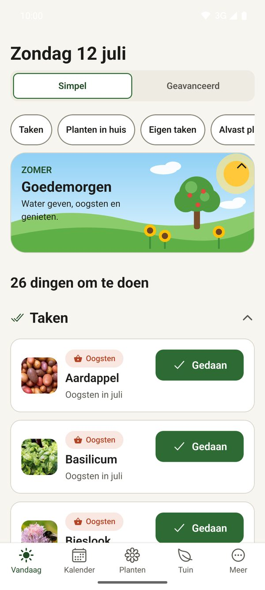
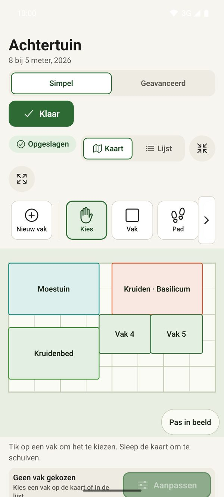
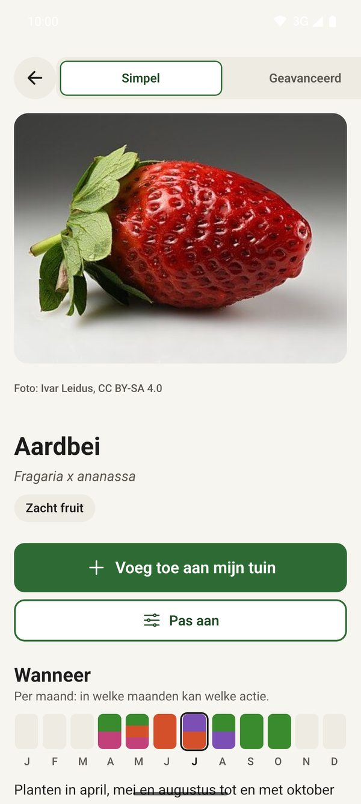
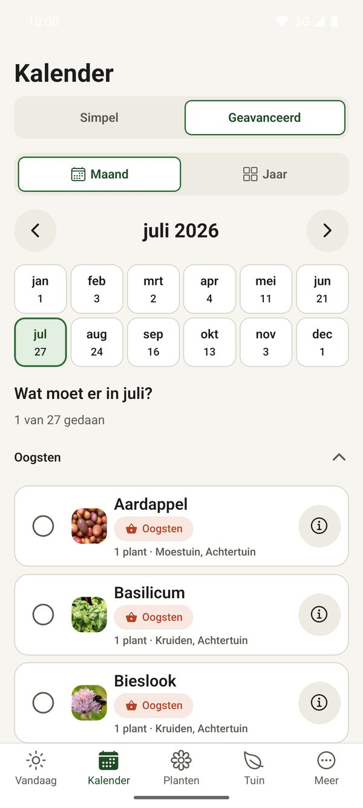

# Tuinplanner

[English](README.md) · [Nederlands](README.nl.md) · **Deutsch** · [Français](README.fr.md) · [Español](README.es.md)

Ein freundlicher Gartenplaner für Android, der ohne Internet funktioniert. Er zeigt dir, wann du säen,
pflanzen, schneiden und ernten musst, erinnert dich daran und hält fest, was in deinem Garten und zu Hause
wächst. Kein Konto, keine Werbung: deine Daten bleiben auf deinem Handy.

  
  
  
  

*Die App selbst ist auf Niederländisch.*

## Was kann die App?

- **Heute**: die Aufgaben des Moments, etwa säen, pflanzen, schneiden, ernten, gießen und düngen. Mit einem Tipp abhaken oder verschieben.
- **Pflanzenbibliothek**: 447 Pflanzen und 21 Zwiebelgewächse mit Monaten für Aussaat, Pflanzung, Schnitt und Ernte, guten und schlechten Nachbarn, Fotos, Quellen und Anbautipps pro Monat.
- **Mein Garten**: die Pflanzen, die du anbaust, pro Jahr und pro Beet, mit Ernten, Fotos und Notizen. Stauden kommen jedes Jahr wieder.
- **Garten entwerfen**: zeichne deinen Garten mit Beeten, sieh den Jahresplan, welche Pflanzen zusammenpassen und wie viel Sonne ein Beet bekommt.
- **Kalender**: was pro Monat oder pro Jahr zu tun ist, auch für deine Zimmerpflanzen.
- **Zimmerpflanzen**: Gieß- und Düngerhythmus, Standort, Problemprotokoll, Fotos und Sicherheit für Haustiere.
- **Tagebuch und Fotos**: Notizen und ein Fotoalbum pro Pflanze, Garten oder Beet.
- **Vorrat und eigene Aufgaben**: Saatgut und Material verwalten und eigene wiederkehrende Aufgaben anlegen.
- **Erinnerungen und Wetter**: lokale Benachrichtigungen, Wetterhinweise und Widgets für den Startbildschirm.
- **Suche** über alles an einem Ort und eine **Sicherung** all deiner Daten samt Fotos.

Einfach oder erweitert: wechsle mit einer Taste. Der erweiterte Modus bringt viele optionale Funktionen, die du in
den Einstellungen einzeln ein- oder ausschaltest.

## Installieren

1. Öffne die Seite **[Releases](../../releases)** und lade auf dem Handy die neueste `tuinplanner-<Version>.apk` herunter.
2. Öffne die Datei. Wenn Android danach fragt, erlaube die Installation aus dieser Quelle.
3. Starte Tuinplanner. Fertig.

Die App ist zum selbst Installieren gedacht und nicht im Play Store.

## Updates

Öffne in der App **Mehr → Einstellungen** und suche nach Updates. Die App findet die neueste Version hier, lädt sie
herunter und bittet Android um die Installation. Ohne deine Bestätigung wird nichts installiert.

## Datenschutz

- Alles funktioniert offline; Pflanzen, Fotos und Notizen bleiben auf deinem Gerät.
- Die App nutzt das Internet nur für den optionalen Wetterhinweis (Open-Meteo) und die Suche nach einer neuen Version.
- Keine Konten, keine Werbung, kein Tracking.

## Quellen und Dank

Die Pflanzendaten stammen aus offenen Quellen, mit einer Quelle pro Pflanze (siehe **Mehr → Quellen und Fotos** in der App).
Fotos stammen von Wikimedia Commons unter freien Lizenzen; Urheber und Lizenz stehen bei jedem Foto. Wetterdaten: Open-Meteo.

## Quellcode

Der Quellcode dieses Projekts ist privat. Dieses Repository enthält nur die Releases und diese Seite.

## Fragen oder Ideen

Eröffne ein [Issue](../../issues). Mit Liebe zur Natur gemacht.
