# Gartenplaner

[Nederlands](README.md) · [English](README.en.md) · **Deutsch** · [Français](README.fr.md) · [Español](README.es.md)

Auf deinem Handy heißen die App und die heruntergeladene Datei *Tuinplanner*. Die App selbst ist auf Niederländisch;
Menü- und Schaltflächennamen nennen wir hier so, wie sie in der App stehen, bei Bedarf mit deutscher Erklärung.

**Wissen, was heute im Garten und zu Hause ansteht, auch ohne Internet.**
Der Gartenplaner ist ein freundlicher Planer für Android: Er zeigt dir, wann du säen, pflanzen, schneiden und
ernten musst, erinnert dich daran und hält fest, was in deinem Garten und zu Hause wächst. Kein Konto, keine
Werbung, kein Tracking: deine Daten bleiben auf deinem Handy.

  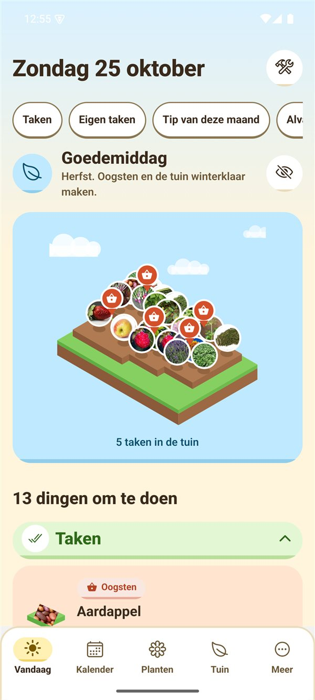
  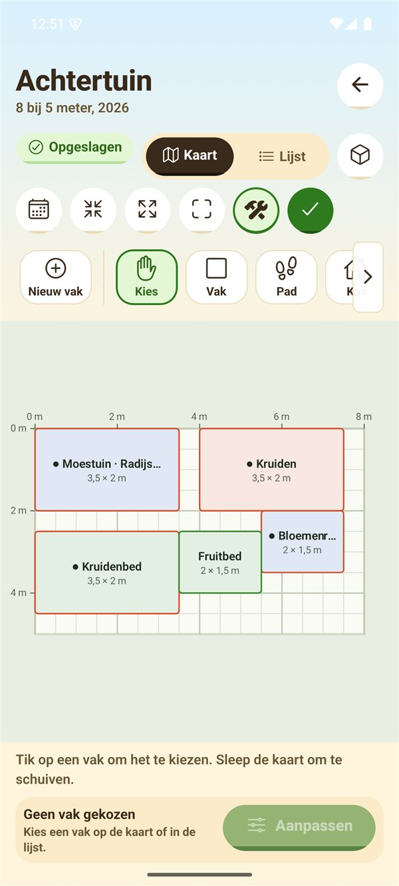
  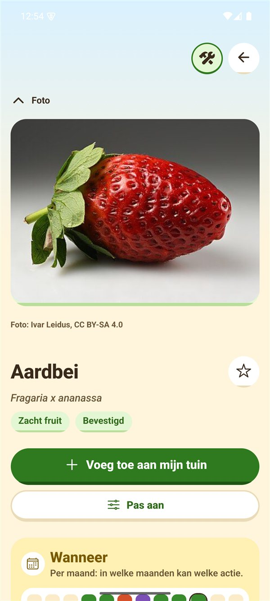
  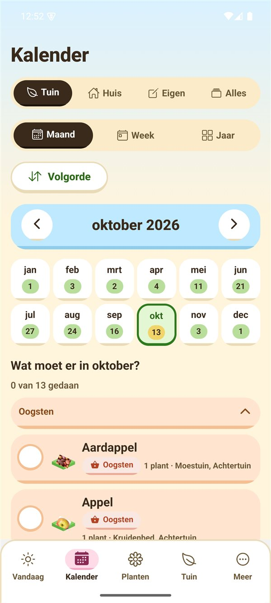

## Inhalt

[Zuerst die Filme ansehen](#zuerst-die-filme-ansehen) · [Warum](#warum) · [Kurz zusammengefasst](#kurz-zusammengefasst) ·
[Das erste Mal](#das-erste-mal) · [Heute](#heute) · [Bibliothek](#pflanzenbibliothek) · [Mein Garten](#mein-garten) ·
[Garten entwerfen](#garten-entwerfen) · [Kalender](#kalender) · [Zimmerpflanzen](#zimmerpflanzen) ·
[Tagebuch, Fotos und Ernte](#tagebuch-fotos-und-ernte) · [Vorrat und Aufgaben](#vorrat-und-eigene-aufgaben) ·
[Erinnerungen und Wetter](#erinnerungen-und-wetter) · [Widgets](#widgets) · [Suche und Sicherung](#suche-und-sicherung) ·
[Aussehen und Barrierefreiheit](#aussehen-und-barrierefreiheit) · [Einfach oder erweitert](#einfach-oder-erweitert) ·
[Installieren](#installieren) · [Datenschutz](#datenschutz) · [Häufige Fragen](#häufige-fragen) ·
[Versionsverlauf](#versionsverlauf)

## Zuerst die Filme ansehen

Vier kurze Filme zeigen die App im Einsatz, jeweils mit einer anderen Gärtnerin oder einem anderen Gärtner. Die Daten
in den Filmen sind erfunden; die Bilder sind Aufnahmen der echten App (Version 3.4.0). Die App und die Filme sind auf
Niederländisch. Klicke auf ein Bild, um den Film zu öffnen und abzuspielen.

<table>
  <tr>
    <td align="center" width="50%">
      <a href="video/tuinplanner-lotte.mp4">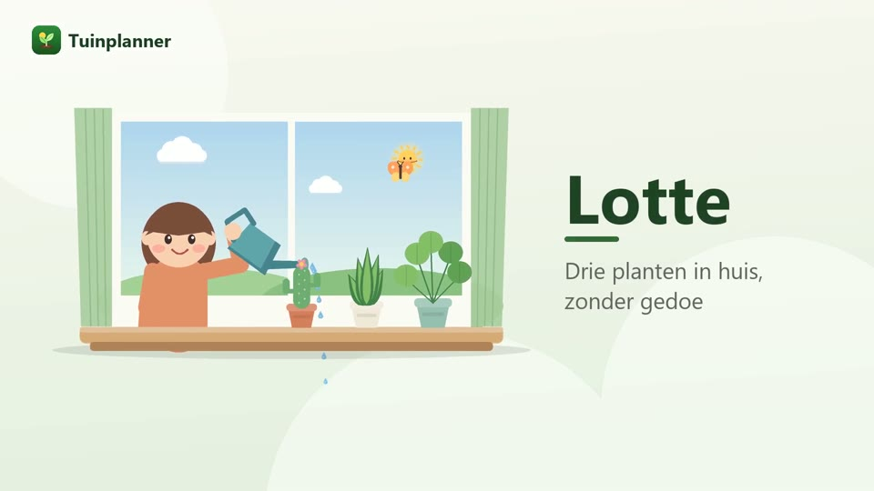</a> 
      <b>Lotte: drei Pflänzchen im Haus</b> (1:33) 
      Gießen mit einer Wischgeste abhaken, eine Pflanze öffnen und hinzufügen und alles im Kalender wiederfinden. In
      der einfachen Ansicht.
    </td>
    <td align="center" width="50%">
      <a href="video/tuinplanner-daan.mp4">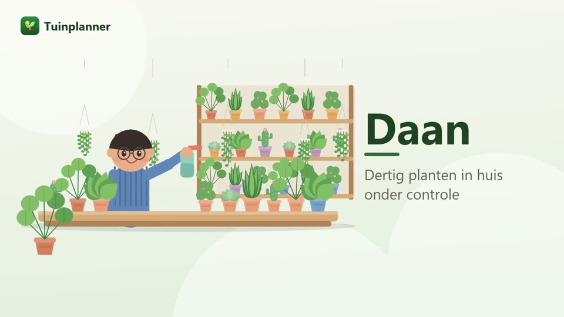</a> 
      <b>Daan: dreißig Pflanzen im Haus</b> (3:05) 
      Nach Gießen oder Düngen filtern, mehrere Pflanzen auf einmal versorgen, suchen und der Kalender pro Woche und Monat.
    </td>
  </tr>
  <tr>
    <td align="center" width="50%">
      <a href="video/tuinplanner-joost.mp4">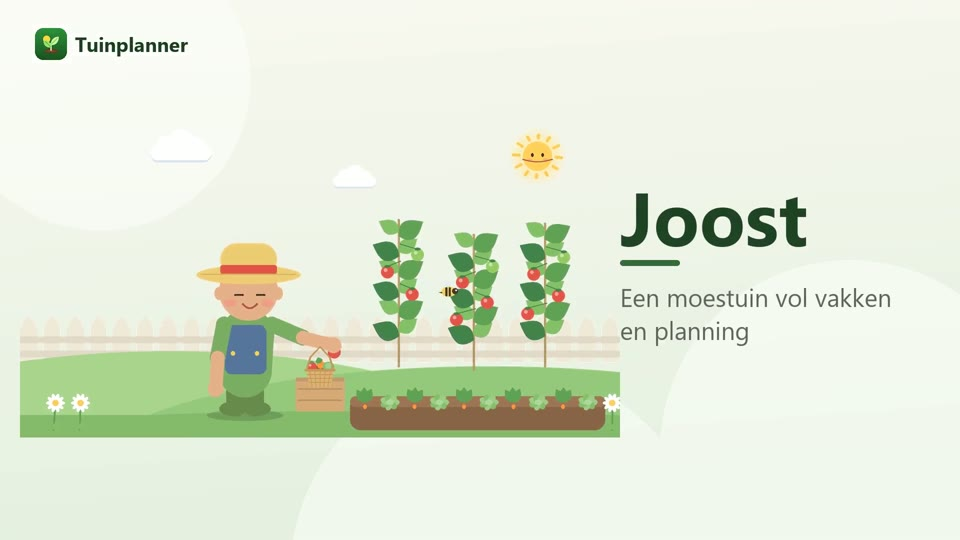</a> 
      <b>Joost: der Gemüsegarten</b> (3:48) 
      Was jetzt in die Erde muss, den Garten als Diorama bearbeiten, eine Warnung zum Fruchtwechsel, Ernte pro Jahr mit
      der Jahreskarte und die Einkaufsliste für Samen.
    </td>
    <td align="center" width="50%">
      <a href="video/tuinplanner-ria.mp4">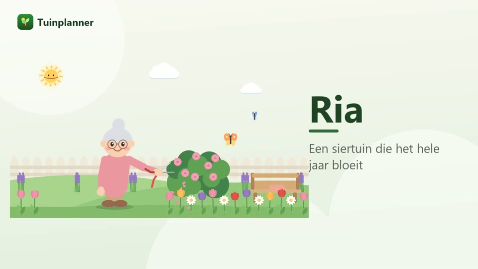</a> 
      <b>Ria: der Ziergarten</b> (3:30) 
      Rabatten und Sträucher in einem Bild, Schnittberatung und Blütezeit pro Pflanze, Schneiden im Kalender, Tagebuch
      mit Fotos und Zwiebeln auf der Einkaufsliste.
    </td>
  </tr>
</table>

Die Filme liegen als normale Dateien im Ordner [`video/`](video/) (zusammen etwa 40 MB). Siehst du keinen Player,
lade die Datei herunter und öffne sie auf deinem Computer oder Handy.

## Warum

Ein Garten braucht Aufmerksamkeit im richtigen Moment: zu spät säen, das Gießen vergessen oder einen
Schnitttermin verpassen. Der Gartenplaner reiht diese Momente für dich auf. Du wählst, was du anbaust, und die
App zeigt pro Tag, was ansteht, mit Erklärung und Quellen. Er funktioniert komplett offline; die
Pflanzenbibliothek steckt in der App.

Für wen ist er gedacht? Für alle mit drei Zimmerpflanzen, die das Gießen nicht vergessen wollen, für den
Gemüsegärtner, der wissen will, was diesen Monat in die Erde muss und was letztes Jahr dort stand, und für die
Liebhaberin eines Ziergartens mit Rosen, Hortensien und Sträuchern, die rechtzeitig geschnitten werden müssen. Mit
der Taste „Simpel oder Geavanceerd" (einfach oder erweitert) bestimmst du selbst, wie viel du siehst.

## Kurz zusammengefasst

| Bereich | Was du bekommst |
|---|---|
| **Vandaag** (Heute) | Die Aufgaben von jetzt, ein kleiner Garten mit Pins auf den Beeten, bei denen etwas ansteht, Wetterhinweis und deine Favoriten |
| **Plantenbibliotheek** (Pflanzenbibliothek) | 638 Pflanzen, 21 Zwiebelgewächse und 156 Zimmerpflanzen (zusammen 794 Pflanzen in der Liste), mit Foto, Quelle und Anbautipps |
| **Mijn tuin** (Mein Garten) | Deine Pflanzen pro Jahr und pro Beet, Ernte und Planung, Garten in Zahlen, als Bild teilen |
| **Tuin ontwerpen** (Garten entwerfen) | Beete zeichnen, im Diorama bearbeiten, Sonne und Schatten, Nachbarn und Fruchtwechsel |
| **Kalender** | Monat, Woche und Jahr für Garten, Haus und eigene Aufgaben, mit einer Reihenfolge, die du selbst festlegst |
| **Planten in huis** (Zimmerpflanzen) | Gieß- und Düngerhythmus pro Pflanze, Umtopfen, Giftigkeit für Haustiere, Protokoll |
| **Dagboek, foto's en oogst** (Tagebuch, Fotos und Ernte) | Was du getan hast, was ansteht, deine Ernte pro Jahr und eine Jahreskarte zum Teilen |
| **Voorraad en taken** (Vorrat und Aufgaben) | Samen und Zwiebeln, Einkaufsliste, eigene wiederkehrende Aufgaben |
| **Herinneringen en weer** (Erinnerungen und Wetter) | Benachrichtigungen, Verschieben, Wetter von Open-Meteo, Widgets für deinen Startbildschirm |
| **Aussehen** | Pflanzenbild (Symbole, Zeichnungen oder Fotos), Bewegung, dunkles Design, Palette für Farbenblinde, große Schrift |
| **Daten** | Offline, kein Konto, Sicherung samt Fotos, Jahresplan als PDF |

## Das erste Mal

Beim ersten Start gehst du durch vier kurze Schritte, die du auch überspringen kannst:

1. **Welkom** (Willkommen). Was die App auf einen Blick kann: funktioniert ohne Internet, deine Daten bleiben auf deinem Gerät, alles ist anpassbar.
2. **Hoeveel wil je zien?** (Wie viel möchtest du sehen?) Wähle *Simpel* (einfach) oder *Geavanceerd* (erweitert). Das kannst du jederzeit ändern.
3. **Zo ziet je tuin eruit** (So sieht dein Garten aus). Ein kleiner Beispielgarten passt sich sofort an, wenn du zwischen
   **Iconen** (Symbole), **Tekeningen** (Zeichnungen) und **Foto's** (Fotos) wählst (*Plantbeeld*, das Pflanzenbild) sowie zwischen
   **Rustig** (ruhig), **Subtiel** (dezent) und **Beleving** (Erlebnis) (*Beweging*, die Bewegung).
4. **Wil je een herinnering?** (Möchtest du eine Erinnerung?) Wähle, ob du Benachrichtigungen möchtest und um welche Uhrzeit.

  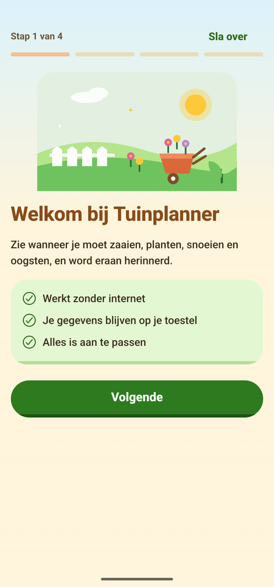
  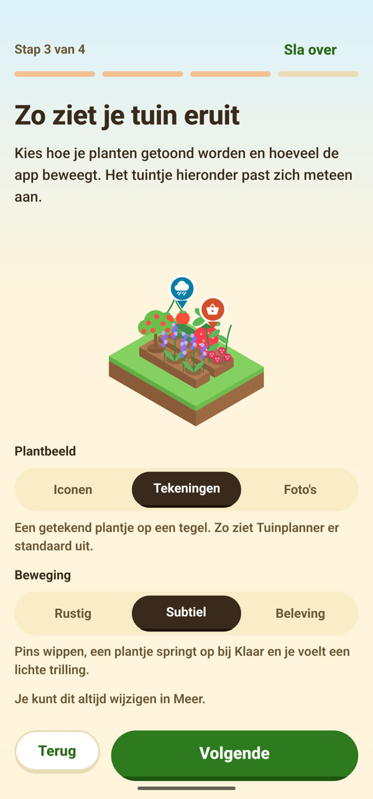
  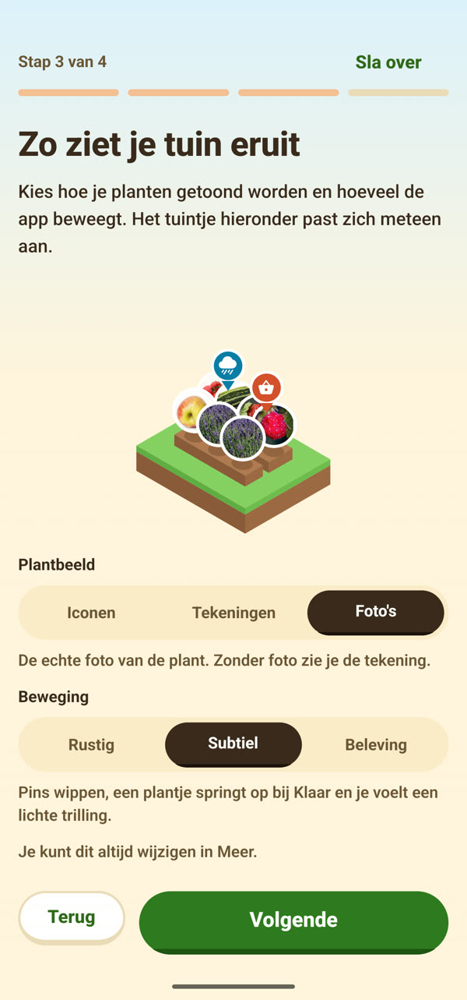

## Heute

Der Startbildschirm (*Vandaag*) zeigt die Aufgaben des Moments: säen, vorziehen, pflanzen, schneiden, ernten, gießen und düngen.
Oben stehen eine Begrüßung mit einem Satz zur Jahreszeit und ein kleiner Garten (Diorama) mit Pins auf den Beeten, bei
denen etwas ansteht. Tippe auf den kleinen Garten, um den Garten zu öffnen.

  
  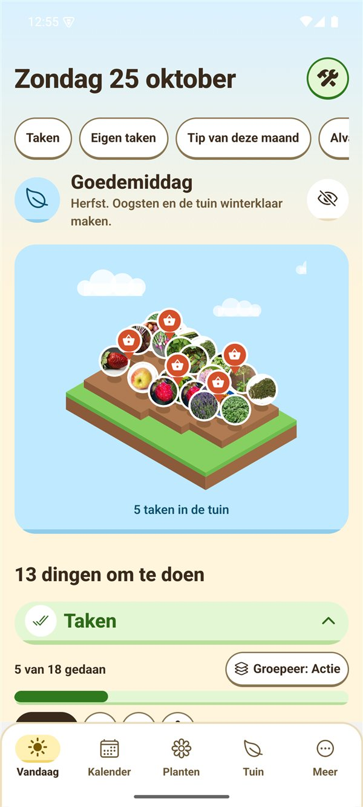
  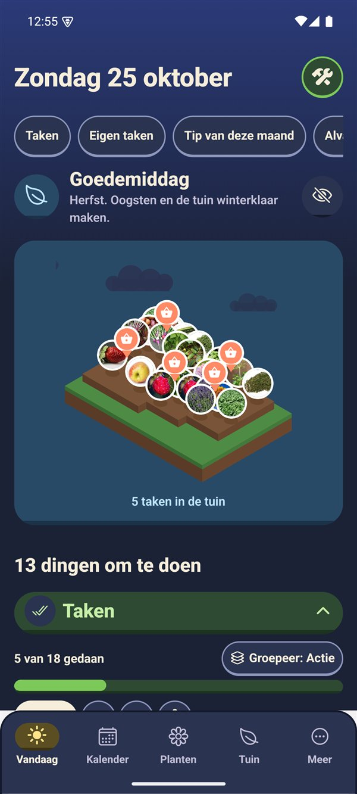

- **Mit einem Tipp abhaken.** Bei einer Ernte wirst du gleich gefragt, wie viel du geerntet hast, damit dein Tagebuch stimmt.
- **Wischen.** Wische eine Aufgabe nach links, um sie abzuhaken, und nach rechts, um sie zu verschieben. In den
  Einstellungen (*Instellingen*) drehst du das um oder schaltest es aus. Eine kurze Meldung mit *Ongedaan* (Rückgängig)
  nimmt einen Fehlgriff zurück, und erledigte Aufgaben verschwinden aus der Liste.
- **Mehrere auf einmal wählen.** Halte eine Zeile oder Kachel gedrückt, um weitere zu wählen; unten erscheinen dann die
  Aktionen (auf die Liste setzen, Status ändern, löschen). Ohne Auswahl sind sie nicht da. Das geht auch im Tagebuch
  und in den Suchergebnissen.
- **Later** (Später): verschiebe eine Aufgabe auf morgen, nächste Woche oder eine Anzahl Tage, die du wählst.
- **Gruppieren und filtern** nach Aktion, Pflanze oder Beet, mit Chips für Gießen, Düngen und Umtopfen der Zimmerpflanzen.
- **Zimmerpflanzen zwischen den Aufgaben**: Gießen, Düngen und Umtopfen stehen als normale Zeilen in der Liste und zählen
  für deinen Fortschritt mit. Du wählst selbst, ob sie eingeklappt oben oder unten stehen.
- **Deine Favoriten**: eine Reihe mit Pflanzen, bei denen du einen Stern gesetzt hast.
- **Schnellknopf**: ein schwebender Knopf mit Notitie (Notiz), Foto und Oogst (Ernte), damit du unterwegs im Garten
  schnell etwas festhältst. In den Einstellungen abschaltbar.
- **Alvast plannen** (Schon mal vorausplanen): sieh voraus, was in den kommenden Monaten ansteht.
- **Tipp des Monats** für die Pflanzen, die du hast, mit Quelle.
- **Wetterhinweis**: Warnung bei Frost, Hitze, Trockenheit oder viel Regen, mit den Namen deiner frostempfindlichen Pflanzen.
- **Wasser bei Regen**: Ist Regen vorhergesagt, schlägt die App vor, deine eigenen Gießaufgaben von heute zu überspringen.
  Du bestätigst mit einem Tipp. Das gilt nur für eigene Aufgaben mit einem Gieß-Wort im Titel, denn für Pflanzen
  im Freien gibt es in den Daten keinen Gießplan.
- **Jahresrückblick im Dezember und Januar**: eine Einladung, dein Erntejahr anzusehen und zu teilen.
- **Wat is nieuw** (Was ist neu): Nach einem Update erscheint einmalig eine Karte mit den Änderungen. Abschaltbar.
- Auf einem Tablet steht „Heute" in zwei Spalten.

## Pflanzenbibliothek

638 Pflanzen und 21 Zwiebelgewächse für deinen Garten, dazu 156 Zimmerpflanzen, jeweils mit Monaten für Aussaat,
Pflanzung, Schnitt und Ernte, Abstand, Standort, guten und schlechten Nachbarn, Fotos und Quellen. Das sind 794 Pflanzen in der Liste.

  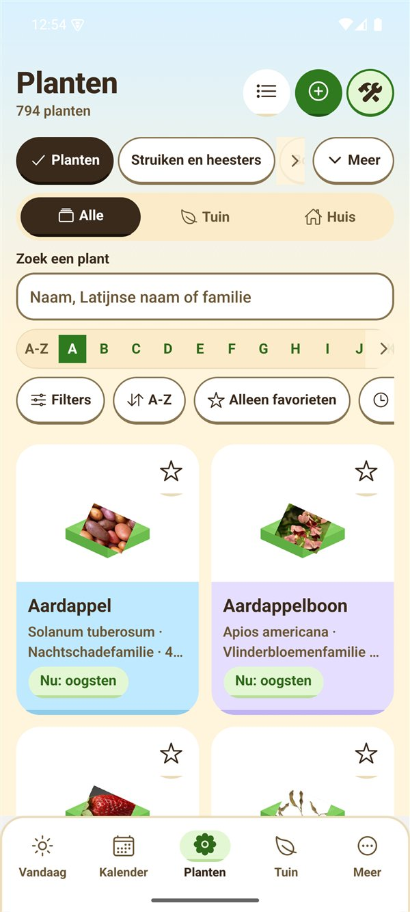
  
  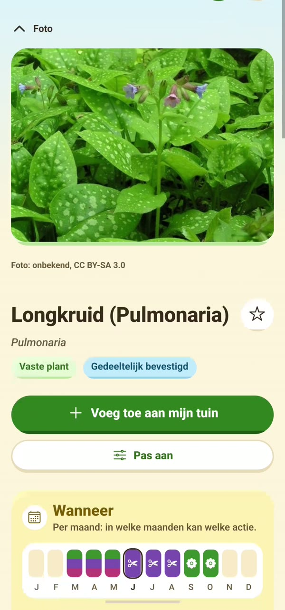
  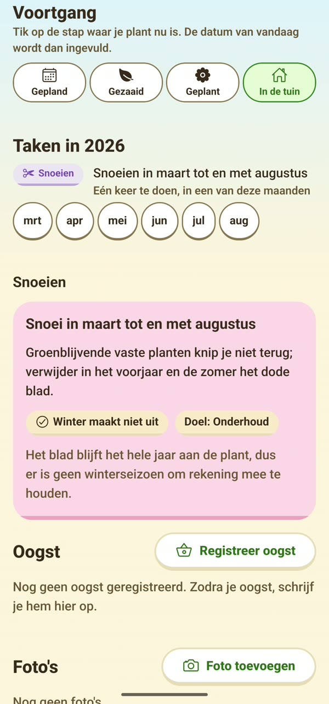

- **Mehr als nur Gemüse.** Bäume, Koniferen, Sträucher, Kletterpflanzen, Bodendecker, Stauden, Ziergräser, Rosen,
  Heckenpflanzen, Gründünger, Obst und Beeren, Kräuter, Wildgemüse, Pilze und Nüsse. Das Kategorienmenü hat 17
  Kategorien; zwei davon legst du als Schnellauswahl fest in der Leiste ab.
- **Anbautipps pro Monat**, mit Quelle. Für 590 Pflanzen stehen sie in der Bibliothek, aus Anbauseiten unter anderem der
  RHS; ein Teil bezieht sich auf die Artengruppe statt auf die Art selbst. Was sich nicht belegen lässt, steht nicht da.
- **Schnittberatung** bei jeder Pflanze, auch ob es „erst nach dem Winter" sein soll und was das Ziel ist (Pflege, Verjüngung).
- **Richtwerte sind markiert.** Bei Pflanzabstand, Blüte und Schnittmonaten, die aus einer einzigen Quelle stammen,
  gerundet oder abgeleitet sind, steht „(richtwaarde)", also Richtwert. Pflanz- und Schnittmonate der neueren Bäume und
  Sträucher stammen teils aus allgemeinen RHS-Leitfäden und sind nur Anhaltspunkte.
- **Krankheiten und Schädlinge** mit Erkennen und Vorbeugen sowie einer Quelle.
- **Filter und Sortierung** nach Gruppe, Rolle, Familie, Standort, Pflanzabstand, Verlässlichkeit, Aktion und Monat.
  Die Überschriften lassen sich einklappen und merken sich ihren Zustand. Sortiere nach A-Z, jetzt säen, Favoriten
  zuerst oder zuletzt angesehen.
- **Schnellauswahl** wie „Kan nu" (Geht jetzt), „Nu zaaien" (Jetzt säen) und „Nu planten" (Jetzt pflanzen), dazu eine
  A-Z-Leiste, die beim Scrollen oben stehen bleibt.
- **Raster, Liste oder kompakt**: drei Arten, die Bibliothek anzuzeigen.
- **Alle, Tuin of Huis** (Alle, Garten oder Haus): die Liste zeigt die Gartenbibliothek, die Zimmerpflanzen oder beides.
- **Favoriten**: setze einen Stern bei einer Pflanze (in der Liste oder im Detail) und filtere auf „Alleen favorieten" (nur Favoriten).
- **Pilze und Nüsse**: 21 essbare Pilze zum Züchten und 27 Nüsse, Samen und verwandte Kulturen, mit Anbauhinweisen und
  Quelle. Giftige Verwechslungen stehen dabei, bei Hanf nur ein rechtlicher Hinweis.
- **Giftig oder Vorsicht**: bei 259 Pflanzen steht eine rote Karte *Giftig* (84) oder eine gelbe Karte *Let op*
  (Vorsicht) (175), mit Quelle. Ohne Karte ist eine Pflanze nicht automatisch sicher.
- **Eigene Pflanze hinzufügen**, wenn deine Pflanze nicht dabei ist.
- Fotos von Wikimedia Commons, immer mit Urheber und Lizenz. Im Detail kannst du das Foto einklappen oder kleiner stellen.

## Mein Garten

Die Pflanzen, die du anbaust oder anbauen willst, pro Jahr und pro Beet.

  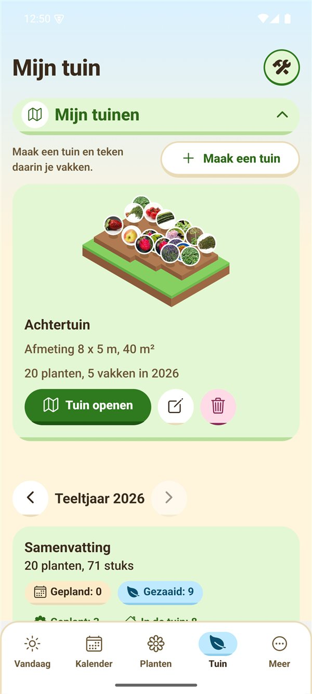
  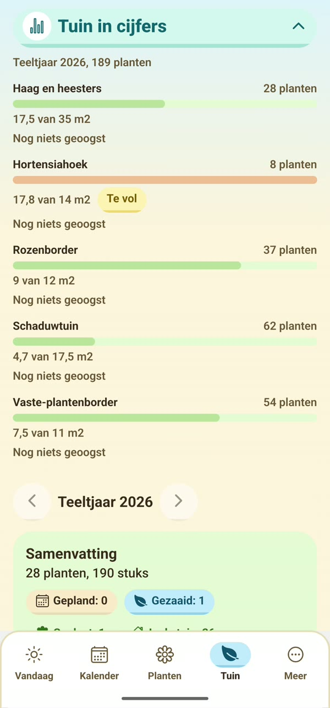
  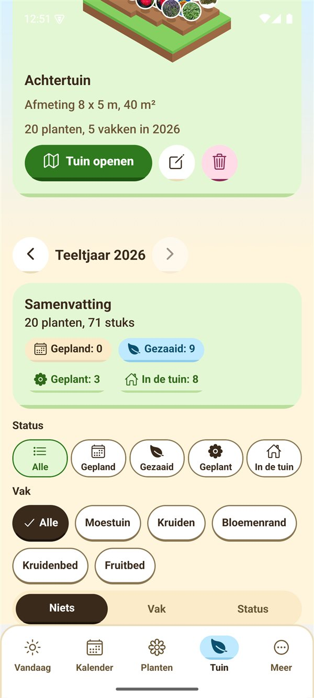
  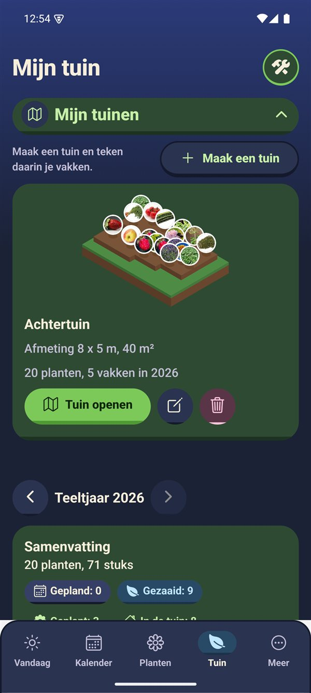

- Pro Pflanze: Anzahl, Beet, Sorte, Aussaat- und Pflanzdatum, Status (geplant, gesät, gepflanzt, im Garten), Ernten, Fotos und Notizen.
- **Mehrere Gärten**, jeweils mit eigenen Maßen (die App berechnet die Fläche) und einem eigenen Diorama.
- **Stauden** kommen jedes Jahr von selbst wieder.
- **Ernte und Planung pro Jahr**: sieh, wie viel du von jeder Art geplant hast, mit dem Platz, den sie einnehmen, wie
  viel noch in ein Beet passt, und einem Jahresbalken pro Art. Passe die Anzahlen an und übernimm die Planung dieses
  Jahres ins nächste.
- **Tuin in cijfers** (Garten in Zahlen): pro Beet die Belegung in Quadratmetern, die Anzahl der Pflanzen und die Ernte
  dieses Jahres, mit einer Markierung *Leeg* (leer), *Bijna leeg* (fast leer) oder *Te vol* (zu voll).
- **Als Bild teilen**: mach aus deinem Garten ein Bild, das du mit Familie oder Nachbarn teilen kannst.
- Eine Pflanze löschst du durch langes Drücken oder mit dem Papierkorb, immer mit Rückfrage.
- Eine Pflanze aus einem Beet heraus bearbeitet? Beim Schließen kommst du zurück ins Beet, nicht in den Garten.

## Garten entwerfen

Zeichne deinen Garten mit Beeten und sieh, was wohin passt. Im Editor wechselst du zwischen **Kaart** (Karte, Draufsicht),
**Lijst** (Liste) und **Diorama** (eine isometrische Ansicht mit Kacheln, Pflanzen und Pins).

  
  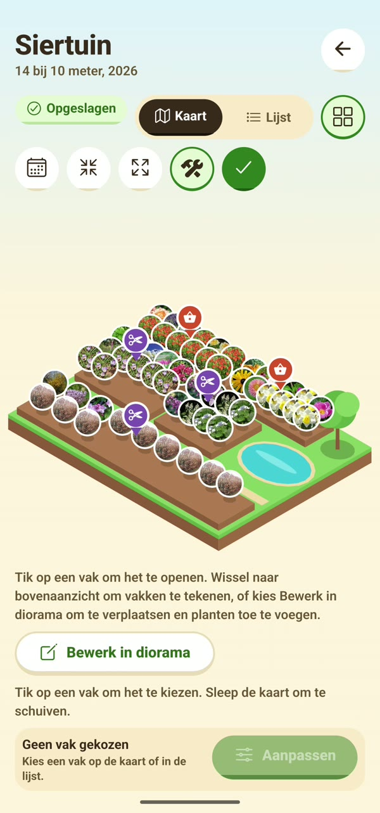
  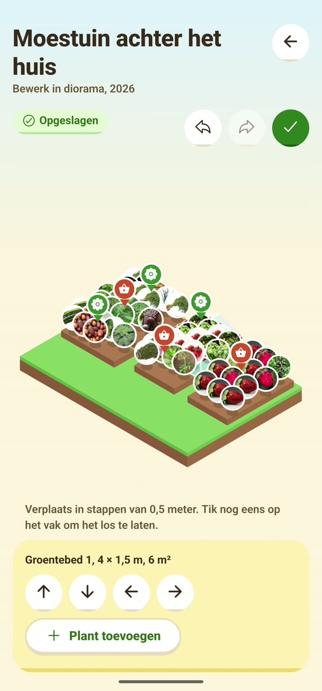
  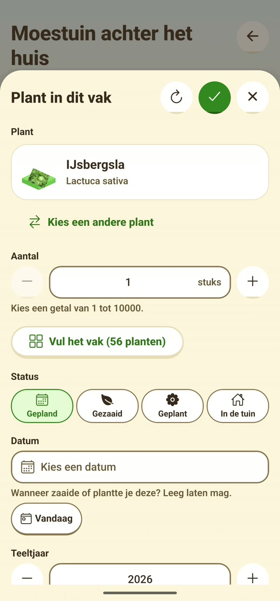

- **Beete** mit Maßen, Pflanzen darin und einem Hintergrundfoto deines eigenen Gartens. Auch Wege, Wasser, Bäume und Gewächshäuser.
- **Im Diorama bearbeiten**: wähle ein Beet durch Antippen, verschiebe es mit Pfeilen in Schritten von einem halben
  Meter (die App achtet auf den Rand und auf Kollisionen), füge eine Pflanze hinzu und mache Schritte rückgängig oder
  wiederhole sie. Ziehen mit dem Finger gibt es nicht.
- **Fruchtwechsel (Wisselteelt)**: Steht dieselbe Pflanzenfamilie zu kurz am selben Platz, bekommt das Beet einen roten
  gestrichelten Rand und eine Warnkarte mit Erklärung. Diesen Rand siehst du auch in Mein Garten und unter Heute.
- **Sonne und Schatten**: die App berechnet den Sonnenstand für den 21. Juni und berücksichtigt Bäume und Gewächshäuser.
- **Nachbarn**: eine Warnung, wenn Pflanzen nebeneinander nicht gut harmonieren.
- **Beet füllen**: die App rechnet aus, wie viele Pflanzen mit dem richtigen Abstand hineinpassen.
- **Jahre vergleichen und kopieren**: sieh, was im Vorjahr im Beet stand, und übernimm ein Jahr ins nächste.
- **Feste Kopfzeile in jedem Panel**: Bei Formularen in einem Panel stehen das Häkchen, ein Reset-Symbol und das Kreuz
  immer sichtbar oben. Das Häkchen lässt sich erst antippen, wenn sich etwas geändert hat und alles stimmt; Reset
  setzt alles zurück.

  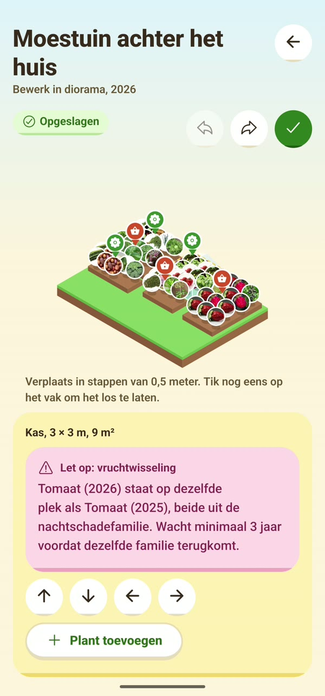

## Kalender

  
  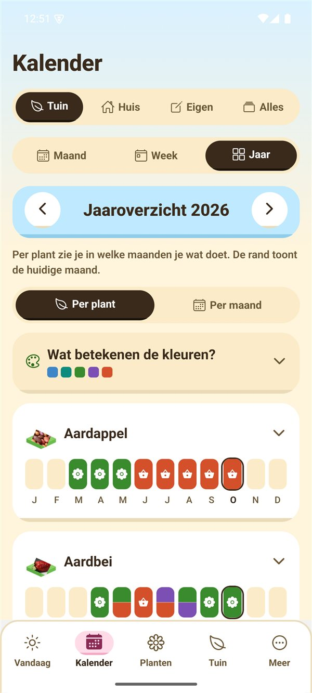
  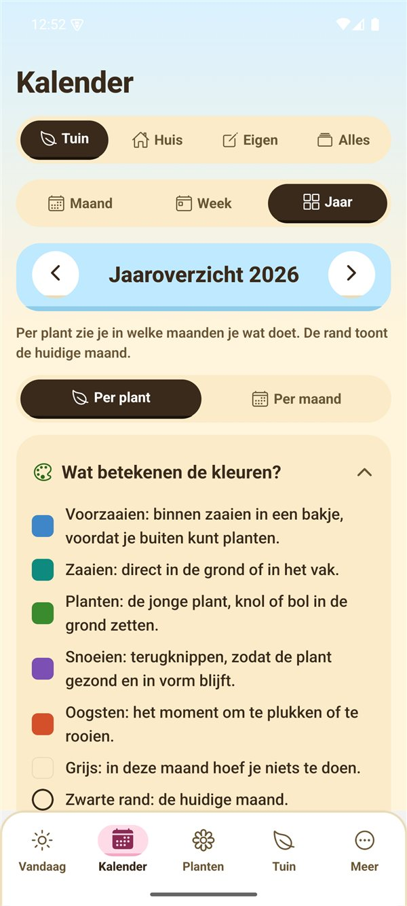
  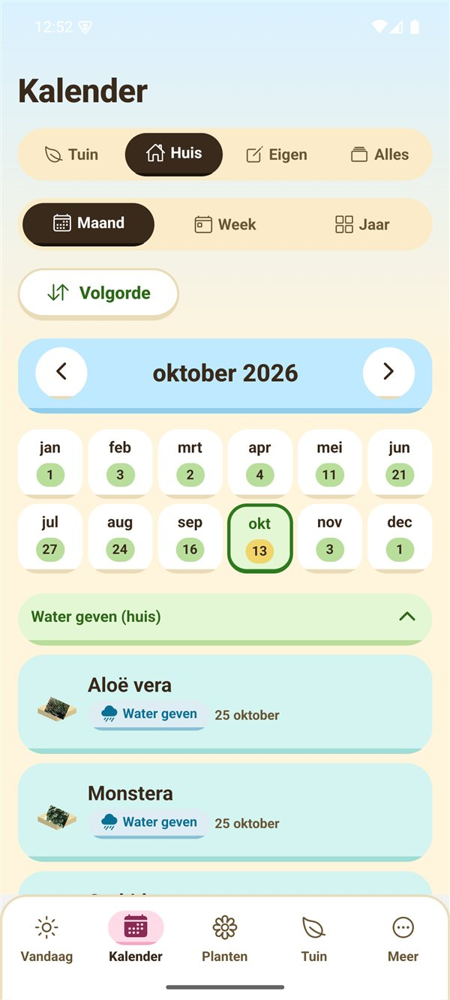

- **Maand** (Monat), **Week** oder **Jaar** (Jahr), für **Tuin** (Garten), **Huis** (Haus), **Eigen** oder **Alles**. In den Einstellungen wählst du, was du zuerst siehst.
- **Monatskacheln**: Jeder Monat ist eine ruhige Kachel mit Namen und der Anzahl der Aufgaben in einem runden Abzeichen.
- **Gießen im Kalender**: Gießen und Düngen der Zimmerpflanzen stehen in der Monatsliste und der Wochenübersicht bei
  jeder Quelle außer Eigen.
- **Reihenfolge, die du selbst festlegst**: Mit der Taste *Volgorde* (Reihenfolge) schiebst du Ernten, Schneiden,
  Pflanzen, Säen, Vorziehen, Gießen, Düngen und eigene Aufgaben nach oben oder unten. Die Wahl bleibt gespeichert und
  bestimmt auch die Aufteilung innerhalb eines Tages.
- Die **Jahresübersicht** zeigt farbige Balken pro Pflanze, mit einem Symbol, wenn ein Monat nur eine Aktion hat. Du
  wählst zwischen *Per plant* (pro Pflanze), *Per maand* (pro Monat) und einem *Raster*.
- **Woche**: deine eigenen Aufgaben sowie Gießen und Düngen der Zimmerpflanzen pro Tag, und oben „Nog te doen" (noch zu
  erledigen). Gruppen sind offen, wenn im eingestellten Zeitraum noch etwas ansteht, und klappen zu, wenn alles
  erledigt ist. Halte einen farbigen Monatsblock gedrückt, um die Farben erklärt zu bekommen.
- Eigene Aufgaben pro Woche; leere Wochen sind standardmäßig ausgeblendet. Leere Bildschirme haben eine Taste zum Hinzufügen.
- Aufgaben in den Kalender deines Handys exportieren (ICS-Datei).

## Zimmerpflanzen

156 Zimmerpflanzenarten mit Foto, Quelle und Richtwerten. Pro Art erhältst du den Gieß- und Düngerhythmus, den
Standort, Tipps pro Monat und ob die Pflanze für Haustiere giftig ist (laut ASPCA).

  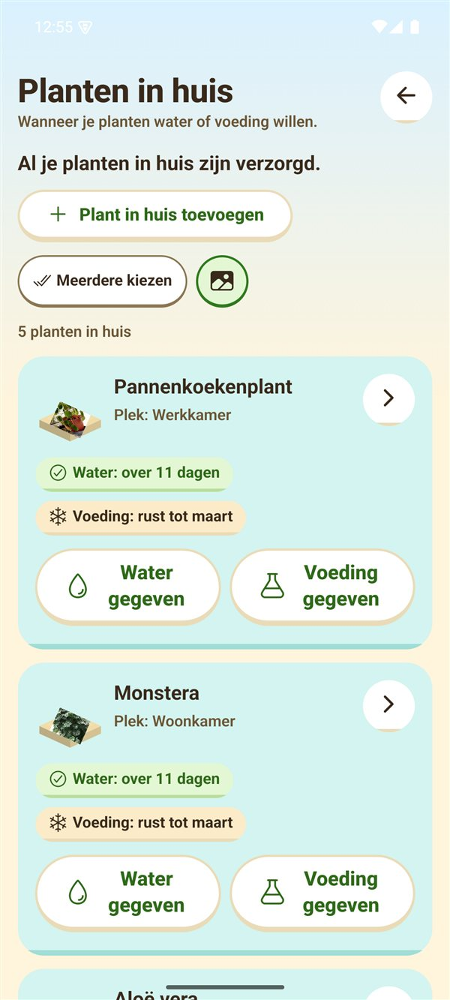
  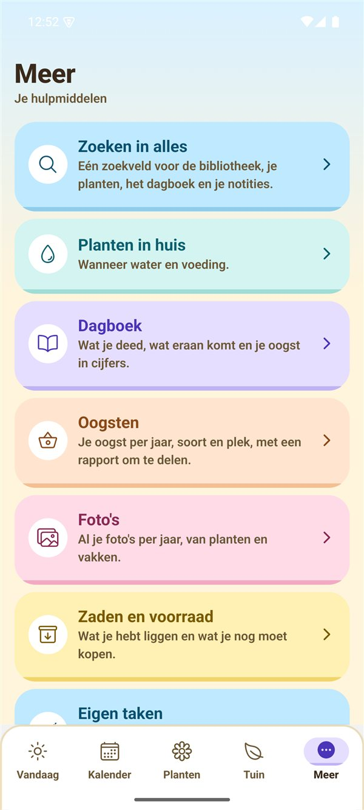

- **Gießen mit einer Wischgeste unter Heute**: Die App merkt sich, wann die Pflanze wieder Wasser möchte.
- **Mehrere Pflanzen auf einmal**: wähle einige aus und gib ihnen in einem Zug Wasser oder Dünger (*Meerdere kiezen*).
- **Jede Pflanze an ihrem Platz**: Woonkamer (Wohnzimmer), Keuken (Küche), Werkkamer (Arbeitszimmer) und was du dir selbst ausdenkst.
- Suche nach Name oder nach einem anderen Namen: „vingeraralia" findet die Schefflera.
- Führe ein Problemprotokoll und füge Fotos hinzu.
- Lege eine eigene Art an, wenn deine Pflanze nicht dabei ist, mit einem eigenen Foto.
- **Umtopfen**: schnell rückgängig machen und eine Erinnerung pro Pflanze (jedes Jahr, alle 2 oder 3 Jahre), mit einer Aufgabe unter Heute, wenn es Zeit ist.
- Eine Jahreskarte pro Pflanze im Kalender (Huis, Jaar) mit Foto und Jahresbalken.

## Tagebuch, Fotos und Ernte

  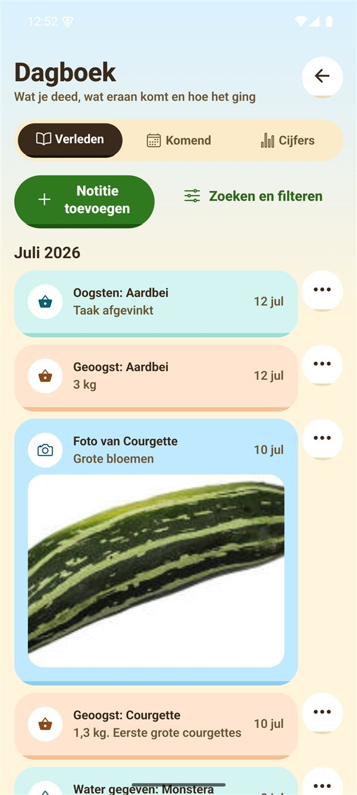
  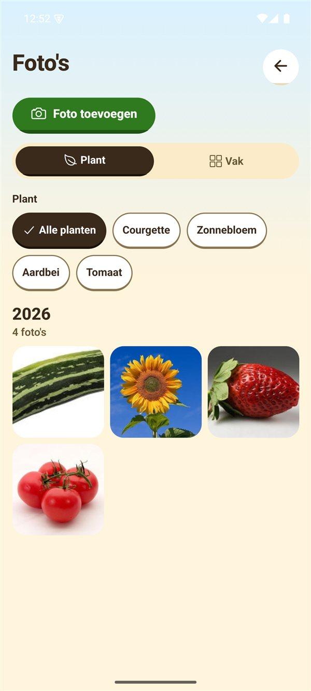
  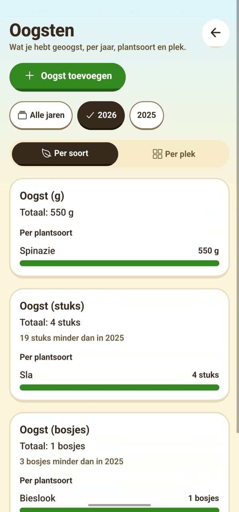
  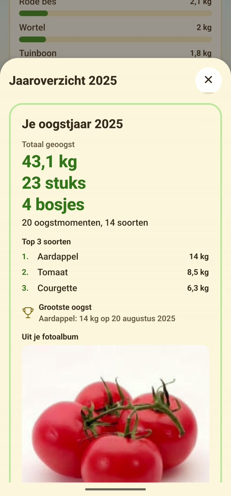

- **Komend** (Anstehend): überfällige Aufgaben und Aufgaben dieser und der nächsten Wochen, direkt abzuhaken. Wie weit im
  Voraus du abhaken darfst (1 Woche, 1 Monat oder 3 Monate), stellst du selbst ein.
- **Geschiedenis** (Verlauf) dessen, was du getan hast, mit Notizen und Fotos.
- **Cijfers** (Zahlen): was du geerntet, gesät und gepflanzt hast, auf einer kurzen und einer langen Statistikseite, auch pro Jahr.
- **Oogsten** (Ernten) hat einen eigenen Bildschirm (Meer, Oogsten): pro Jahr, Art und Ort, über mehrere Jahre, mit einem
  Bericht zum Teilen und einer Taste, um eine Ernte hinzuzufügen.
- **Jaarkaart** (Jahreskarte): pro Jahr deine Summen, Rekorde, die Top 3 und Fotos aus deinem Album. Mit der Einstellung
  Beleving gibt es dazu Konfetti. Teile die Karte als Bild (PNG).
- **Fotoalbum** pro Pflanze, Garten oder Beet, mit Zeitleiste. Eigene Fotos fügst du mit einem Assistenten in drei Schritten hinzu.

## Vorrat und eigene Aufgaben

  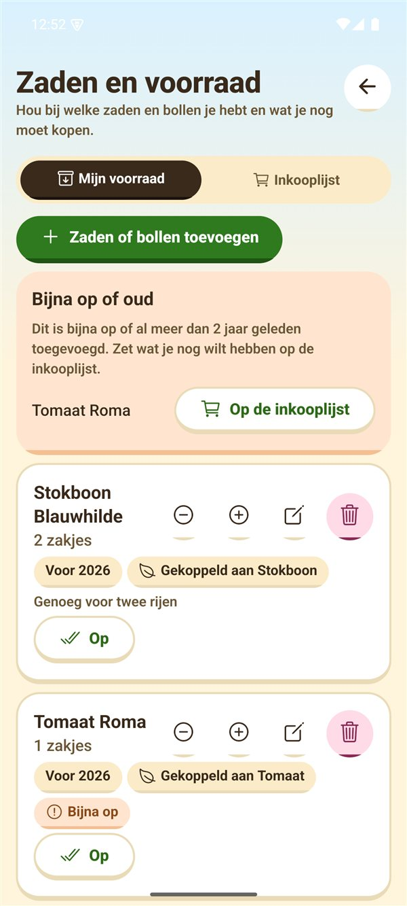
  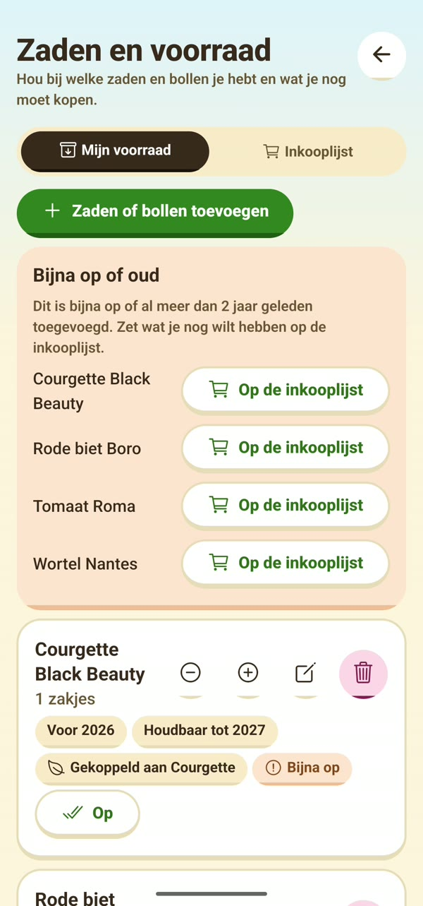
  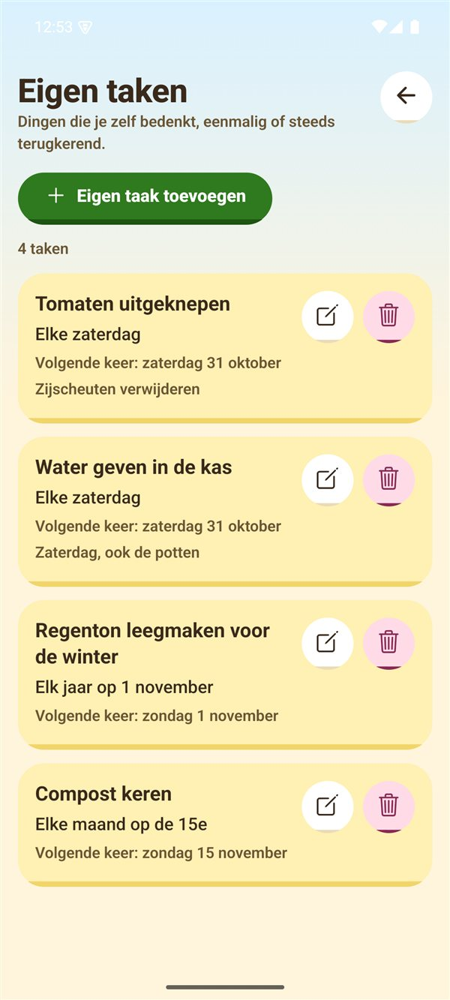

- **Saatgut und Zwiebeln**: Name und Pflanze verknüpfen, Haltbarkeit (auch für mehrere Jahre) und ein Foto der Tüte.
- **Fast leer und zu alt**: Die App markiert Samen, von denen nur noch einer oder weniger übrig ist, und Samen, die älter
  als zwei Jahre sind, mit einer Taste zur Einkaufsliste.
- **Einkaufsliste** aus dem, was du für das kommende Jahr brauchst, auch für das Jahr danach.
- **Eigene Aufgaben**: wiederkehrend und mit mehreren Pflanzen und Beeten verknüpfbar. Wiederholungen: jede Woche, alle
  2 Wochen, jeden Monat, alle 2 Monate, alle 3 Monate, jedes halbe Jahr, alle 9 Monate, jedes Jahr, alle 2 Jahre und alle 3 Jahre.

## Erinnerungen und Wetter

- **Benachrichtigungen** auf deinem Gerät: täglich oder wöchentlich, und eine Wochenübersicht am Sonntagabend.
- **Verschieben**: eine Aufgabe um einen Tag, eine Woche oder eine selbst gewählte Anzahl Tage verschieben.
- **Intelligente Erinnerungszeit** (optional): die App wählt den Moment, zu dem du sie meist öffnest.
- **Sicherungserinnerung**: Die App erinnert dich daran, eine Sicherung zu machen (aus, 1 Woche, 2 Wochen, 1 Monat oder 3 Monate).
- **Wetter**: Vorhersage von Open-Meteo für deinen Ort, mit Hinweisen bei Frost, Hitze, Trockenheit oder viel Regen.
- **Eigene Frostdaten**: stelle deinen letzten und ersten Frost selbst ein.

## Widgets

Vier Widgets für deinen Startbildschirm, die der Palette für Farbenblinde folgen, wenn du sie eingeschaltet hast:

- **Tuin, teller** (Garten, Zähler): wie viele Aktionen noch anstehen und wie viele überfällig sind.
- **Tuin, kort overzicht** (Garten, Kurzübersicht): die nächsten drei Aktionen.
- **Tuin, lang overzicht** (Garten, lange Übersicht): eine Liste mit den Aktionen dieses Monats und deinem Fortschritt.
- **Tuin, vandaag** (Garten, heute): Fortschritt von heute, die nächste Aktion und das Wetter.

## Suche und Sicherung

- **Alles durchsuchen**: Bibliothek, deine Pflanzen, Tagebuch, eigene Aufgaben und Vorrat, mit Fotos in den Ergebnissen.
- **Nur essbar** (*Alleen eetbaar*): ein Schalter in der Suche zeigt nur, was du essen kannst. Samennamen wie
  Sonnenblumenkern oder Kürbiskern führen zur Pflanze.
- **Sicherung** (Back-up): exportiere und importiere all deine Daten samt Fotos, oder lass die App jede Woche automatisch
  eine Sicherung in einem gewählten Ordner ablegen.
- **Jahresplan als PDF**: erst eine Vorschau auf dem Bildschirm, dann öffnen, speichern oder teilen.

## Aussehen und Barrierefreiheit

Das Design heißt *Tuinwereld* (Gartenwelt): warmes Creme, dicke weiche Karten, runde Tasten und Farben pro Bereich (Gras,
Orange, Türkis, Lila, Gelb, Rosa und Himmel).

- **Plantbeeld** (Pflanzenbild): wähle **Iconen** (ein Symbol pro Pflanzengruppe), **Tekeningen** (ein gezeichnetes
  Pflänzchen auf einer Kachel, mehr als 50 Formen) oder **Foto's** (das echte Foto auf einer Kachel; ohne Foto siehst du
  die Zeichnung). Das gilt in Listen, Aufgaben, Kalender, Beeten, Zimmerpflanzen und im Diorama.
- **Beweging** (Bewegung): **Rustig** (keine Animation und kein Vibrieren), **Subtiel** (Pins wippen, ein Pflänzchen
  springt bei Klaar auf, ein leichtes Vibrieren) oder **Beleving** (obendrein Konfetti bei Klaar sowie Wolken und Regen
  über dem kleinen Garten). Ist die Bewegungsreduzierung deines Geräts eingeschaltet, bekommst du immer Rustig.
- **Luchtverloop** (Himmelsverlauf; optional, standardmäßig aus): ein Farbverlauf oben, der Tageszeit und Jahreszeit folgt.
- **Hell oder dunkel**, nach deinem Gerät oder selbst gewählt.
- **Textgröße**: normal, groß oder extra groß.
- **Farbenblindenfreundliche Palette** (Okabe-Ito) für die Statusfarben, auch in den Widgets.
- Funktioniert mit **TalkBack** und passt sich **Tablets** an (zwei Spalten unter Heute, breitere Layouts).
- Die Einstellungen sind ein eigenes Menü mit einem Bildschirm pro Gruppe und einem Suchfeld.

## Einfach oder erweitert

Eine Taste oben rechts schaltet „erweitert" ein oder aus. Einfach zeigt nur, was du jetzt brauchst. Erweitert zeigt
alle Details und gibt dir in den Einstellungen **26 Zusatzfunktionen**, die du einzeln ein- oder ausschaltest:

Tipp mit Quelle, Tipp des Monats unter Heute, Zimmerpflanzen-Tipps, Krankheiten und Schädlinge,
Fruchtwechsel-Warnung, Haltbarkeit von Saatgut, Wetterhinweis, Frostdatum pro Region, Wochenübersicht, Kalenderexport,
Aufgaben verschieben, intelligente Erinnerungszeit, Schattenanalyse, Nachbarnprüfung, Beet automatisch füllen, Jahre
vergleichen, Hintergrundfoto deines Gartens, Foto-Zeitleiste, Erntediagramm, Einkaufsliste, eigene Aufgaben unter Heute,
Zimmerpflanzen unter Heute, Vorausplanen, globale Suche, Tablet-Layout und automatische Sicherung.

Beim Wechseln geht nichts verloren.

## Installieren

1. Öffne die Seite **[Releases](../../releases)** und lade auf dem Handy die neueste `tuinplanner-<Version>.apk` herunter.
2. Öffne die Datei. Wenn Android danach fragt, erlaube die Installation aus dieser Quelle.
3. Starte Tuinplanner. Fertig.

Die App ist zum selbst Installieren gedacht und nicht im Play Store.

**Voraussetzungen.** Android 7.0 oder neuer und ein 64-Bit-Handy oder -Tablet (arm64). Die Installationsdatei ist groß
(etwa 155 MB), weil die ganze Pflanzenbibliothek mit Fotos darin steckt; danach funktioniert alles ohne Internet.

### Updates

Öffne in der App **Meer, Instellingen** (Mehr, Einstellungen) und suche nach Updates. Die App findet die neueste
Version hier, lädt sie herunter und bittet Android um die Installation. Ohne deine Bestätigung wird nichts installiert.

## Datenschutz

- Alles funktioniert offline; Pflanzen, Fotos und Notizen bleiben auf deinem Gerät.
- Die App nutzt das Internet nur für den optionalen Wetterhinweis (Open-Meteo) und die Suche nach einer neuen Version.
- Keine Konten, keine Werbung, kein Tracking.

## Häufige Fragen

**Muss ich ein Konto anlegen?** Nein. Es gibt kein Konto, und es wird nichts an einen Server von uns geschickt.

**Funktioniert es ohne Internet?** Ja. Nur der Wetterhinweis und die Suche nach Updates nutzen das Internet, und beide sind optional.

**Wie nehme ich meine Daten auf ein neues Handy mit?** Erstelle unter Instellingen, Back-up (Einstellungen, Sicherung)
einen Export (mit Fotos) und importiere ihn auf dem neuen Handy. Du kannst auch jede Woche automatisch eine Sicherung
in einem Ordner ablegen lassen.

**Warum steht bei manchen Zahlen „richtwaarde"?** Weil die Quelle keinen genauen Wert nennt oder wir nur eine Quelle
dafür gefunden haben. Die App tut nicht so, als wäre es sicherer.

**Eine Pflanze fehlt?** Füge sie selbst als eigene Pflanze hinzu oder, bei Zimmerpflanzen, als eigene Art.

**Ist eine Pflanze ohne rote oder gelbe Karte sicher?** Nicht unbedingt. Die Karten *Giftig* und *Let op* (Vorsicht)
stehen nur bei Pflanzen, für die wir eine Quelle gefunden haben.

**Du siehst die Filme nicht abspielen?** Lade die Datei aus dem Ordner [`video/`](video/) herunter und spiele sie lokal ab.

**Warum ist die App nicht im Play Store?** Sie ist zum selbst Installieren gedacht.

## Versionsverlauf

Eine Auswahl dessen, was pro Version dazugekommen ist. Alle Versionen stehen auf der Seite [Releases](../../releases).

| Version | Was ist neu |
|---|---|
| **3.4.0** | Einführung mit einem Beispielgarten (Pflanzenbild und Bewegung wählen); die App startet etwa doppelt so schnell und die Pflanzenliste scrollt flüssiger |
| **3.3.0** | Bearbeiten im Diorama, Fruchtwechsel-Warnung, Garten in Zahlen, Garten als Bild teilen, Erntejahreskarte, Schnellknopf, Himmelsverlauf, Wasser bei Regen, Kalenderraster |
| **3.2.x** | Favoriten, Sortieren, Palette für Farbenblinde und extra große Schrift, Sicherungserinnerung, Kalender mit Monatskacheln, Gießen und feste Reihenfolge, feste Kopfzeile mit Häkchen und Reset in Panels |
| **3.1** | Bewegung (ruhig, dezent, Erlebnis), Einstellungen als eigenes Menü |
| **3.0** | Neues Design *Tuinwereld*, Pflanzenbild mit Symbolen, Zeichnungen oder Fotos, kleiner Garten unter Heute |
| **2.x** | 143 neue Bäume, Sträucher, Kletterpflanzen und Stauden (638 Pflanzen), Kategorienmenü, Anbautipps für 140 weitere Pflanzen, Richtwerte markiert |
| **1.x** | Wischen bei Aufgaben, mehrere wählen, Zimmerpflanzen zwischen den Aufgaben, Woche im Kalender, Ernten, Umtopfen, Pilze und Nüsse, giftig oder Vorsicht |

## Quellen und Dank

Die Pflanzendaten stammen aus offenen Quellen, mit einer Quelle pro Pflanze (siehe **Meer, Bronnen en foto's**, also Mehr, Quellen und Fotos, in der App).
Fotos stammen von Wikimedia Commons unter freien Lizenzen; Urheber und Lizenz stehen bei jedem Foto.
Wetterdaten: Open-Meteo. Giftigkeit für Haustiere: ASPCA.

## Quellcode

Der Quellcode dieses Projekts ist privat. Dieses Repository enthält nur die Releases, die Filme und diese Seite.

## Fragen oder Ideen

Eröffne ein [Issue](../../issues). Mit Liebe zur Natur gemacht.
