# Garden Planner

[Nederlands](README.md) · **English** · [Deutsch](README.de.md) · [Français](README.fr.md) · [Español](README.es.md)

On your phone the app and the downloaded file are called *Tuinplanner*. The app itself is in Dutch, so menu and button
names below are given in Dutch, with an English explanation where needed.

**Know what to do in the garden and at home today, even without internet.**
Garden Planner is a friendly planner for Android. It shows when to sow, plant, prune and harvest, reminds you,
and keeps track of what grows in your garden and at home. No account, no ads, no tracking: your data stays
on your phone.

  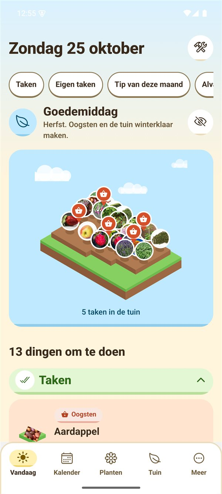
  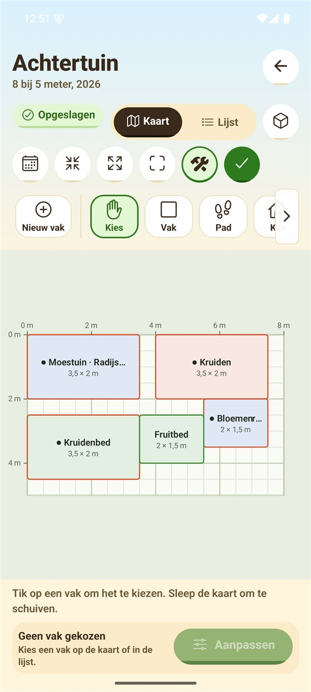
  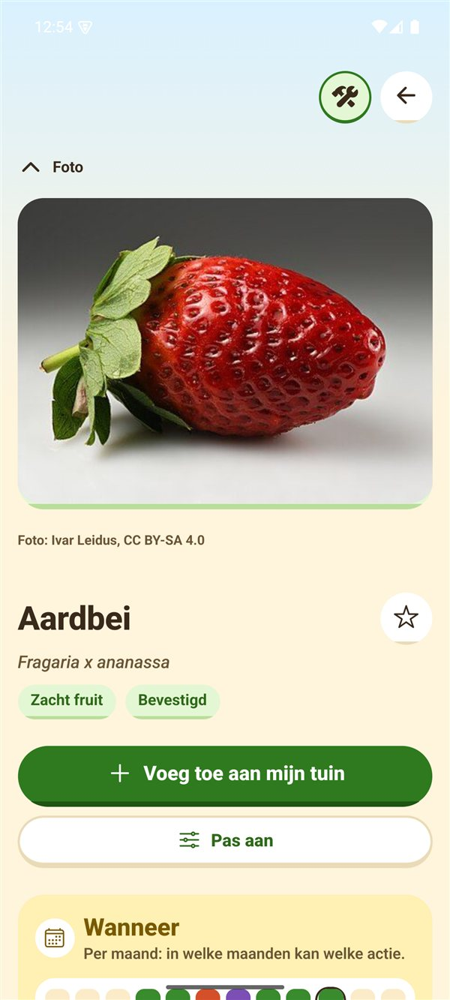
  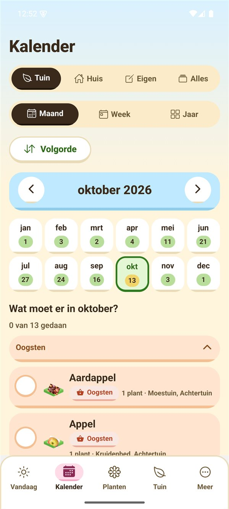

## Contents

[Watch the films first](#watch-the-films-first) · [Why](#why) · [In brief](#in-brief) ·
[First time](#the-first-time) · [Today](#today) · [Library](#plant-library) · [My garden](#my-garden) ·
[Garden design](#garden-design) · [Calendar](#calendar) · [Houseplants](#houseplants) ·
[Diary, photos and harvest](#diary-photos-and-harvest) · [Stock and tasks](#stock-and-own-tasks) ·
[Reminders and weather](#reminders-and-weather) · [Widgets](#widgets) · [Search and backup](#search-and-backup) ·
[Appearance and accessibility](#appearance-and-accessibility) · [Simple or advanced](#simple-or-advanced) ·
[Install](#install) · [Privacy](#privacy) · [FAQ](#frequently-asked-questions) ·
[Version history](#version-history)

## Watch the films first

Four short films show the app in use, each with a different gardener. The data in the films is made up; the
footage is recorded from the real app (version 3.4.0). Click an image to open and play the film.

<table>
  <tr>
    <td align="center" width="50%">
      <a href="video/tuinplanner-lotte.mp4">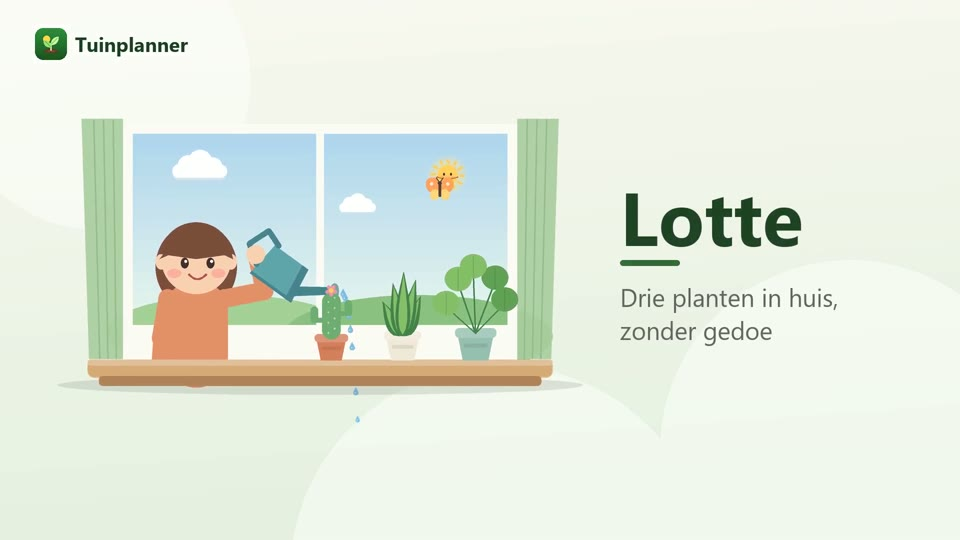</a> 
      <b>Lotte: three plants at home</b> (1:33) 
      Ticking off watering with one swipe, opening a plant and adding it, and seeing everything again in the calendar.
      In the simple view.
    </td>
    <td align="center" width="50%">
      <a href="video/tuinplanner-daan.mp4">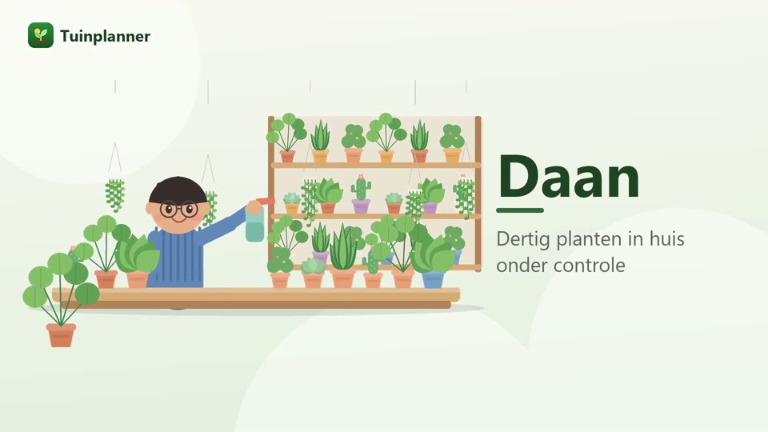</a> 
      <b>Daan: thirty plants at home</b> (3:05) 
      Filtering on water or feeding, caring for several plants at once, searching, and the calendar by week and month.
    </td>
  </tr>
  <tr>
    <td align="center" width="50%">
      <a href="video/tuinplanner-joost.mp4">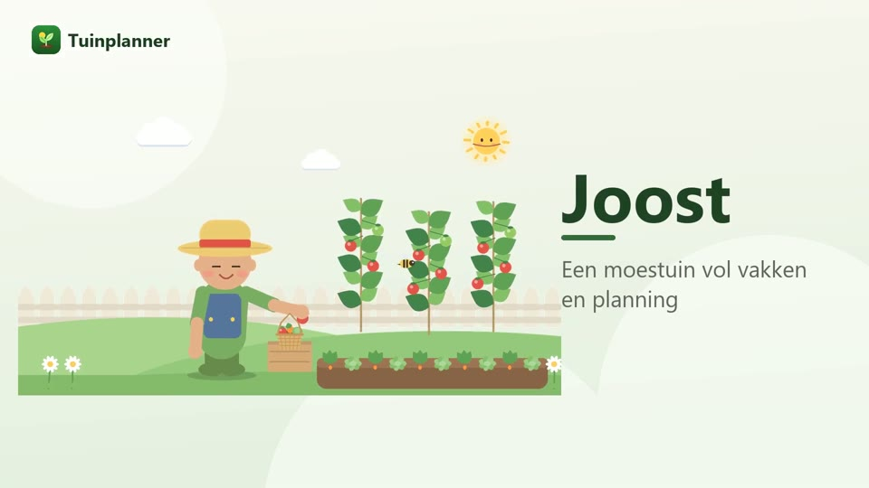</a> 
      <b>Joost: the vegetable garden</b> (3:48) 
      What needs to go in the ground now, editing the garden as a diorama, a crop rotation warning, harvest per year
      with the year card, and the shopping list for seeds.
    </td>
    <td align="center" width="50%">
      <a href="video/tuinplanner-ria.mp4">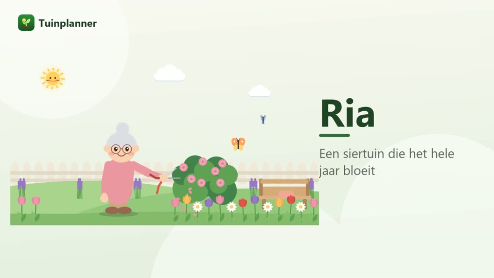</a> 
      <b>Ria: the ornamental garden</b> (3:30) 
      Borders and shrubs in one view, pruning advice and flowering time per plant, pruning in the calendar, a diary with
      photos and bulbs on the shopping list.
    </td>
  </tr>
</table>

The films are ordinary files in the [`video/`](video/) folder (about 40 MB in total). If you do not see a player,
download the file and open it on your computer or phone.

## Why

A garden needs attention at the right moment: sowing too late, forgetting to water, missing a pruning window.
Garden Planner lines those moments up for you. You choose what you grow, and the app shows per day what is due,
with explanations and sources. It works completely offline; the plant library is inside the app.

Who is it for? Someone with three houseplants who does not want to forget to water them, the vegetable gardener who
wants to know what needs to go in the ground this month and what stood there last year, and the lover of an ornamental
garden with roses, hydrangeas and shrubs that need pruning on time. With the Simpel (simple) or Geavanceerd (advanced)
button you decide how much you see.

## In brief

| Part | What you get |
|---|---|
| **Vandaag** (Today) | The tasks of the moment, a small garden with pins on the beds where something is due, weather advice and your favourites |
| **Plantenbibliotheek** (Plant library) | 638 plants, 21 bulb crops and 156 houseplants (794 plants in the list in total), with photo, source and growing tips |
| **Mijn tuin** (My garden) | Your plants per year and per bed, harvest and planning, garden in numbers, sharing as a picture |
| **Tuin ontwerpen** (Garden design) | Drawing beds, editing in the diorama, sun and shade, neighbours and crop rotation |
| **Kalender** (Calendar) | Month, week and year for garden, home and own tasks, with an order you fix yourself |
| **Planten in huis** (Houseplants) | Watering and feeding rhythm per plant, repotting, toxicity to pets, log |
| **Dagboek, foto's en oogst** (Diary, photos and harvest) | What you did, what is coming, your harvest per year and a year card to share |
| **Voorraad en taken** (Stock and tasks) | Seeds and bulbs, shopping list, own recurring tasks |
| **Herinneringen en weer** (Reminders and weather) | Notifications, postponing, weather from Open-Meteo, widgets for your home screen |
| **Uiterlijk** (Appearance) | Plant display (icons, drawings or photos), motion, dark theme, colour-blind palette, large text |
| **Gegevens** (Data) | Offline, no account, backup including photos, year plan as PDF |

## The first time

The first time you use the app you go through four short steps, which you can also skip:

1. **Welkom** (Welcome). What the app does at a glance: works without internet, your data stays on your device, everything can be adjusted.
2. **Hoeveel wil je zien?** (How much do you want to see?) Choose Simpel or Geavanceerd. You can always change this.
3. **Zo ziet je tuin eruit** (This is how your garden looks). A sample garden adapts at once as you choose between
   **Iconen** (icons), **Tekeningen** (drawings) or **Foto's** (photos), called *Plantbeeld* (plant display), and
   between **Rustig** (calm), **Subtiel** (subtle) or **Beleving** (experience), called *Beweging* (motion).
4. **Wil je een herinnering?** (Do you want a reminder?) Choose whether you want notifications and at what time.

  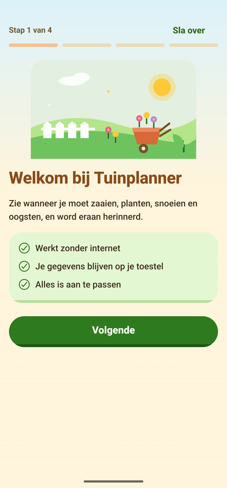
  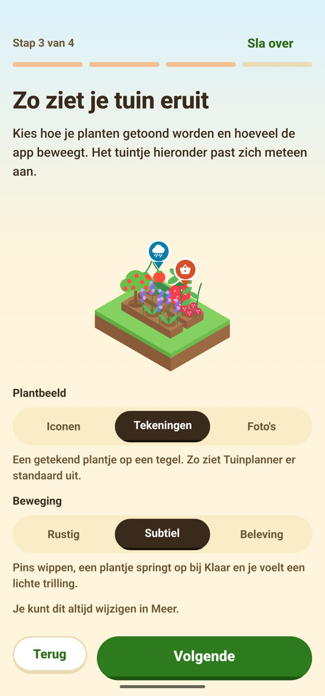
  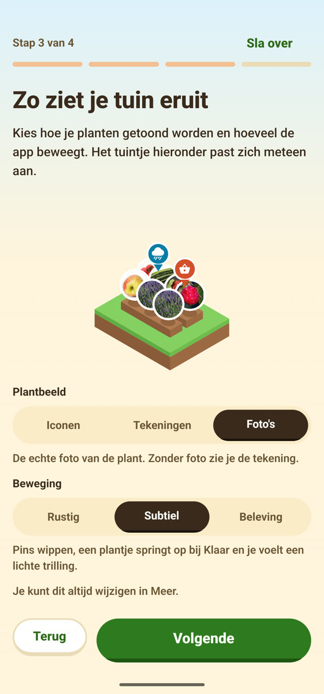

## Today

The home screen (*Vandaag*) shows the tasks of the moment: sowing, pre-sowing, planting, pruning, harvesting,
watering and feeding. At the top is a greeting with a line about the season and a small garden (diorama) with pins on
the beds where something is due. Tap the small garden to open the garden.

  
  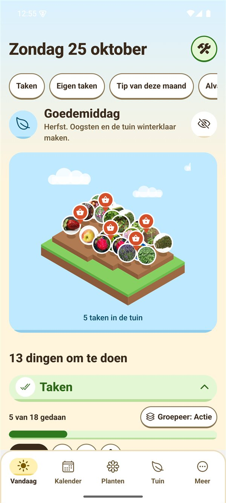
  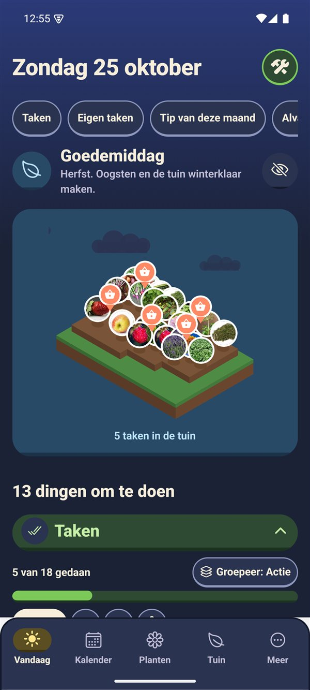

- **Tick off with one tap.** A harvest asks right away how much you picked, so your diary stays correct.
- **Swipe.** Swipe a task left to tick it off and right to postpone it. You can flip that or turn it off in
  Instellingen (Settings). A short message with *Ongedaan* (Undo) lets you take back a slip, and finished tasks leave
  the list.
- **Pick several at once.** Press and hold a row or tile to pick more; the actions (add to your list, change status,
  delete) then appear at the bottom. Without a selection they are not there. It also works in the diary and in search
  results.
- **Later**: postpone a task until tomorrow, next week or a number of days you choose.
- **Group and filter** by action, plant or bed, with chips for watering, feeding and repotting of houseplants.
- **Houseplants among the tasks**: watering, feeding and repotting appear as ordinary rows in the list and count
  towards your progress. You choose whether they sit folded at the top or at the bottom.
- **Your favourites**: a row with plants you have put a star on.
- **Quick button**: a floating button with Notitie (note), Foto (photo) and Oogst (harvest), so you can quickly record
  something while out in the garden. Can be turned off in Settings.
- **Plan ahead**: look ahead to what is coming in the next months.
- **Tip of this month** for the plants you have, with a source.
- **Weather advice**: a warning for frost, heat, drought or heavy rain, naming your frost-tender plants.
- **Water when it rains**: if rain is forecast, the app suggests skipping your own watering tasks for today. You
  confirm with a tap. This only works for own tasks with a watering word in the title, because for outdoor plants
  the data contains no watering schedule.
- **Year overview in December and January**: an invitation to look at your harvest year and share it.
- **What is new**: after an update a small card appears once with what has changed. Can be turned off.
- On a tablet, Today is shown in two columns.

## Plant library

638 plants and 21 bulb crops for your garden, plus 156 houseplants, each with sowing, planting, pruning and harvest
months, spacing, position, good and bad neighbours, photos and sources. That makes 794 plants in the list.

  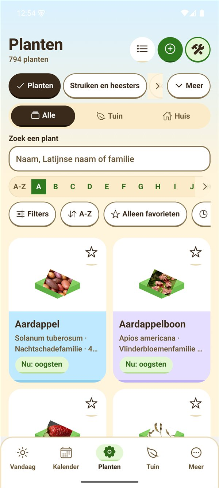
  
  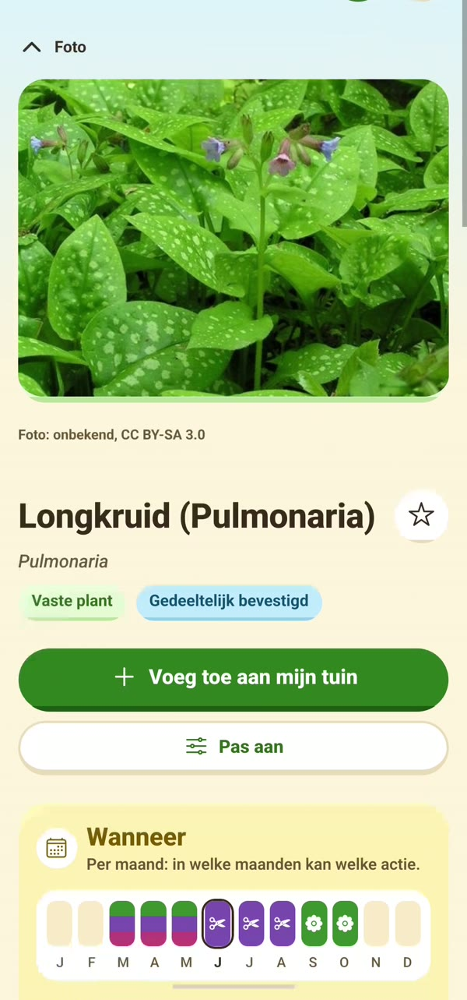
  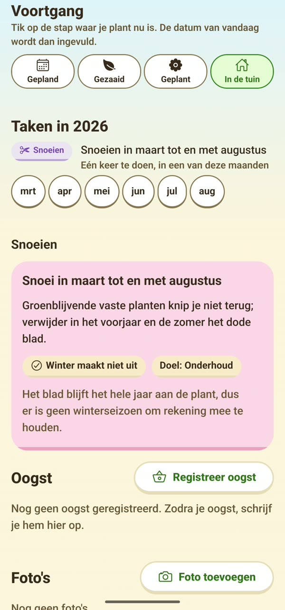

- **More than just vegetables.** Trees, conifers, shrubs, climbers, ground cover, perennials, ornamental grasses,
  roses, hedge plants, green manures, fruit and berries, herbs, wild vegetables, mushrooms and nuts. The category
  menu has 17 categories; you pin two as quick choices in the bar.
- **Growing tips per month**, with the source. For 590 plants they are in the library, from cultivation pages of the
  RHS among others; some are based on a species group rather than the species itself. Anything that cannot be backed
  up is left out.
- **Pruning advice** for every plant, including whether it can wait until after winter and what the aim is
  (maintenance, rejuvenation).
- **Guideline values are marked.** Where plant spacing, flowering and pruning months come from a single source, are
  rounded or derived, it says "(richtwaarde)" (guideline value). Planting and pruning months of the newer trees and
  shrubs partly come from general RHS guides and are indicative.
- **Diseases and pests** with how to recognise and prevent them, and a source.
- **Filters and sorting** by group, role, family, position, plant spacing, reliability, action and month. Headings
  fold away and remember their state. Sort by A-Z, sow now, favourites first or last viewed.
- **Quick choices** such as "Can do now", "Sow now" and "Plant now", plus an A-Z bar that stays at the top while you scroll.
- **Grid, list or compact**: three ways to show the library.
- **All, Garden or House** (*Alle, Tuin of Huis*): the list shows the garden library, the houseplants or both.
- **Favourites**: put a star on a plant (in the list or the detail) and filter on "Alleen favorieten" (favourites only).
- **Mushrooms and nuts**: 21 edible mushrooms to grow and 27 nuts, seeds and related crops, with growing notes and
  sources. Poisonous look-alikes are listed, and hemp only has a legal warning.
- **Poisonous or take care**: 259 plants have a red *Giftig* (Poisonous, 84) card or a yellow *Let op* (Take care, 175)
  card, with a source. No card does not necessarily mean a plant is safe.
- **Add your own plant** if your plant is not in the list.
- Photos from Wikimedia Commons, always with maker and licence. In the detail you can fold the photo away or make it smaller.

## My garden

The plants you grow or want to grow, per year and per bed.

  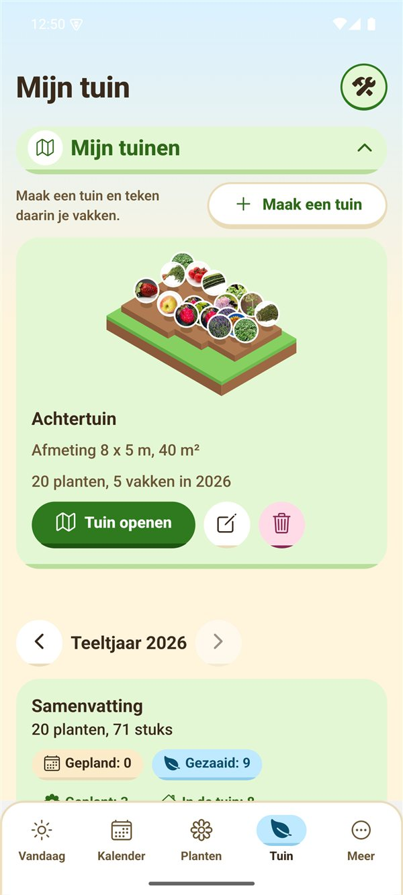
  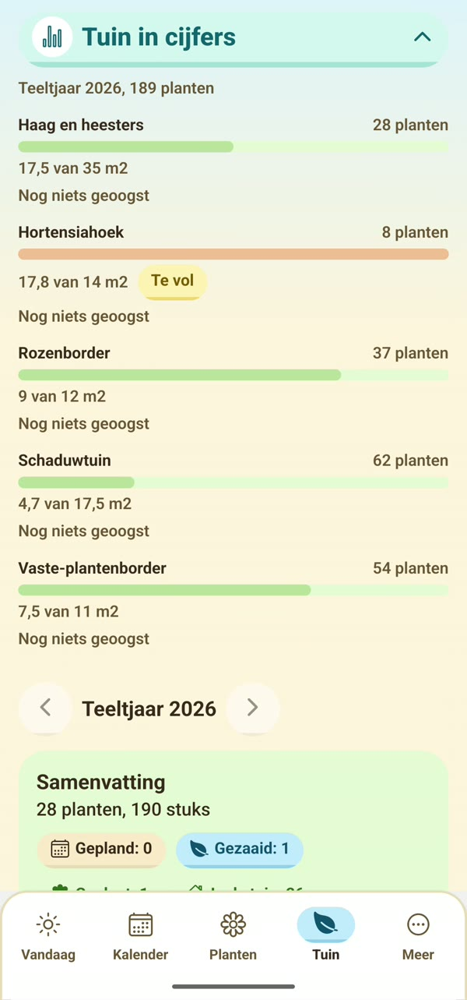
  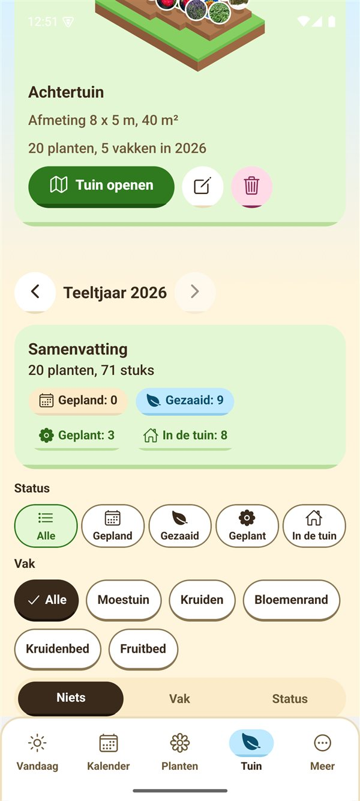
  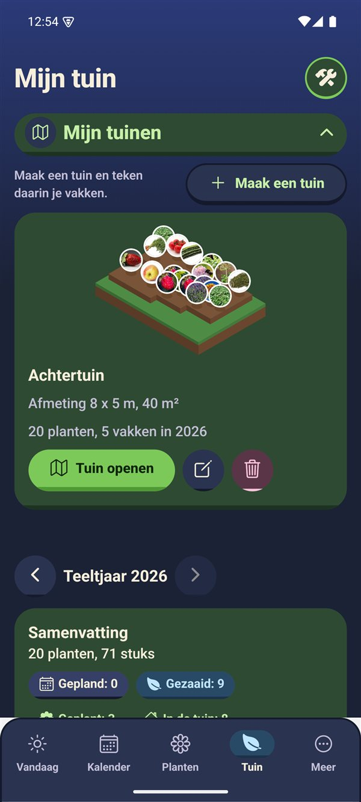

- Per plant: number, bed, variety, sowing and planting date, status (planned, sown, planted, in the garden), harvests, photos and notes.
- **Several gardens**, each with its own size (the app works out the area) and its own diorama.
- **Perennials** return every year by themselves.
- **Harvest and planning per year**: see how many of each species you planned, with the space they take, how many more
  fit in a bed, and a year bar per species. Adjust the numbers and copy this year's plan to the next.
- **Tuin in cijfers** (Garden in numbers): per bed the occupancy in square metres, the number of plants and this
  year's harvest, with a marker *Leeg* (Empty), *Bijna leeg* (Almost empty) or *Te vol* (Too full).
- **Share as a picture**: turn your garden into a picture to share with family or neighbours.
- A plant can be removed with a long press or the bin, always with a confirmation.
- Editing a plant from a bed? Closing brings you back to that bed, not to the garden.

## Garden design

Draw your garden with beds and see what fits where. In the editor you switch between **Kaart** (Map, top view),
**Lijst** (List) and **Diorama** (an isometric view with tiles, plants and pins).

  
  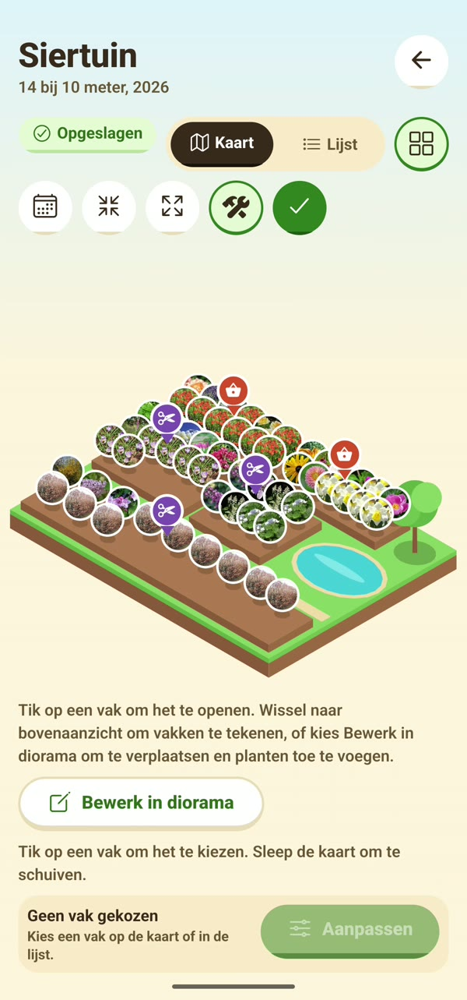
  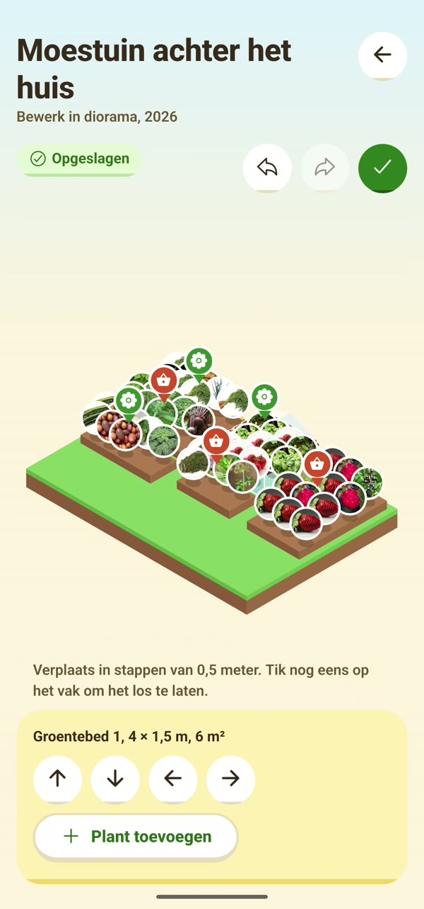
  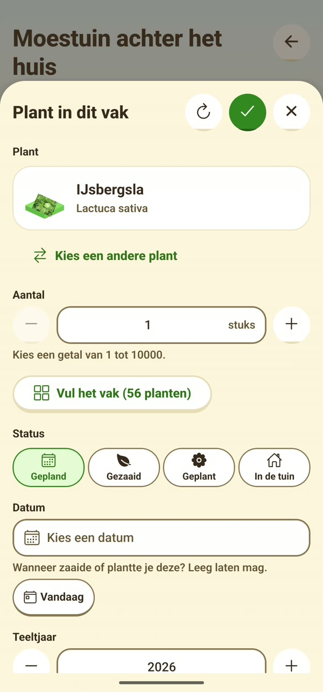

- **Beds** with dimensions, plants in them and a background photo of your own garden. Also paths, water, trees and greenhouses.
- **Edit in the diorama**: pick a bed by tapping it, move it with arrows in steps of half a metre (the app watches the
  edge and collisions), add a plant and undo or redo. Dragging with your finger is not possible.
- **Wisselteelt (crop rotation)**: if the same plant family stands too soon in the same place, the bed gets a red
  dotted border and a warning card with an explanation. You also see that border in My garden and on Today.
- **Sun and shade**: the app calculates the sun position for 21 June and takes trees and greenhouses into account.
- **Neighbours**: a warning when plants next to each other do not get along.
- **Fill bed**: the app works out how many plants fit with the right spacing.
- **Compare and copy years**: see what stood in a bed last year and copy a year to the next.
- **Fixed header in every panel**: in forms in a panel, the tick, a reset icon and the cross are always visible at the
  top. The tick can only be tapped once something has changed and everything is valid; reset puts everything back.

  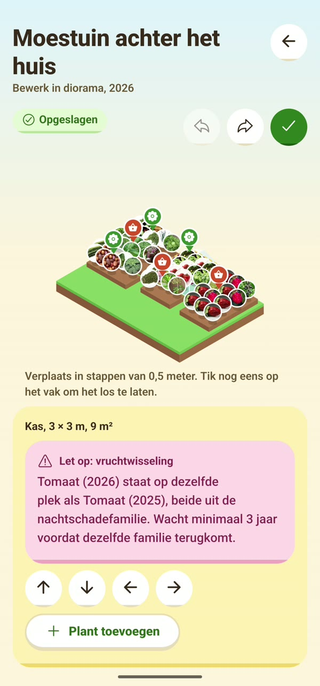

## Calendar

  
  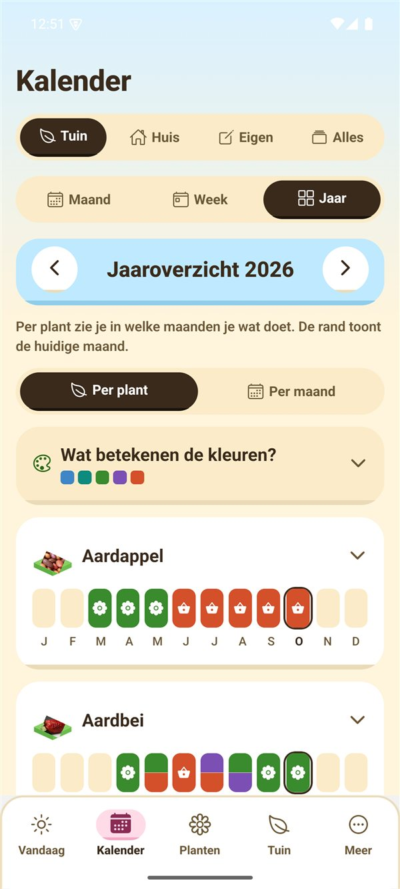
  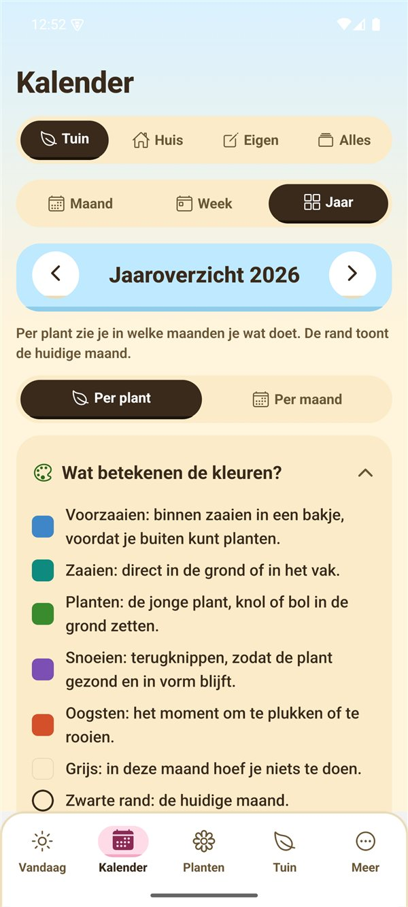
  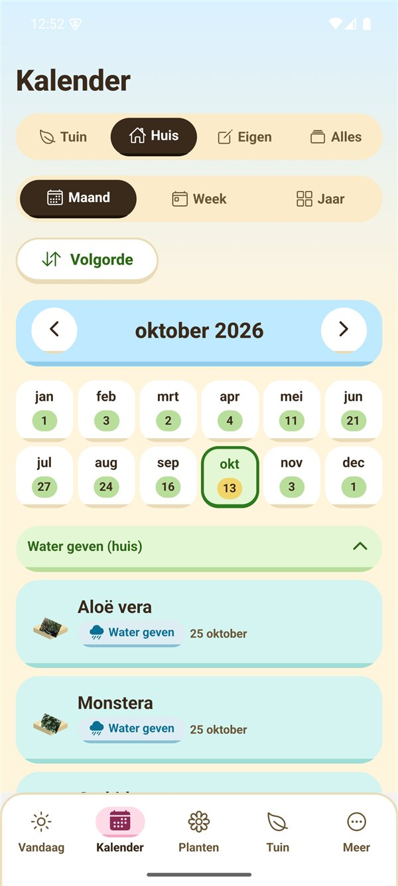

- **Month**, **Week** or **Year**, for **Garden**, **House**, **Own** or **All**. In Settings you choose what you see first.
- **Month tiles**: each month is a calm tile with its name and the number of tasks in a round badge.
- **Watering in the calendar**: watering and feeding of houseplants appear in the month list and the week overview for
  every source except Own.
- **An order you fix yourself**: with the *Volgorde* (Order) button you move harvesting, pruning, planting, sowing,
  pre-sowing, watering, feeding and own tasks up or down. The choice is kept and also decides the layout within a day.
- The **year overview** shows coloured bars per plant, with an icon when a month has only one action. You choose
  between *Per plant*, *Per maand* (Per month) and a *Raster* (Grid).
- **Week**: your own tasks, and the water and feeding for your houseplants per day, and "Nog te doen" (Still to do) at
  the top. Groups open when there is still something to do, and fold shut when all is done. Press and hold a coloured
  month block for an explanation of the colours.
- Own tasks per week; empty weeks are hidden by default. Empty screens have a button to add something.
- Export tasks to your phone's calendar (ICS file).

## Houseplants

156 houseplant species with photo, source and guideline values. Per species you get the watering and feeding
rhythm, the position, tips per month and whether the plant is toxic to pets (according to the ASPCA).

  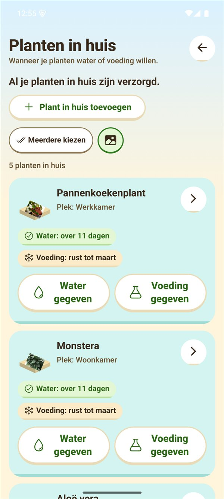
  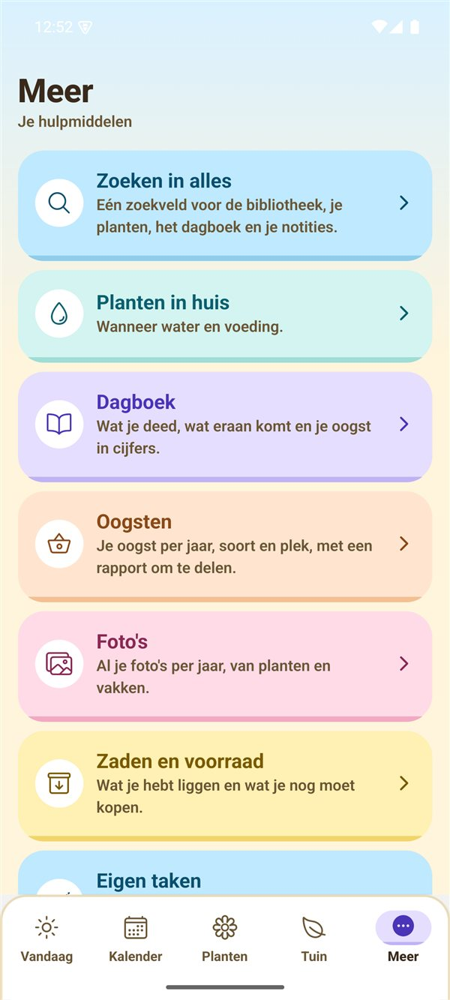

- **Watering with a swipe on Today**: the app remembers when the plant wants water again.
- **Several plants at once**: pick a few and water or feed them in one go (*Meerdere kiezen*, Pick several).
- **Every plant in its own place**: Living room, Kitchen, Study and whatever you come up with yourself.
- Search by name or by another name: "vingeraralia" finds the Schefflera.
- Keep a problem log and add photos.
- Add your own species if your plant is not in the list, with your own photo.
- **Repotting**: a quick undo and a reminder per plant (every year, every 2 or 3 years), with a task on Today when it is time.
- A year card per plant in the calendar (Huis, Jaar) with photo and year bar.

## Diary, photos and harvest

  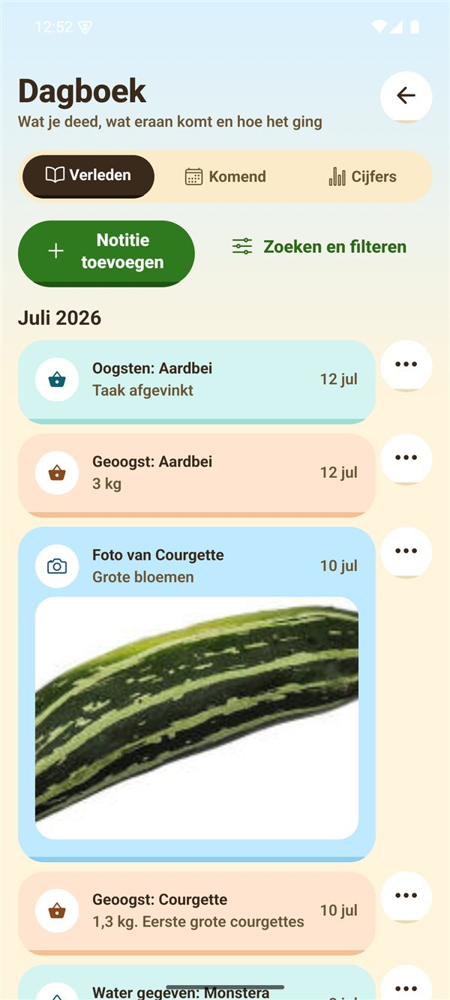
  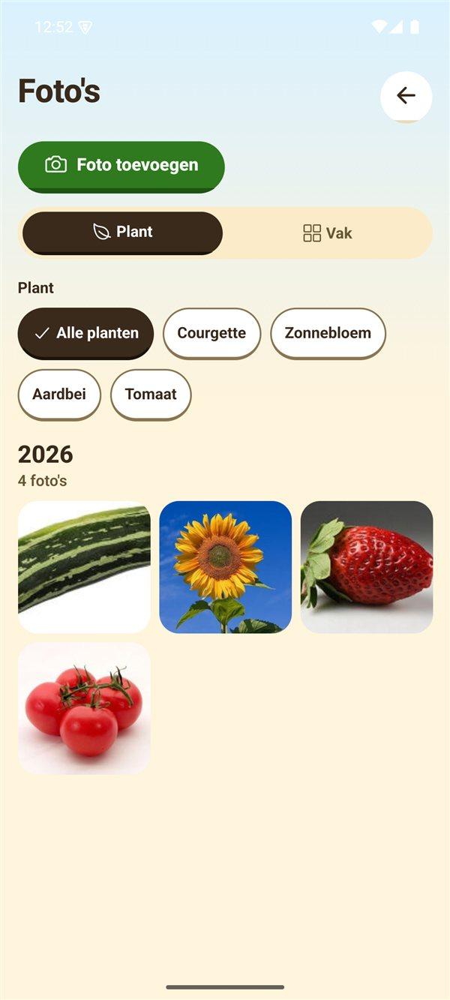
  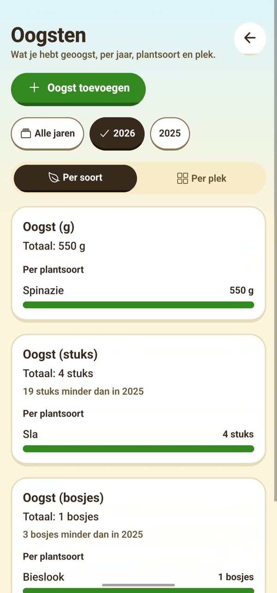
  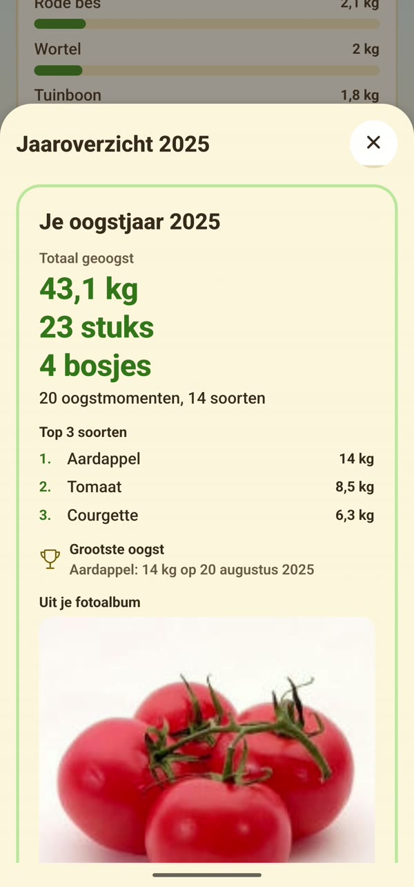

- **Upcoming** (*Komend*): overdue tasks and tasks of this and the coming weeks, ready to tick off. How far ahead you
  may tick off (1 week, 1 month or 3 months) is up to you.
- **History** of what you did, with notes and photos.
- **Figures**: what you harvested, sowed and planted, in a short and a long statistics page, also per year.
- **Harvests** (*Oogsten*) has its own screen (More, Oogsten): per year, species and place, across several years, with
  a report to share and a button to add a harvest.
- **Year card**: per year your totals, records, top 3 and photos from your album. With the Beleving setting you get
  confetti too. Share the card as a picture (PNG).
- **Photo album** per plant, garden or bed, with a timeline. Add your own photo with a three-step wizard.

## Stock and own tasks

  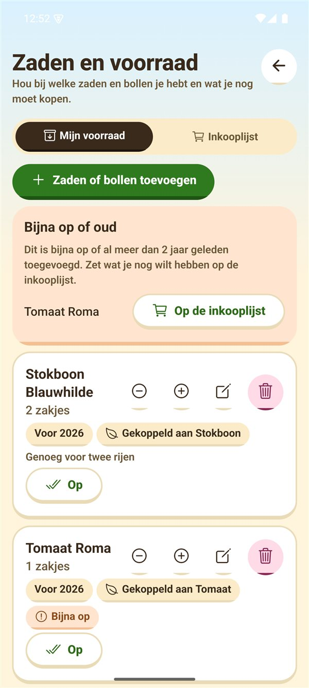
  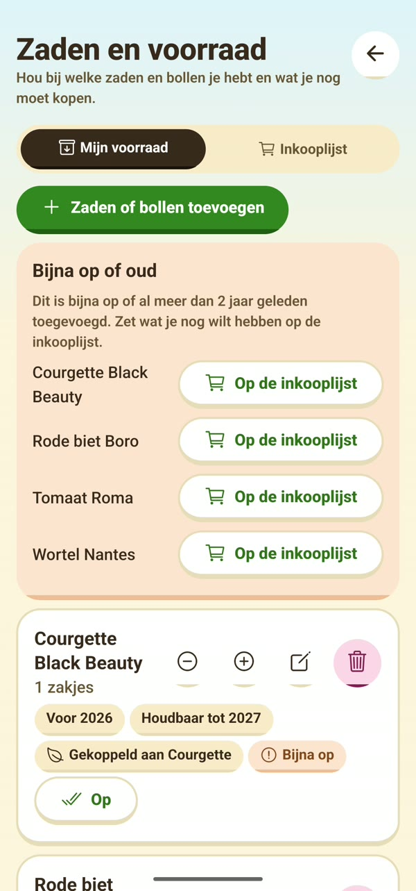
  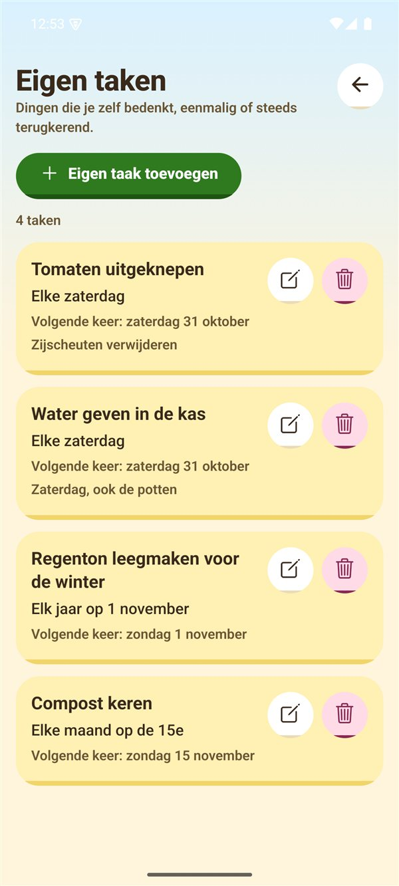

- **Seeds and bulbs**: link name and plant, shelf life (also for several years) and a photo of the packet.
- **Almost out and too old**: the app marks seeds of which one or none is left, and seeds older than two years, with a
  button to the shopping list.
- **Shopping list** from what you need for the coming year, also for the year after.
- **Own tasks**: recurring, and linkable to several plants and beds. Repeats: every week, every 2 weeks, every month,
  every 2 months, every 3 months, every half year, every 9 months, every year, every other year and every 3 years.

## Reminders and weather

- **Notifications** on your device: daily or weekly, and a week overview on Sunday evening.
- **Postpone**: move a task by a day, a week or a number of days you choose.
- **Smart reminder time** (optional): the app picks the moment you usually open it.
- **Backup reminder**: let the app remind you to make a backup (off, 1 week, 2 weeks, 1 month or 3 months).
- **Weather**: forecast from Open-Meteo for your location, with advice for frost, heat, drought or heavy rain.
- **Own frost dates**: set your own last and first frost.

## Widgets

Four widgets for your home screen, which follow the colour-blind palette if you have it switched on:

- **Tuin, teller** (Garden, counter): how many actions you still have to do and how many are late.
- **Tuin, kort overzicht** (Garden, short overview): the next three actions.
- **Tuin, lang overzicht** (Garden, long overview): a list with this month's actions and your progress.
- **Tuin, vandaag** (Garden, today): progress for today, the next action and the weather.

## Search and backup

- **Search everything**: library, your plants, diary, own tasks and stock, with photos in the results.
- **Edible only**: a switch in Search shows only what you can eat. Seed names such as sunflower seed or pumpkin seed find the plant.
- **Backup**: export and import all your data, photos included, or let the app put a backup in a chosen folder
  every week.
- **Year plan as PDF**: a preview on screen first, then open, save or share.

## Appearance and accessibility

The design is called *Tuinwereld* (Garden World): warm cream, thick soft cards, round buttons and a colour per part
(grass, orange, turquoise, purple, yellow, pink and sky).

- **Plantbeeld** (Plant display): choose **Iconen** (a pictogram per plant group), **Tekeningen** (a drawn plant on a
  tile, more than 50 shapes) or **Foto's** (the real photo on a tile; without a photo you see the drawing). It applies
  in lists, tasks, calendar, beds, houseplants and the diorama.
- **Beweging** (Motion): **Rustig** (no animation or vibration), **Subtiel** (pins bounce, a plant pops up when you
  tick Klaar, a light vibration) or **Beleving** (on top of that, confetti at Klaar and clouds and rain above the
  small garden). If your device's reduce-motion setting is on, you always get Rustig.
- **Sky gradient** (*Luchtverloop*, optional, off by default): a colour gradient at the top that follows the time of
  day and the season.
- **Light or dark**, following your device or chosen yourself.
- **Text size**: normal, large or extra large.
- **Colour-blind friendly palette** (Okabe-Ito) for the status colours, also in the widgets.
- Works with **TalkBack** and adapts to **tablets** (two columns on Today, wider layouts).
- Settings are a menu of their own with a screen per group and a search field.

## Simple or advanced

One button at the top right switches advanced on or off. Simple shows only what you need now. Advanced shows all
details and gives you **26 extra functions** in Settings that you switch on or off one by one:

tip with source, tip of the month on Today, houseplant tips, diseases and pests, crop rotation warning,
seed shelf life, weather advice, frost date per region, week overview, calendar export, postponing tasks, smart
reminder time, shade analysis, neighbour check, filling beds automatically, comparing years, background photo of your
garden, photo timeline, harvest chart, shopping list, own tasks on Today, houseplants on Today, plan ahead,
global search, tablet layout and automatic backup.

Nothing is lost when you switch.

## Install

1. Open the **[Releases](../../releases)** page and download the newest `tuinplanner-<version>.apk` on your phone.
2. Open the file. If Android asks, allow installing from this source.
3. Start Tuinplanner. That is all.

The app is made for installing yourself and is not in the Play Store.

**Requirements.** Android 7.0 or newer and a 64-bit phone or tablet (arm64). The installation file is large
(about 155 MB), because the whole plant library with photos is inside; after that everything works without internet.

### Updates

Open **More → Settings** in the app and check for updates. The app finds the newest release here, downloads
it and asks Android to install it. Nothing is installed without your confirmation.

## Privacy

- Everything works offline; your plants, photos and notes stay on your device.
- The app only uses the internet for the optional weather advice (Open-Meteo) and to check for a new version.
- There are no accounts, no advertising and no tracking.

## Frequently asked questions

**Do I have to create an account?** No. There is no account and nothing is sent to a server of ours.

**Does it work without internet?** Yes. Only the weather advice and checking for updates use the internet, and both are optional.

**How do I take my data to a new phone?** Under Settings, Back-up, make an export (with photos) and import it on the
new phone. You can also have a backup put in a folder automatically every week.

**Why does it say "richtwaarde" (guideline value) next to some numbers?** Because the source gives no exact value, or
because we found only one source for it. The app does not pretend it is more certain than that.

**Is a plant missing?** Add it yourself as your own plant or, for houseplants, as your own species.

**Is a plant without a red or yellow card safe?** Not necessarily. The cards Giftig (Poisonous) and Let op (Take care)
only appear on plants for which we found a source.

**Can you not see the films playing?** Download the file from the [`video/`](video/) folder and play it locally.

**Why is the app not in the Play Store?** It is made for installing yourself.

## Version history

A selection of what was added per version. All versions are on the [Releases](../../releases) page.

| Version | What is new |
|---|---|
| **3.4.0** | Onboarding with a sample garden (choose plant display and motion); the app starts about twice as fast and the plant list scrolls more smoothly |
| **3.3.0** | Editing in the diorama, crop rotation warning, garden in numbers, sharing the garden as a picture, harvest year card, quick button, sky gradient, water when it rains, calendar grid |
| **3.2.x** | Favourites, sorting, colour-blind palette and extra large text, backup reminder, calendar with month tiles, watering and fixed order, fixed header with tick and reset in panels |
| **3.1** | Motion (calm, subtle, experience), Settings as a menu of its own |
| **3.0** | New design *Tuinwereld*, plant display with icons, drawings or photos, small garden on Today |
| **2.x** | 143 new trees, shrubs, climbers and perennials (638 plants), category menu, growing tips for 140 extra plants, guideline values marked |
| **1.x** | Swiping on tasks, picking several, houseplants among the tasks, week in the calendar, harvests, repotting, mushrooms and nuts, poisonous or take care |

## Sources and credits

Plant data is compiled from open sources, with a source per plant (see **More → Sources and photos** in the app).
Photos come from Wikimedia Commons under free licences; maker and licence are shown with every photo.
Weather data: Open-Meteo. Toxicity for pets: ASPCA.

## Source code

The source code of this project is private. This repository only contains the releases, the films and this page.

## Questions or ideas

Open an [issue](../../issues). Made with love for nature.
