# Planificador de jardín

[Nederlands](README.md) · [English](README.en.md) · [Deutsch](README.de.md) · [Français](README.fr.md) · **Español**

En tu teléfono, la aplicación y el archivo descargado se llaman *Tuinplanner*. La propia aplicación está en neerlandés; en este texto verás los nombres de menús y botones tal como aparecen en la aplicación (en neerlandés), con una breve explicación en español cuando hace falta.

**Saber qué toca hoy en el jardín y en casa, incluso sin internet.**
El planificador de jardín es una herramienta amigable para Android: te dice cuándo sembrar, plantar, podar y
cosechar, te lo recuerda y lleva el registro de lo que crece en tu jardín y en casa. Sin cuenta, sin anuncios,
sin rastreo: tus datos se quedan en tu teléfono.

  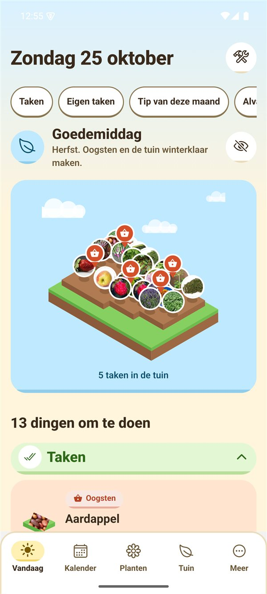
  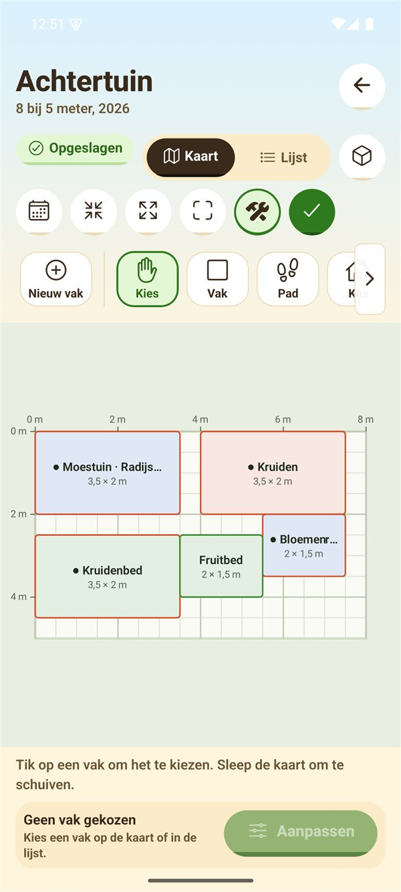
  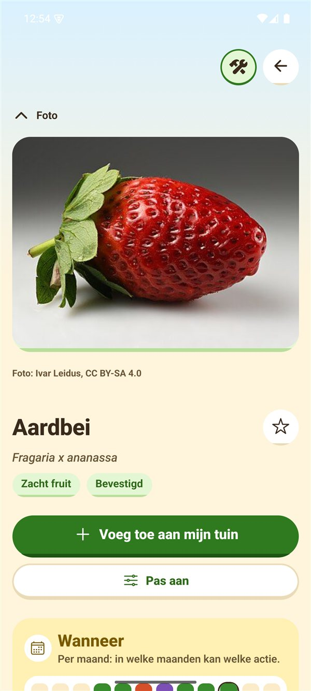
  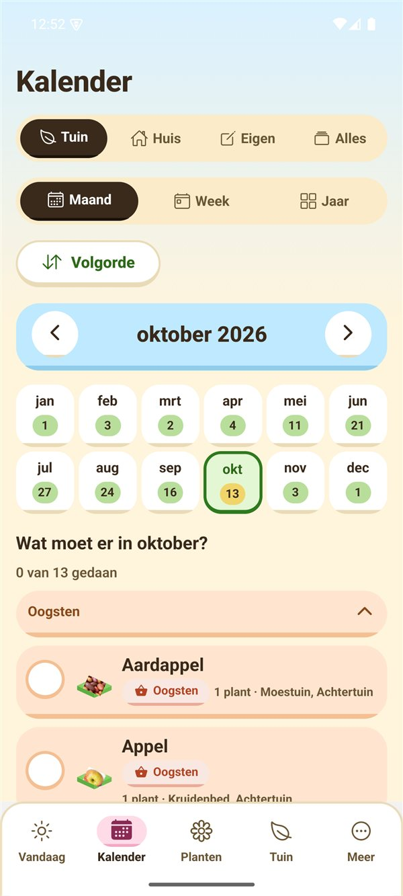

## Contenido

[Mira primero los vídeos](#mira-primero-los-vídeos) · [Por qué](#por-qué) · [En resumen](#en-resumen) ·
[La primera vez](#la-primera-vez) · [Hoy](#hoy) · [Biblioteca](#biblioteca-de-plantas) · [Mi jardín](#mi-jardín) ·
[Diseñar el jardín](#diseñar-el-jardín) · [Calendario](#calendario) · [Plantas de interior](#plantas-de-interior) ·
[Diario, fotos y cosecha](#diario-fotos-y-cosecha) · [Existencias y tareas](#existencias-y-tareas-propias) ·
[Recordatorios y tiempo](#recordatorios-y-tiempo) · [Widgets](#widgets) · [Búsqueda y copia de seguridad](#búsqueda-y-copia-de-seguridad) ·
[Apariencia y accesibilidad](#apariencia-y-accesibilidad) · [Sencillo o avanzado](#sencillo-o-avanzado) ·
[Instalar](#instalar) · [Privacidad](#privacidad) · [Preguntas frecuentes](#preguntas-frecuentes) ·
[Historial de versiones](#historial-de-versiones)

## Mira primero los vídeos

Cuatro vídeos cortos muestran la aplicación en uso, cada uno con un jardinero distinto. Los datos de los vídeos son
inventados; las imágenes son grabaciones de la aplicación real (versión 3.4.0). Haz clic en una imagen para abrir y
reproducir el vídeo. Los vídeos están en neerlandés.

<table>
  <tr>
    <td align="center" width="50%">
      <a href="video/tuinplanner-lotte.mp4">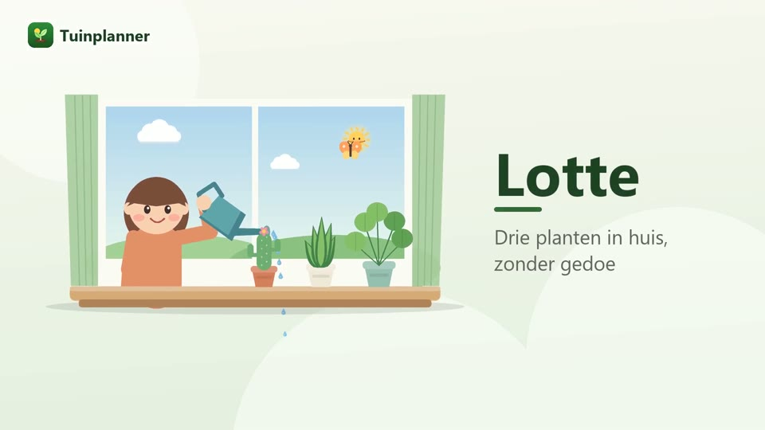</a> 
      <b>Lotte: tres plantitas en casa</b> (1:33) 
      Marcar el riego con un solo deslizamiento, abrir y añadir una planta, y verlo todo en el calendario. En la
      vista sencilla.
    </td>
    <td align="center" width="50%">
      <a href="video/tuinplanner-daan.mp4">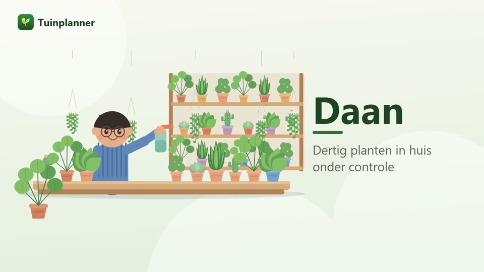</a> 
      <b>Daan: treinta plantas en casa</b> (3:05) 
      Filtrar por riego o abono, cuidar varias plantas a la vez, buscar, y el calendario por semana y por mes.
    </td>
  </tr>
  <tr>
    <td align="center" width="50%">
      <a href="video/tuinplanner-joost.mp4">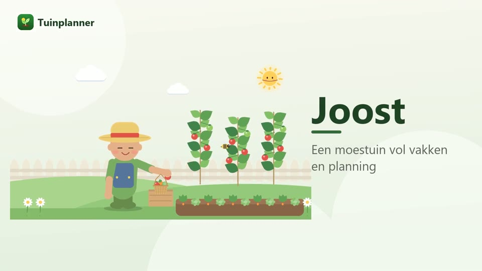</a> 
      <b>Joost: el huerto</b> (3:48) 
      Lo que toca poner en la tierra ahora, editar el jardín como diorama, un aviso de rotación de cultivos, la
      cosecha por año con la tarjeta anual, y la lista de compra de semillas.
    </td>
    <td align="center" width="50%">
      <a href="video/tuinplanner-ria.mp4">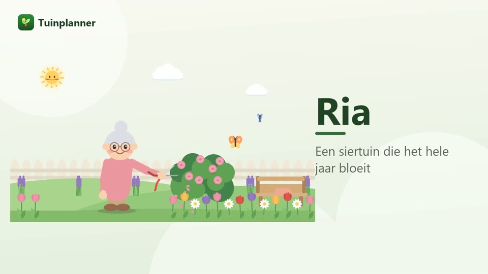</a> 
      <b>Ria: el jardín ornamental</b> (3:30) 
      Borduras y arbustos en una sola imagen, consejo de poda y época de floración por planta, podar desde el
      calendario, diario con fotos y bulbos en la lista de compra.
    </td>
  </tr>
</table>

Los vídeos están como archivos normales en la carpeta [`video/`](video/) (en total unos 40 MB). Si no ves ningún
reproductor, descarga el archivo y ábrelo en tu ordenador o teléfono.

## Por qué

Un jardín pide atención en el momento justo: sembrar tarde, olvidar regar o perder la ventana de poda. El
planificador de jardín ordena esos momentos por ti. Eliges lo que cultivas y la aplicación muestra por día lo que
toca, con explicaciones y fuentes. Funciona totalmente sin conexión; la biblioteca de plantas está dentro de la
aplicación.

¿Para quién es? Para quien tiene tres plantas de interior y no quiere olvidarse de regarlas, para quien tiene un
huerto y quiere saber qué toca poner en la tierra este mes y qué había el año pasado, y para quien ama un jardín
ornamental con rosas, hortensias y arbustos que hay que podar a tiempo. Con el botón Sencillo o Avanzado (*Simpel*
o *Geavanceerd*) decides tú cuánto ves.

## En resumen

| Apartado | Qué obtienes |
|---|---|
| **Vandaag** (Hoy) | Las tareas de ahora, un jardincito con pins en los bancales donde hay algo que hacer, avisos del tiempo y tus favoritas |
| **Plantenbibliotheek** (Biblioteca de plantas) | 638 plantas, 21 plantas de bulbo y 156 plantas de interior (794 plantas en total en la lista), con foto, fuente y consejos de cultivo |
| **Mijn tuin** (Mi jardín) | Tus plantas por año y por bancal, cosecha y planificación, jardín en cifras, compartir como imagen |
| **Tuin ontwerpen** (Diseñar el jardín) | Dibujar bancales, editar en el diorama, sol y sombra, vecinas y rotación de cultivos |
| **Kalender** (Calendario) | Mes, semana y año para jardín, casa y tareas propias, con un orden que fijas tú |
| **Planten in huis** (Plantas de interior) | Ritmo de riego y abono por planta, trasplante, toxicidad para mascotas, registro |
| **Dagboek, foto's en oogst** (Diario, fotos y cosecha) | Lo que hiciste, lo que viene, tu cosecha por año y una tarjeta anual para compartir |
| **Voorraad en taken** (Existencias y tareas) | Semillas y bulbos, lista de compra, tareas propias recurrentes |
| **Herinneringen en weer** (Recordatorios y tiempo) | Notificaciones, aplazar, tiempo de Open-Meteo, widgets para tu pantalla de inicio |
| **Uiterlijk** (Apariencia) | Imagen de las plantas (iconos, dibujos o fotos), movimiento, tema oscuro, paleta para daltonismo, texto grande |
| **Gegevens** (Datos) | Sin conexión, sin cuenta, copia de seguridad con fotos, plan anual en PDF |

## La primera vez

La primera vez que abres la aplicación pasas por cuatro pasos cortos, que también puedes saltarte:

1. **Welkom** (Bienvenida). Qué hace la aplicación de un vistazo: funciona sin internet, tus datos se quedan en tu dispositivo, todo se puede ajustar.
2. **Hoeveel wil je zien?** (¿Cuánto quieres ver?) Elige Sencillo o Avanzado. Siempre puedes cambiarlo.
3. **Zo ziet je tuin eruit** (Así se ve tu jardín). Un jardincito de ejemplo se adapta al instante cuando eliges entre
   **Iconen** (iconos), **Tekeningen** (dibujos) o **Foto's** (fotos), en *Plantbeeld* (imagen de las plantas), y entre
   **Rustig** (tranquilo), **Subtiel** (sutil) o **Beleving** (vivencia), en *Beweging* (movimiento).
4. **Wil je een herinnering?** (¿Quieres un recordatorio?) Elige si quieres notificaciones y a qué hora.

  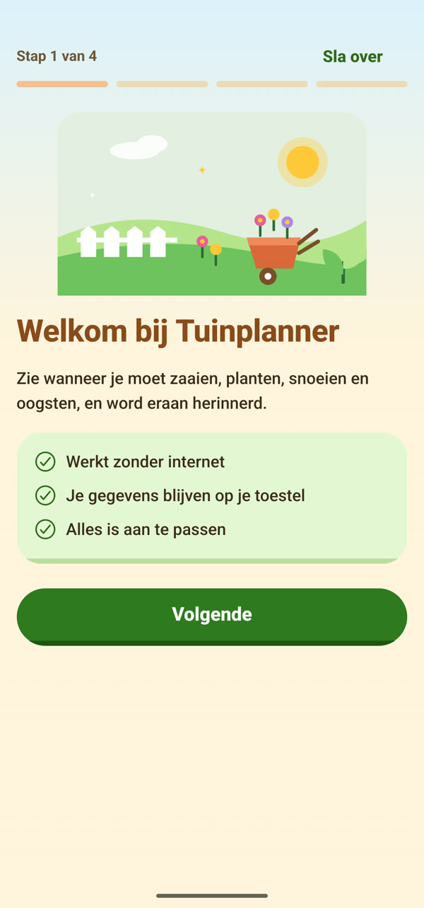
  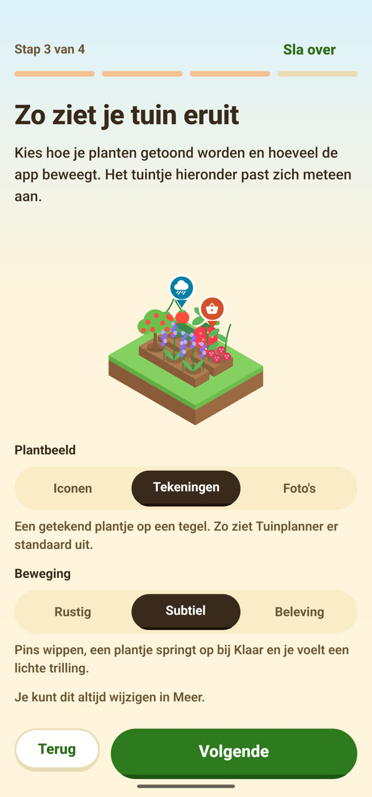
  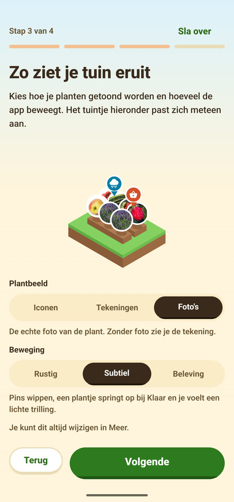

## Hoy

La pantalla de inicio (*Vandaag*) muestra las tareas del momento: sembrar, sembrar en semillero, plantar, podar,
cosechar, regar y abonar. Arriba hay un saludo con una frase sobre la estación y un jardincito (diorama) con pins en
los bancales donde hay algo que hacer. Toca el jardincito para abrir el jardín.

  
  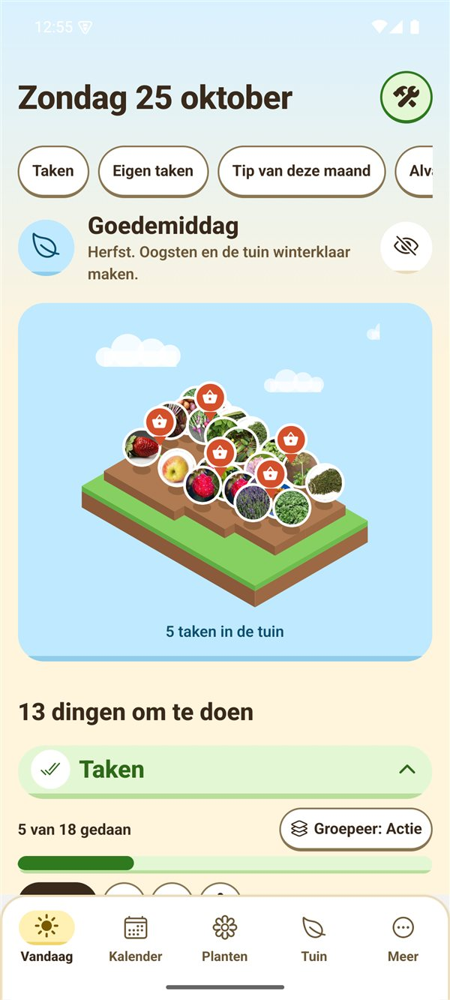
  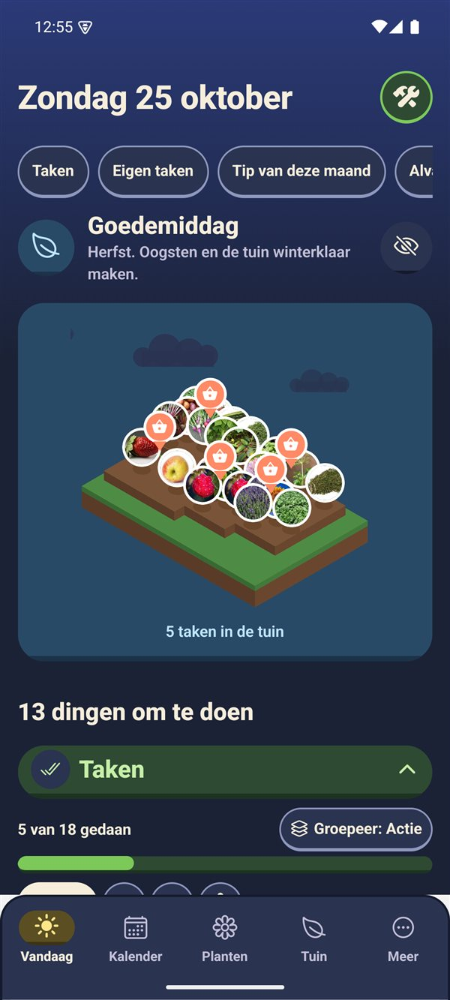

- **Márcalas con un toque.** Una cosecha pregunta enseguida cuánto has recogido, para que tu diario sea correcto.
- **Deslizar.** Desliza una tarea a la izquierda para marcarla y a la derecha para aplazarla. En *Instellingen*
  (Ajustes) puedes invertirlo o desactivarlo. Un breve aviso con *Ongedaan* (Deshacer) te deja corregir un error, y
  las tareas hechas salen de la lista.
- **Elegir varias a la vez.** Mantén pulsada una fila o tarjeta para elegir más; abajo aparecen las acciones (añadir
  a tu lista, cambiar el estado, eliminar). Sin selección no están. También funciona en el diario y en los
  resultados de búsqueda.
- **Later** (Más tarde): aplaza una tarea hasta mañana, la semana que viene o un número de días que elijas.
- **Agrupar y filtrar** por acción, planta o bancal, con chips para riego, abono y trasplante de las plantas de interior.
- **Plantas de interior entre las tareas**: riego, abono y trasplante aparecen como filas normales en la lista y
  cuentan en tu progreso. Tú eliges si van plegadas arriba o abajo.
- **Tus favoritas**: una fila con las plantas a las que has puesto una estrella.
- **Botón rápido**: un botón flotante con Notitie (nota), Foto y Oogst (cosecha), para anotar algo enseguida mientras
  estás en el jardín. Se puede desactivar en Ajustes.
- **Planificar con antelación** (*Alvast plannen*): mira qué viene en los próximos meses.
- **Consejo del mes** para las plantas que tienes, con fuente.
- **Aviso del tiempo**: advertencia por helada, calor, sequía o mucha lluvia, con el nombre de tus plantas sensibles a la helada.
- **Riego y lluvia**: si se prevé lluvia, la aplicación propone saltarse hoy tus tareas propias de riego. Tú lo
  confirmas con un toque. Solo funciona con tareas propias que lleven una palabra de riego en el título, porque para
  las plantas de exterior no existe en los datos un calendario de riego.
- **Resumen anual en diciembre y enero**: una invitación a mirar y compartir tu año de cosecha.
- **Novedades**: tras una actualización aparece una sola vez una tarjeta con lo que ha cambiado. Se puede desactivar.
- En una tableta, «Hoy» se muestra en dos columnas.

## Biblioteca de plantas

638 plantas y 21 plantas de bulbo para tu jardín, más 156 plantas de interior, cada una con los meses de siembra,
plantación, poda y cosecha, distancia, ubicación, buenos y malos vecinos, fotos y fuentes. Son 794 plantas en la lista.

  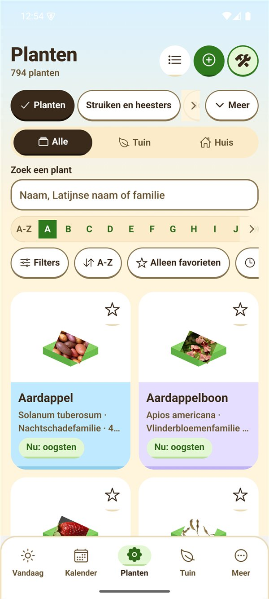
  
  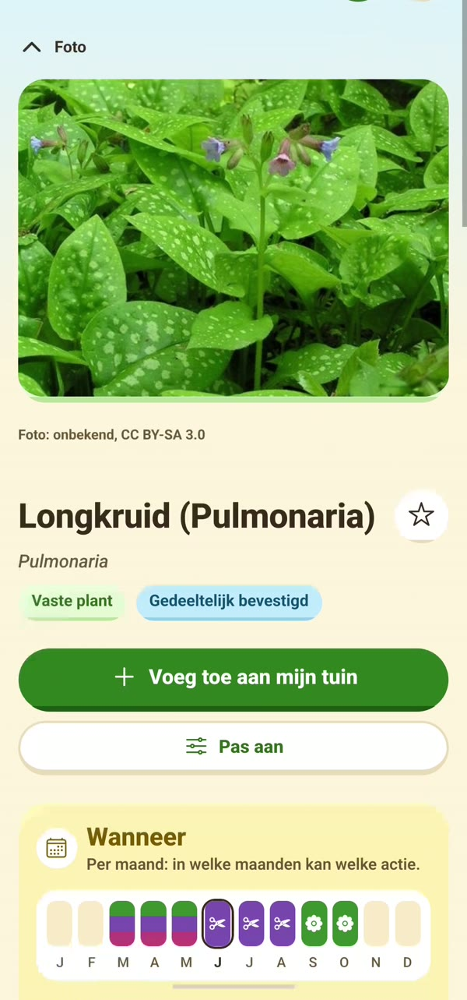
  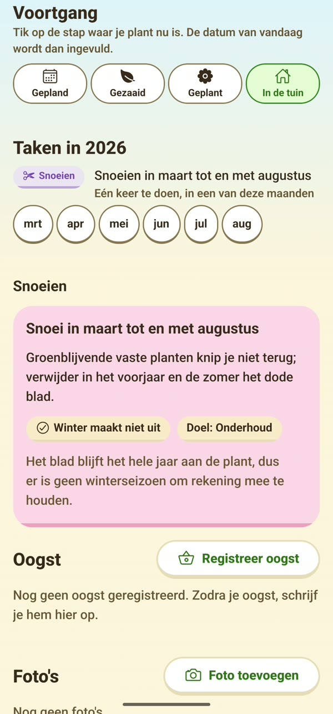

- **Mucho más que hortalizas.** Árboles, coníferas, arbustos, trepadoras, plantas tapizantes, perennes, gramíneas
  ornamentales, rosales, plantas de seto, abonos verdes, frutas y bayas, hierbas aromáticas, verduras silvestres,
  setas y frutos secos. El menú de categorías tiene 17 categorías; dos las fijas como acceso rápido en la barra.
- **Consejos de cultivo por mes**, con la fuente. Para 590 plantas están en la biblioteca, tomados de páginas de
  cultivo de, entre otras, la RHS; una parte se basa en el grupo de especies y no en la especie misma. Lo que no se
  puede respaldar, no aparece.
- **Consejo de poda** en cada planta, incluido si conviene esperar a después del invierno y cuál es el objetivo
  (mantenimiento, rejuvenecimiento).
- **Los valores orientativos están marcados.** En distancia de plantación, floración y meses de poda que proceden de
  una sola fuente, están redondeados o deducidos, aparece «(richtwaarde)», es decir, valor orientativo. Los meses
  de plantación y poda de los árboles y arbustos más recientes proceden en parte de guías generales de la RHS y son
  indicativos.
- **Enfermedades y plagas** con cómo reconocerlas y prevenirlas, y una fuente.
- **Filtros y orden** por grupo, función, familia, ubicación, distancia de plantación, fiabilidad, acción y mes. Los
  títulos se pliegan y recuerdan su estado. Ordena por A-Z, sembrar ahora, favoritas primero o vistas por última vez.
- **Opciones rápidas** como «Kan nu» (Se puede ahora), «Nu zaaien» (Sembrar ahora) y «Nu planten» (Plantar ahora),
  con una barra A-Z que se queda arriba mientras te desplazas.
- **Cuadrícula, lista o compacto**: tres formas de mostrar la biblioteca.
- **Alle, Tuin of Huis** (Todas, Jardín o Casa): la lista muestra la biblioteca del jardín, las plantas de interior o ambas.
- **Favoritas**: pon una estrella a una planta (en la lista o en la ficha) y filtra por «Alleen favorieten» (solo favoritas).
- **Setas y frutos secos**: 21 setas comestibles para cultivar y 27 frutos secos, semillas y cultivos afines, con
  notas de cultivo y fuente. Se indican las confusiones venenosas, y con el cáñamo solo una advertencia legal.
- **Venenoso o precaución**: 259 plantas tienen una tarjeta roja *Giftig* (venenoso, 84) o amarilla *Let op*
  (precaución, 175), con fuente. Sin tarjeta, una planta no es necesariamente segura.
- **Añadir tu propia planta** si la tuya no está en la lista.
- Fotos de Wikimedia Commons, siempre con autor y licencia. En la ficha puedes plegar la foto o hacerla más pequeña.

## Mi jardín

Las plantas que cultivas o quieres cultivar, por año y por bancal.

  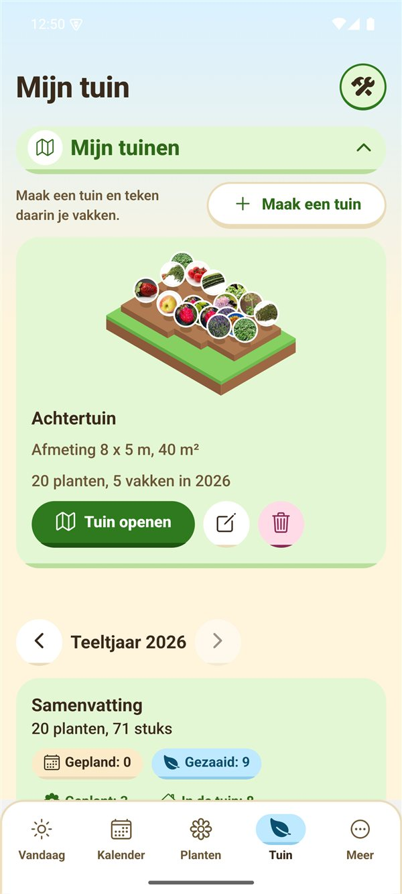
  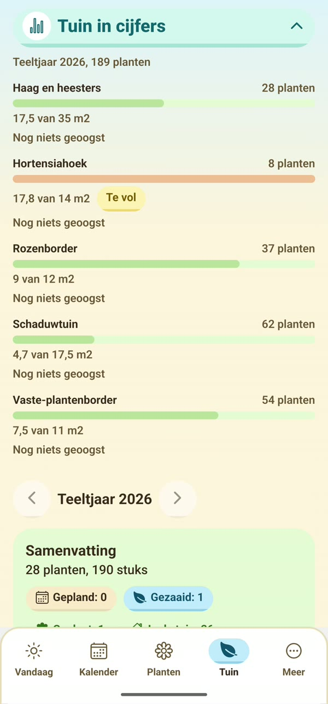
  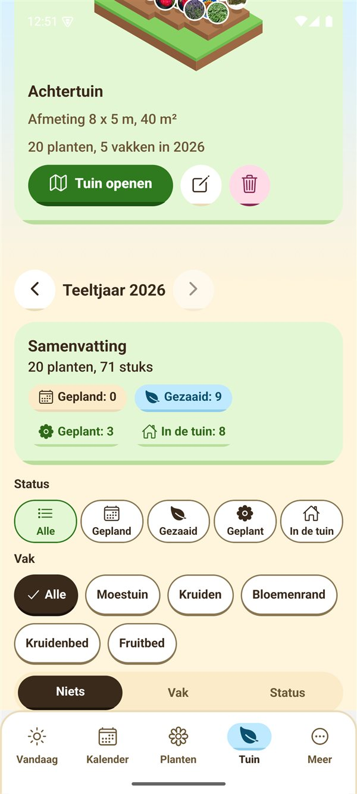
  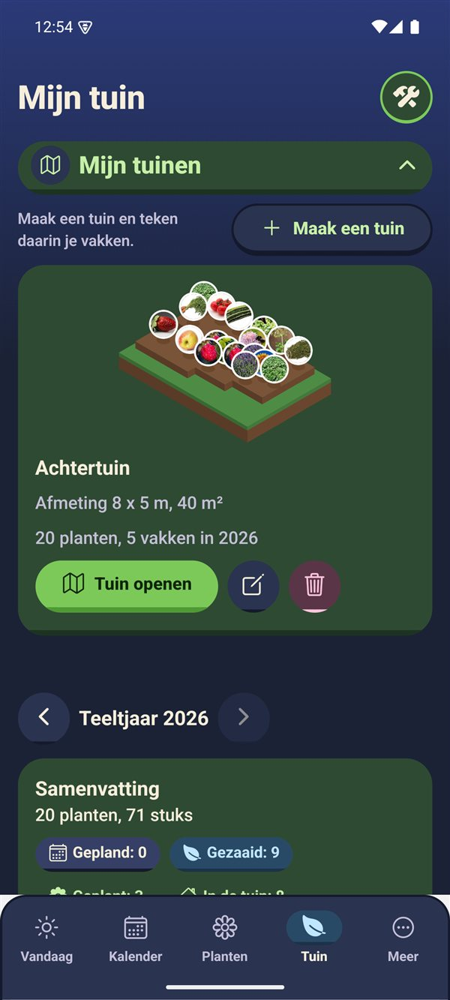

- Por planta: cantidad, bancal, variedad, fecha de siembra y plantación, estado (planeada, sembrada, plantada, en el
  jardín), cosechas, fotos y notas.
- **Varios jardines**, cada uno con sus propias medidas (la aplicación calcula la superficie) y su propio diorama.
- **Las perennes** vuelven solas cada año.
- **Cosecha y planificación por año**: mira cuántas de cada especie has planeado, con el espacio que ocupan, cuántas
  caben todavía en un bancal, y una barra anual por especie. Ajusta las cantidades y copia la planificación de este
  año al siguiente.
- **Tuin in cijfers** (Jardín en cifras): por bancal, la ocupación en metros cuadrados, el número de plantas y la
  cosecha de este año, con una marca *Leeg* (vacío), *Bijna leeg* (casi vacío) o *Te vol* (demasiado lleno).
- **Compartir como imagen**: convierte tu jardín en una imagen para compartir con familia o vecinos.
- Una planta se elimina con una pulsación larga o la papelera, siempre con confirmación.
- ¿Editas una planta desde un bancal? Al cerrar vuelves a ese bancal, no al jardín.

## Diseñar el jardín

Dibuja tu jardín con bancales y mira qué cabe dónde. En el editor alternas entre **Kaart** (mapa, vista cenital),
**Lijst** (lista) y **Diorama** (una imagen isométrica con baldosas, plantas y pins).

  
  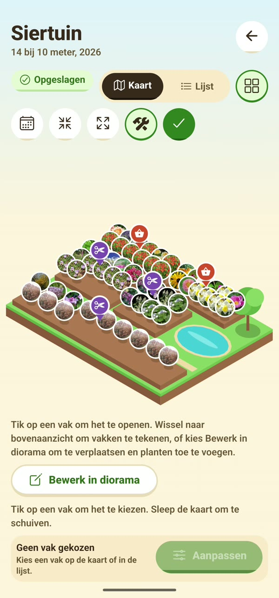
  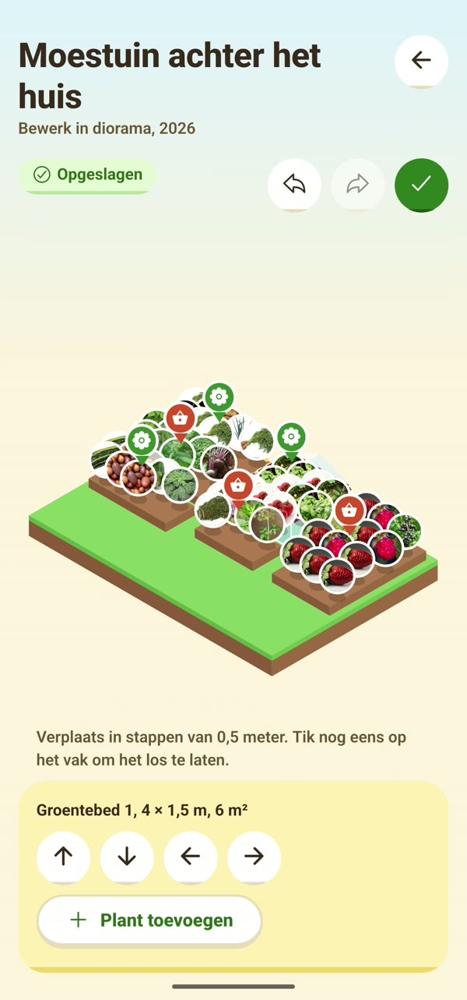
  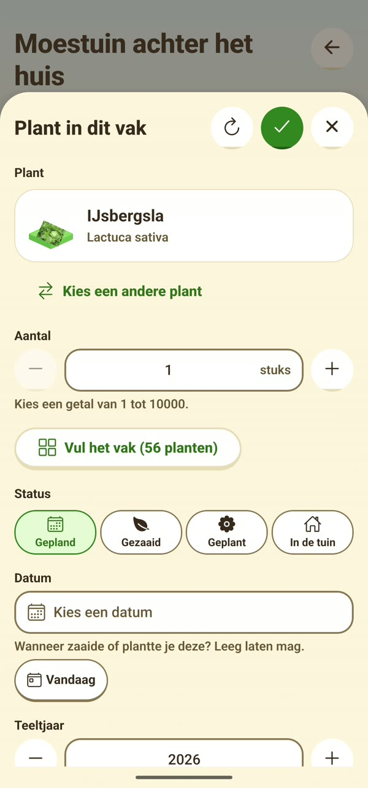

- **Bancales** con medidas, plantas y una foto de fondo de tu propio jardín. También caminos, agua, árboles e invernaderos.
- **Editar en el diorama**: elige un bancal tocándolo, muévelo con flechas en pasos de medio metro (la aplicación
  vigila el borde y las colisiones), añade una planta y deshaz o rehaz. Arrastrar con el dedo no existe.
- **Rotación de cultivos** (*wisselteelt* o *vruchtwisseling*): si la misma familia de plantas está demasiado poco
  tiempo en el mismo sitio, el bancal recibe un borde rojo punteado y una tarjeta de aviso con explicación. Ese borde
  también lo ves en Mi jardín y en Hoy.
- **Sol y sombra**: la aplicación calcula la posición del sol para el 21 de junio y tiene en cuenta árboles e invernaderos.
- **Vecinas**: un aviso cuando plantas contiguas no se llevan bien.
- **Llenar el bancal**: la aplicación calcula cuántas plantas caben con la distancia correcta.
- **Comparar y copiar años**: mira qué había en un bancal el año pasado y copia un año al siguiente.
- **Cabecera fija en cada panel**: en los formularios de un panel, la marca de verificación, un icono de reinicio y la
  cruz están siempre visibles arriba. La marca solo se puede pulsar cuando algo ha cambiado y todo es correcto; el
  reinicio lo devuelve todo a como estaba.

  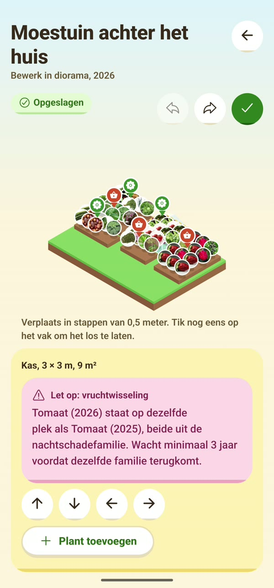

## Calendario

  
  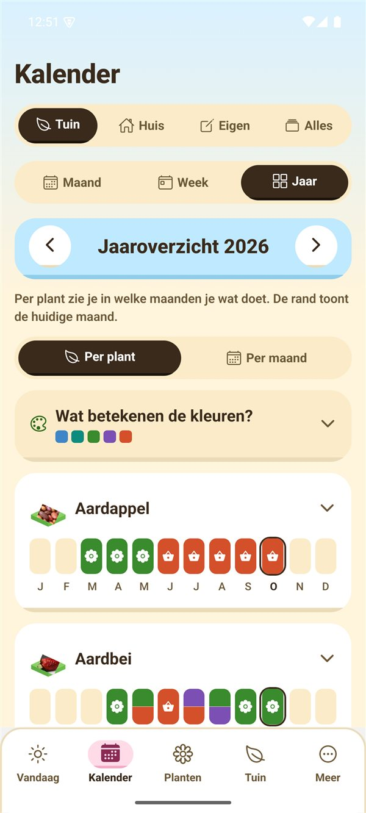
  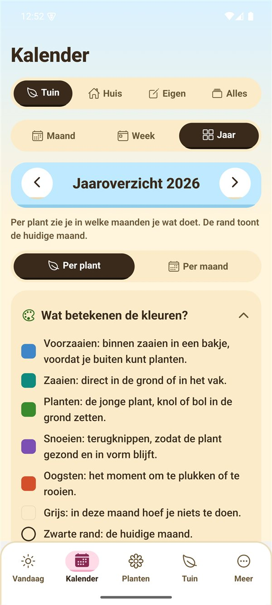
  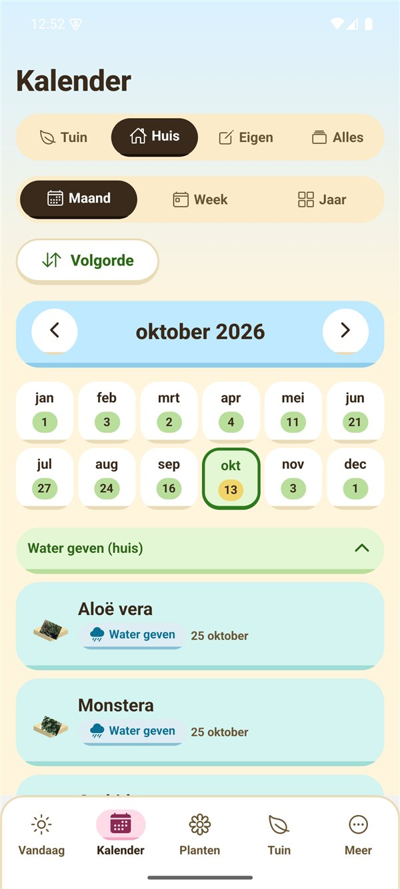

- **Maand** (Mes), **Week** (Semana) o **Jaar** (Año), para **Tuin** (Jardín), **Huis** (Casa), **Eigen** (Propias) o
  **Alles** (Todo). En Ajustes eliges lo que ves primero.
- **Baldosas de mes**: cada mes es una baldosa tranquila con el nombre y el número de tareas en una insignia redonda.
- **Riego en el calendario**: el riego y el abono de las plantas de interior aparecen en la lista del mes y en la
  vista semanal con cada fuente excepto Propias.
- **Un orden que fijas tú**: con el botón *Volgorde* (orden) subes o bajas cosechar, podar, plantar, sembrar, sembrar
  en semillero, regar, abonar y tareas propias. La elección se guarda y determina también la disposición dentro de un día.
- El **resumen anual** muestra barras de colores por planta, con un icono cuando un mes tiene una sola acción. Eliges
  entre *Per plant* (por planta), *Per maand* (por mes) y una *Raster* (cuadrícula).
- **Semana**: tus tareas propias y el riego y abono de las plantas de interior, día a día, y arriba «Nog te doen»
  (Pendiente). Los grupos están abiertos si queda algo por hacer y se cierran cuando todo está hecho. Mantén pulsado
  un bloque de mes de color para ver qué significan los colores.
- Tareas propias por semana; las semanas vacías están ocultas por defecto. Las pantallas vacías tienen un botón para añadir algo.
- Exporta las tareas al calendario de tu teléfono (archivo ICS).

## Plantas de interior

156 especies de plantas de interior con foto, fuente y valores orientativos. Por especie obtienes el ritmo de
riego y abono, la ubicación, consejos por mes y si la planta es tóxica para las mascotas (según la ASPCA).

  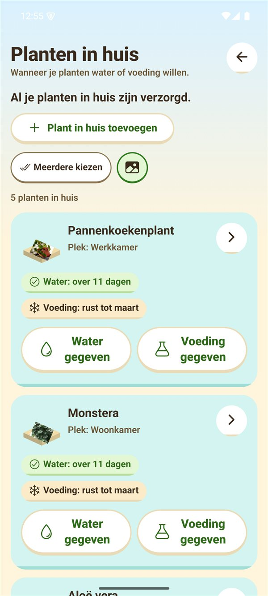
  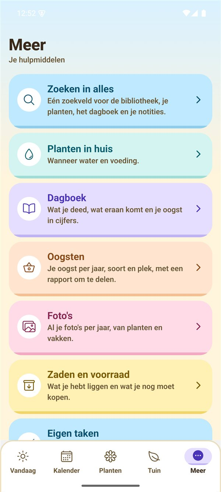

- **Regar con un deslizamiento en Hoy**: la aplicación recuerda cuándo la planta vuelve a necesitar agua.
- **Varias plantas a la vez**: elige unas cuantas y dales agua o abono de una vez («Meerdere kiezen», elegir varias).
- **Cada planta en su sitio**: Woonkamer (salón), Keuken (cocina), Werkkamer (despacho) y lo que se te ocurra.
- Busca por nombre o por otro nombre: «vingeraralia» encuentra la schefflera.
- Lleva un registro de problemas y añade fotos.
- Añade tu propia especie si tu planta no está en la lista, con tu propia foto.
- **Trasplante**: deshacer rápido y un recordatorio por planta (cada año, cada 2 o 3 años), con una tarea en Hoy cuando toca.
- Una tarjeta anual por planta en el calendario (Huis, Jaar), con foto y barra anual.

## Diario, fotos y cosecha

  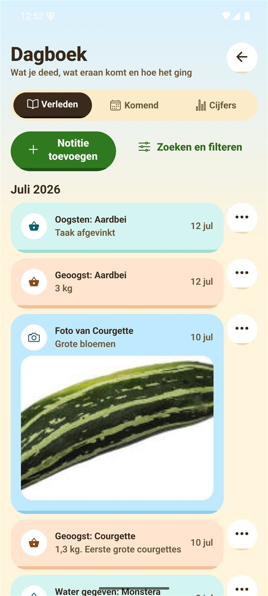
  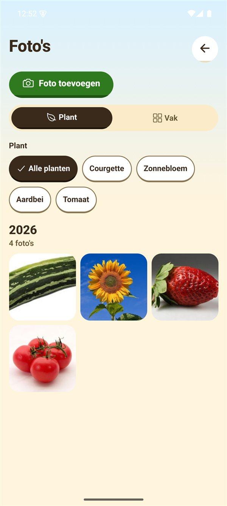
  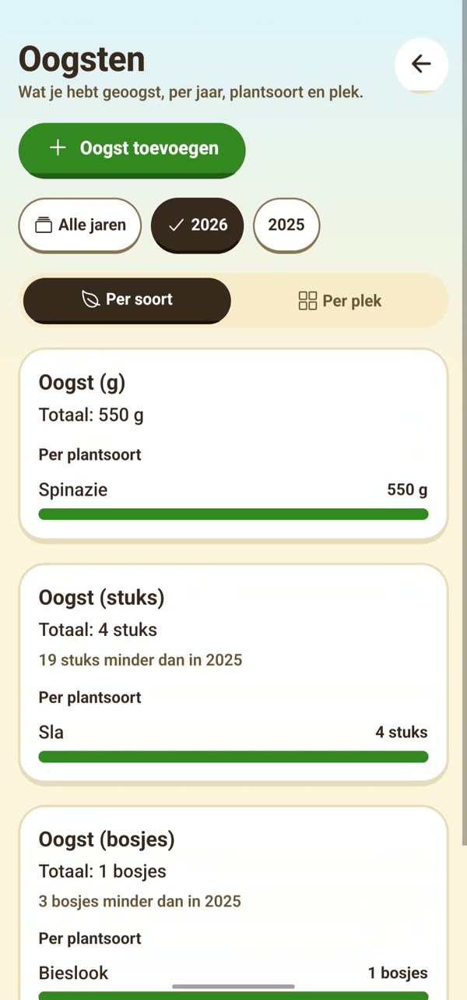
  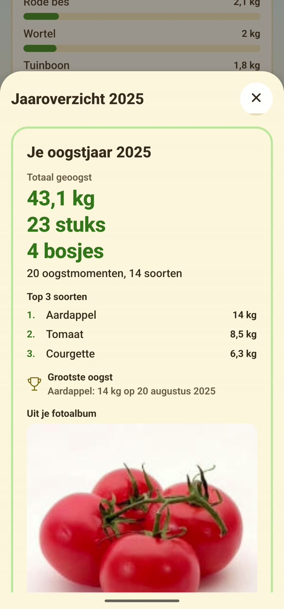

- **Komend** (Próximas): tareas atrasadas y tareas de esta semana y las siguientes, listas para marcar. Hasta dónde
  puedes marcar por adelantado (1 semana, 1 mes o 3 meses) lo ajustas tú.
- **Geschiedenis** (Historial) de lo que hiciste, con notas y fotos.
- **Cijfers** (Cifras): lo que has cosechado, sembrado y plantado, en una página de estadísticas corta y otra larga, también por año.
- **Oogsten** (Cosechas) tiene su propia pantalla (Meer, Oogsten): por año, especie y lugar, en varios años, con un
  informe para compartir y un botón para añadir una cosecha.
- **Jaarkaart** (tarjeta anual): por año tus totales, récords, el top 3 y fotos de tu álbum. Con el ajuste Beleving
  se añade confeti. Comparte la tarjeta como imagen (PNG).
- **Álbum de fotos** por planta, jardín o bancal, con línea de tiempo. Añade tu propia foto con un asistente de tres pasos.

## Existencias y tareas propias

  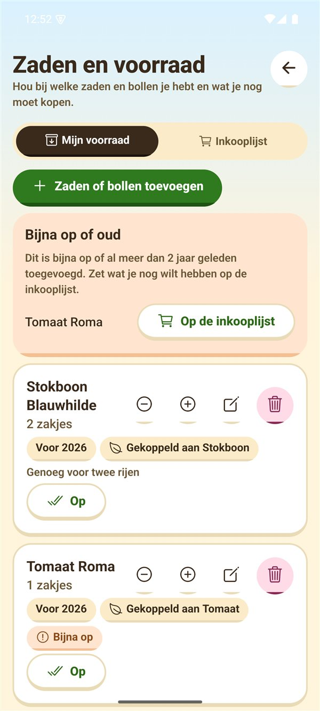
  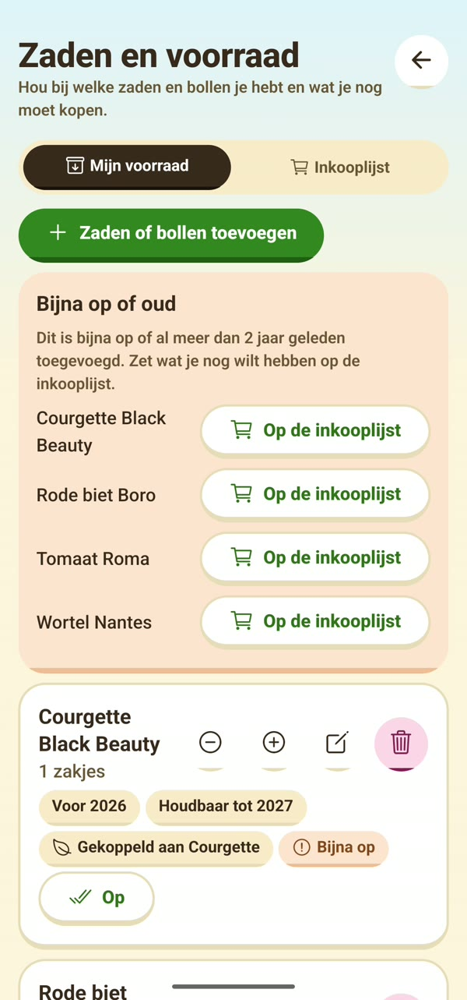
  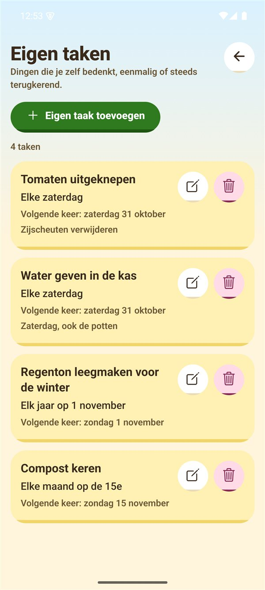

- **Semillas y bulbos**: vincula nombre y planta, caducidad (también para varios años) y una foto del sobre.
- **Casi agotadas y demasiado viejas**: la aplicación marca las semillas de las que queda una o menos y las de más de
  dos años, con un botón hacia la lista de compra.
- **Lista de compra** a partir de lo que necesitas para el próximo año, también para el año siguiente.
- **Tareas propias**: recurrentes y vinculables a varias plantas y bancales. Repeticiones: cada semana, cada 2
  semanas, cada mes, cada 2 meses, cada 3 meses, cada medio año, cada 9 meses, cada año, cada 2 años y cada 3 años.

## Recordatorios y tiempo

- **Notificaciones** en tu dispositivo: diarias o semanales, y un resumen de la semana el domingo por la noche.
- **Aplazar**: mueve una tarea un día, una semana o un número de días que elijas.
- **Hora de recordatorio inteligente** (opcional): la aplicación elige el momento en que sueles abrirla.
- **Recordatorio de copia de seguridad**: deja que la aplicación te recuerde hacer una copia (desactivado, 1 semana, 2
  semanas, 1 mes o 3 meses).
- **Tiempo**: previsión de Open-Meteo para tu lugar, con consejos por helada, calor, sequía o mucha lluvia.
- **Fechas de helada propias**: ajusta tú mismo tu última y tu primera helada.

## Widgets

Cuatro widgets para tu pantalla de inicio, que siguen la paleta para daltonismo si la tienes activada:

- **Tuin, teller** (Jardín, contador): cuántas acciones te quedan y cuántas van con retraso.
- **Tuin, kort overzicht** (Jardín, resumen corto): las tres próximas acciones.
- **Tuin, lang overzicht** (Jardín, resumen largo): una lista con las acciones de este mes y tu progreso.
- **Tuin, vandaag** (Jardín, hoy): el progreso de hoy, la próxima acción y el tiempo.

## Búsqueda y copia de seguridad

- **Buscar en todo**: biblioteca, tus plantas, diario, tareas propias y existencias, con fotos en los resultados.
- **Solo comestible** (*Alleen eetbaar*): un interruptor en la búsqueda muestra solo lo que se puede comer. Nombres de
  semillas como pipa de girasol o de calabaza llevan a la planta.
- **Copia de seguridad**: exporta e importa todos tus datos, fotos incluidas, o deja que la aplicación guarde cada
  semana una copia automática en una carpeta elegida.
- **Plan anual en PDF**: primero una vista previa en pantalla y luego abrir, guardar o compartir.

## Apariencia y accesibilidad

El diseño se llama *Tuinwereld* (mundo del jardín): crema cálido, tarjetas gruesas y suaves, botones redondos y colores
por apartado (hierba, naranja, turquesa, morado, amarillo, rosa y cielo).

- **Plantbeeld** (imagen de las plantas): elige **Iconen** (un pictograma por grupo de plantas), **Tekeningen** (una
  plantita dibujada sobre una baldosa, más de 50 formas) o **Foto's** (la foto real sobre una baldosa; sin foto ves el
  dibujo). Vale para listas, tareas, calendario, bancales, plantas de interior y el diorama.
- **Beweging** (movimiento): **Rustig** (sin animación ni vibración), **Subtiel** (los pins se balancean, una plantita
  salta al marcar «Klaar», una vibración ligera) o **Beleving** (además, confeti al marcar «Klaar» y nubes y lluvia
  sobre el jardincito). Si en tu dispositivo está activada la reducción de movimiento, siempre obtienes Rustig.
- **Cielo cambiante** (*Luchtverloop*, opcional, desactivado por defecto): un degradado de color arriba que sigue la
  hora y la estación.
- **Claro u oscuro**, según tu dispositivo o a tu elección.
- **Tamaño de texto**: normal, grande o extra grande.
- **Paleta apta para daltonismo** (Okabe-Ito) para los colores de estado, también en los widgets.
- Funciona con **TalkBack** y se adapta a **tabletas** (dos columnas en Hoy, disposiciones más anchas).
- Los ajustes son un menú propio con una pantalla por grupo y un campo de búsqueda.

## Sencillo o avanzado

Un botón arriba a la derecha activa o desactiva el modo avanzado. Sencillo muestra solo lo que necesitas ahora.
Avanzado muestra todos los detalles y te da **26 funciones adicionales** en los ajustes, que activas o desactivas
una por una:

consejo con fuente, consejo del mes en Hoy, consejos de plantas de interior, enfermedades y plagas, aviso de
rotación de cultivos, caducidad de las semillas, aviso del tiempo, fecha de helada por región, resumen semanal,
exportar al calendario, aplazar tareas, hora de recordatorio inteligente, análisis de sombra, control de vecinas,
llenar bancales automáticamente, comparar años, foto de fondo de tu jardín, línea de tiempo de fotos, gráfico de
cosecha, lista de la compra, tareas propias en Hoy, plantas de interior en Hoy, planificar con antelación, búsqueda
global, disposición para tableta y copia de seguridad automática.

No se pierde nada al cambiar.

## Instalar

1. Abre la página **[Releases](../../releases)** y descarga en tu teléfono el último `tuinplanner-<versión>.apk`.
2. Abre el archivo. Si Android lo pide, permite instalar desde esta fuente.
3. Inicia Tuinplanner. Listo.

La aplicación está pensada para instalarla por tu cuenta y no está en Play Store.

**Requisitos.** Android 7.0 o posterior y un teléfono o tableta de 64 bits (arm64). El archivo de instalación es
grande (unos 155 MB), porque lleva dentro toda la biblioteca de plantas con fotos; después todo funciona sin internet.

### Actualizaciones

En la aplicación abre **Meer, Instellingen** (Más, Ajustes) y busca actualizaciones. La aplicación encuentra aquí la
última versión, la descarga y pide a Android que la instale. No se instala nada sin tu confirmación.

## Privacidad

- Todo funciona sin conexión; tus plantas, fotos y notas se quedan en tu dispositivo.
- La aplicación solo usa internet para los consejos del tiempo opcionales (Open-Meteo) y para buscar una versión nueva.
- Sin cuentas, sin publicidad y sin rastreo.

## Preguntas frecuentes

**¿Tengo que crear una cuenta?** No. No hay cuenta y no se envía nada a ningún servidor nuestro.

**¿Funciona sin internet?** Sí. Solo el aviso del tiempo y la búsqueda de actualizaciones usan internet, y ambos son opcionales.

**¿Cómo me llevo mis datos a un teléfono nuevo?** En *Instellingen*, *Back-up* (Ajustes, Copia de seguridad), haz una
exportación (con fotos) e impórtala en el teléfono nuevo. También puedes dejar que la aplicación guarde cada semana
una copia automática en una carpeta.

**¿Por qué pone «richtwaarde» (valor orientativo) en algunos números?** Porque la fuente no da un valor exacto, o
porque solo encontramos una fuente. La aplicación no aparenta que sea más seguro de lo que es.

**¿Falta una planta?** Añádela tú como planta propia o, en el caso de las plantas de interior, como especie propia.

**¿Es segura una planta sin tarjeta roja o amarilla?** No necesariamente. Las tarjetas *Giftig* (venenoso) y *Let op*
(precaución) solo aparecen en plantas para las que encontramos una fuente.

**¿No se reproducen los vídeos?** Descarga el archivo de la carpeta [`video/`](video/) y reprodúcelo en local.

**¿Por qué la aplicación no está en Play Store?** Está pensada para instalarla por tu cuenta.

## Historial de versiones

Una selección de lo que se ha añadido en cada versión. Todas las versiones están en la página [Releases](../../releases).

| Versión | Novedades |
|---|---|
| **3.4.0** | Primeros pasos con un jardincito de ejemplo (elegir imagen de las plantas y movimiento); la aplicación arranca unas dos veces más rápido y la lista de plantas se desplaza con más fluidez |
| **3.3.0** | Editar en el diorama, aviso de rotación de cultivos, jardín en cifras, compartir el jardín como imagen, tarjeta anual de cosecha, botón rápido, cielo cambiante, riego y lluvia, cuadrícula del calendario |
| **3.2.x** | Favoritas, ordenar, paleta para daltonismo y texto extra grande, recordatorio de copia de seguridad, calendario con baldosas de mes, riego y orden fijo, cabecera fija con marca y reinicio en los paneles |
| **3.1** | Movimiento (tranquilo, sutil, vivencia), Ajustes como menú propio |
| **3.0** | Nuevo diseño *Tuinwereld*, imagen de las plantas con iconos, dibujos o fotos, jardincito en Hoy |
| **2.x** | 143 árboles, arbustos, trepadoras y perennes nuevos (638 plantas), menú de categorías, consejos de cultivo para 140 plantas más, valores orientativos marcados |
| **1.x** | Deslizar en las tareas, elegir varias, plantas de interior entre las tareas, semana en el calendario, cosechas, trasplante, setas y frutos secos, venenoso o precaución |

## Fuentes y agradecimientos

Los datos de las plantas proceden de fuentes abiertas, con una fuente por planta (consulta **Meer, Bronnen en foto's**
en la aplicación, es decir, Más, Fuentes y fotos).
Las fotos vienen de Wikimedia Commons con licencias libres; el autor y la licencia figuran en cada foto.
Datos del tiempo: Open-Meteo. Toxicidad para mascotas: ASPCA.

## Código fuente

El código fuente de este proyecto es privado. Este repositorio solo contiene las versiones publicadas, los vídeos y esta página.

## Preguntas o ideas

Abre un [issue](../../issues). Hecho con amor por la naturaleza.
