# Planificateur de jardin

[Nederlands](README.md) · [English](README.en.md) · [Deutsch](README.de.md) · **Français** · [Español](README.es.md)

Sur ton téléphone, l'application et le fichier téléchargé s'appellent *Tuinplanner*. L'application elle-même est en néerlandais : les noms de menus et de boutons sont donnés ici en néerlandais, avec une explication en français quand c'est utile.

**Savoir ce qu'il y a à faire aujourd'hui au jardin et à la maison, même sans internet.**
Le planificateur de jardin est un outil convivial pour Android. Il t'indique quand semer, planter, tailler et
récolter, te le rappelle et garde la trace de ce qui pousse dans ton jardin et chez toi. Pas de compte, pas de
publicité, pas de suivi : tes données restent sur ton téléphone.

  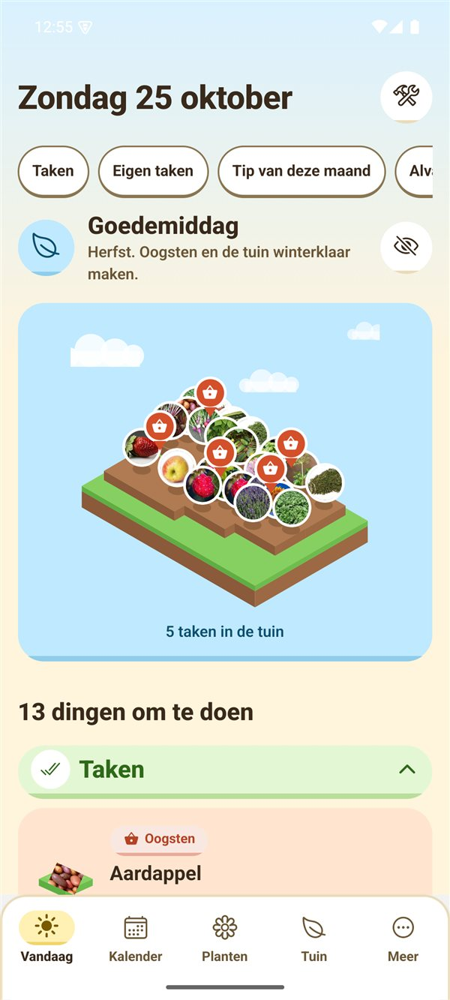
  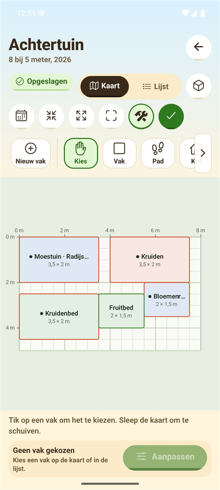
  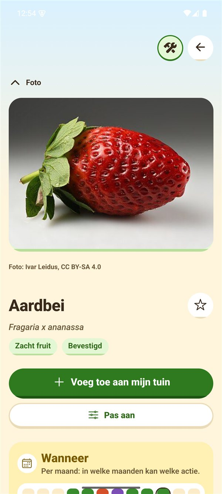
  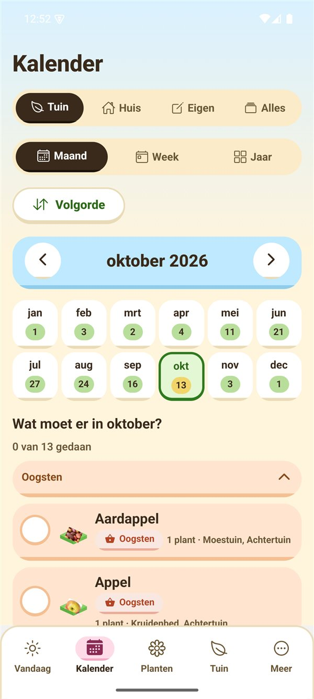

## Sommaire

[Regarde d'abord les films](#regarde-dabord-les-films) · [Pourquoi](#pourquoi) · [En bref](#en-bref) ·
[La première fois](#la-première-fois) · [Aujourd'hui](#aujourdhui) · [Bibliothèque](#bibliothèque-de-plantes) · [Mon jardin](#mon-jardin) ·
[Concevoir le jardin](#concevoir-le-jardin) · [Calendrier](#calendrier) · [Plantes d'intérieur](#plantes-dintérieur) ·
[Journal, photos et récoltes](#journal-photos-et-récoltes) · [Stock et tâches](#stock-et-tâches-personnelles) ·
[Rappels et météo](#rappels-et-météo) · [Widgets](#widgets) · [Recherche et sauvegarde](#recherche-et-sauvegarde) ·
[Apparence et accessibilité](#apparence-et-accessibilité) · [Simple ou avancé](#simple-ou-avancé) ·
[Installer](#installer) · [Confidentialité](#confidentialité) · [Questions fréquentes](#questions-fréquentes) ·
[Historique des versions](#historique-des-versions)

## Regarde d'abord les films

Quatre courts films montrent l'application en usage, chacun avec un autre jardinier. Les données des films sont
inventées ; les images sont des enregistrements de la vraie application (version 3.4.0). Clique sur une image pour
ouvrir et lire le film. Les films sont en néerlandais.

<table>
  <tr>
    <td align="center" width="50%">
      <a href="video/tuinplanner-lotte.mp4">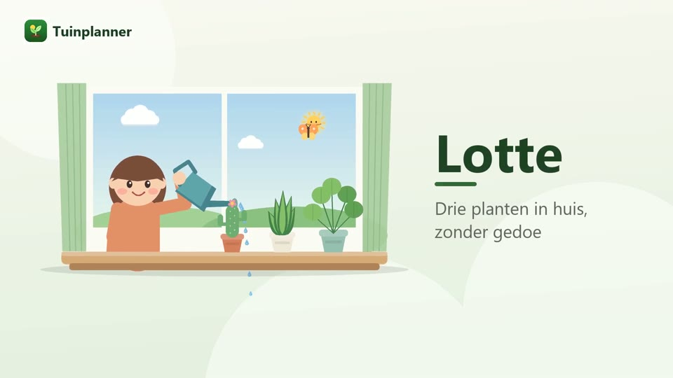</a> 
      <b>Lotte : trois plantes à la maison</b> (1:33) 
      Cocher l'arrosage d'un geste, ouvrir et ajouter une plante, et tout retrouver dans le calendrier. En mode
      simple.
    </td>
    <td align="center" width="50%">
      <a href="video/tuinplanner-daan.mp4">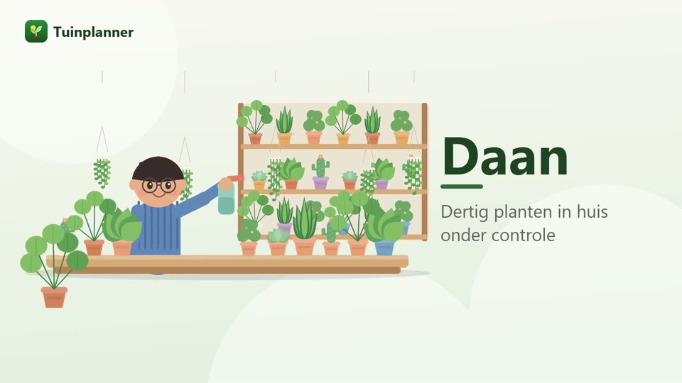</a> 
      <b>Daan : trente plantes à la maison</b> (3:05) 
      Filtrer par arrosage ou engrais, soigner plusieurs plantes à la fois, chercher, et le calendrier par semaine et
      par mois.
    </td>
  </tr>
  <tr>
    <td align="center" width="50%">
      <a href="video/tuinplanner-joost.mp4">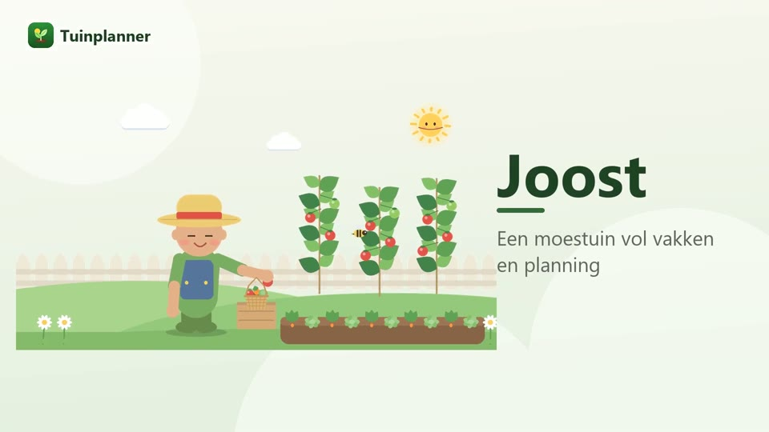</a> 
      <b>Joost : le potager</b> (3:48) 
      Ce qui doit aller en terre maintenant, modifier le jardin en diorama, un avertissement de rotation des cultures,
      la récolte par année avec la carte annuelle, et la liste d'achat de graines.
    </td>
    <td align="center" width="50%">
      <a href="video/tuinplanner-ria.mp4">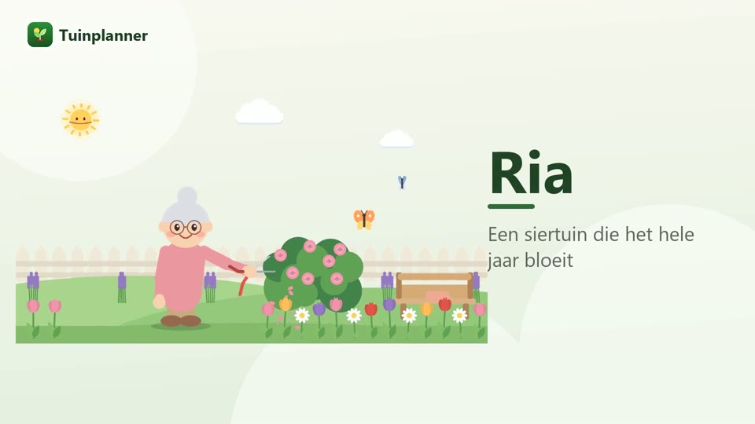</a> 
      <b>Ria : le jardin d'ornement</b> (3:30) 
      Massifs et arbustes en une seule vue, conseil de taille et floraison par plante, tailler dans le calendrier,
      journal avec photos et bulbes sur la liste d'achat.
    </td>
  </tr>
</table>

Les films sont de simples fichiers dans le dossier [`video/`](video/) (environ 40 Mo au total). Si tu ne vois pas de
lecteur, télécharge le fichier et ouvre-le sur ton ordinateur ou ton téléphone.

## Pourquoi

Un jardin demande de l'attention au bon moment : semer trop tard, oublier d'arroser ou rater la taille. Le
planificateur de jardin aligne ces moments pour toi. Tu choisis ce que tu cultives, et l'application montre jour
par jour ce qui est à faire, avec des explications et des sources. Tout fonctionne hors ligne ; la bibliothèque
de plantes est dans l'application.

Pour qui ? Pour quelqu'un qui a trois plantes d'intérieur et ne veut pas oublier de les arroser, pour le jardinier
potager qui veut savoir ce qui doit aller en terre ce mois-ci et ce qu'il y avait l'an dernier, et pour l'amateur de
jardin d'ornement avec des rosiers, des hortensias et des arbustes à tailler à temps. Avec le bouton Simple ou
Avancé, tu décides toi-même de la quantité d'informations affichées.

## En bref

| Élément | Ce que tu obtiens |
|---|---|
| **Vandaag** (Aujourd'hui) | Les tâches du moment, un petit jardin avec des repères sur les parcelles où il y a quelque chose à faire, le conseil météo et tes favorites |
| **Plantenbibliotheek** (Bibliothèque de plantes) | 638 plantes, 21 plantes à bulbes et 156 plantes d'intérieur (794 plantes au total dans la liste), avec photo, source et conseils de culture |
| **Mijn tuin** (Mon jardin) | Tes plantes par année et par parcelle, récolte et planification, jardin en chiffres, partage en image |
| **Tuin ontwerpen** (Concevoir le jardin) | Dessiner des parcelles, modifier dans le diorama, soleil et ombre, voisins et rotation des cultures |
| **Kalender** (Calendrier) | Mois, semaine et année pour le jardin, la maison et tes tâches, avec un ordre que tu fixes toi-même |
| **Planten in huis** (Plantes d'intérieur) | Rythme d'arrosage et d'engrais par plante, rempotage, toxicité pour les animaux, journal de bord |
| **Dagboek, foto's en oogst** (Journal, photos et récoltes) | Ce que tu as fait, ce qui arrive, ta récolte par année et une carte annuelle à partager |
| **Voorraad en taken** (Stock et tâches) | Graines et bulbes, liste d'achat, tâches personnelles récurrentes |
| **Herinneringen en weer** (Rappels et météo) | Notifications, report, météo d'Open-Meteo, widgets pour ton écran d'accueil |
| **Uiterlijk** (Apparence) | Image des plantes (icônes, dessins ou photos), mouvement, thème sombre, palette pour daltoniens, grand texte |
| **Gegevens** (Données) | Hors ligne, pas de compte, sauvegarde photos comprises, plan annuel en PDF |

## La première fois

À la première utilisation, tu passes par quatre courtes étapes, que tu peux aussi sauter :

1. **Welkom** (Bienvenue). Ce que fait l'application en un coup d'œil : fonctionne sans internet, tes données restent sur ton appareil, tout est modifiable.
2. **Hoeveel wil je zien?** (Combien veux-tu voir ?) Choisis Simpel (simple) ou Geavanceerd (avancé). Tu peux toujours changer.
3. **Zo ziet je tuin eruit** (Voici à quoi ressemble ton jardin). Un petit jardin d'exemple s'adapte tout de suite quand tu choisis entre **Iconen** (icônes), **Tekeningen** (dessins) ou
   **Foto's** (photos) pour *Plantbeeld* (image des plantes), et entre **Rustig** (calme), **Subtiel** (subtil) ou **Beleving** (expérience) pour *Beweging* (mouvement).
4. **Wil je een herinnering?** (Veux-tu un rappel ?) Choisis si tu veux des notifications et à quelle heure.

  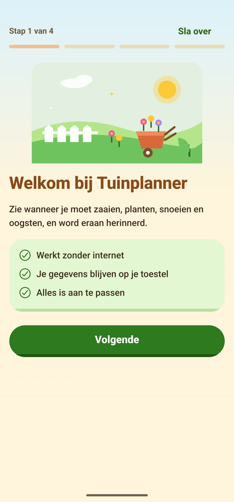
  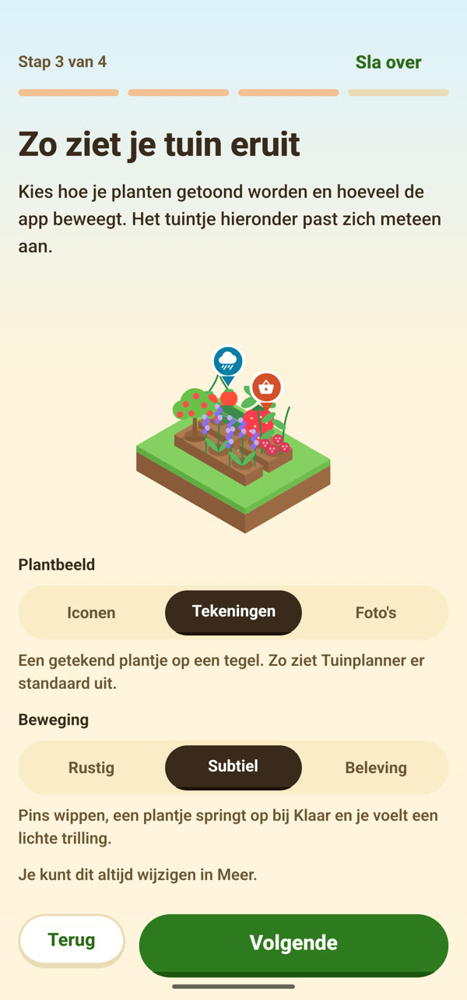
  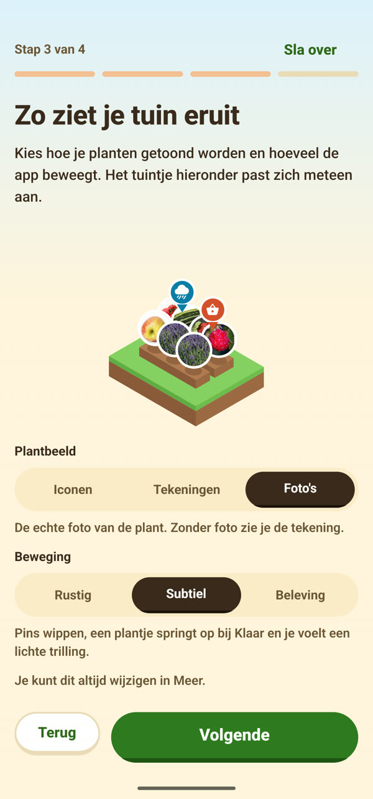

## Aujourd'hui

L'écran d'accueil (*Vandaag*) montre les tâches du moment : semer, semer sous abri, planter, tailler, récolter,
arroser et nourrir. En haut, tu trouves un salut avec une phrase sur la saison et un petit jardin (diorama) avec des
repères sur les parcelles où il y a quelque chose à faire. Touche le petit jardin pour ouvrir le jardin.

  
  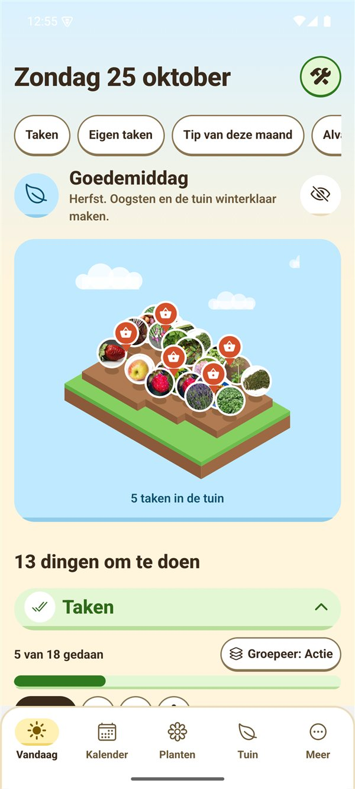
  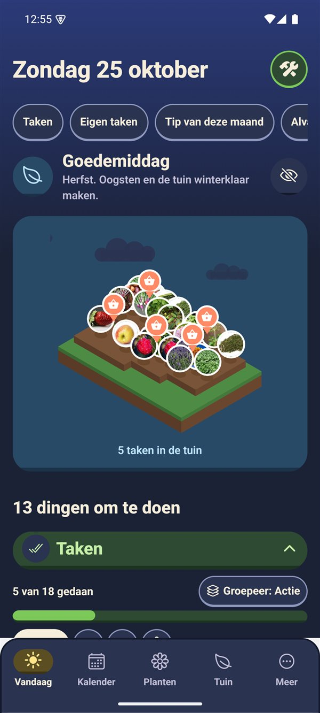

- **Coche d'un geste.** Une récolte demande tout de suite combien tu as récolté, pour que ton journal reste juste.
- **Glisser.** Glisse une tâche vers la gauche pour la cocher et vers la droite pour la reporter. Tu peux inverser cela
  ou le désactiver dans *Instellingen* (Réglages). Un court message avec *Ongedaan* (Annuler) te laisse corriger une
  erreur, et les tâches faites quittent la liste.
- **Choisir plusieurs à la fois.** Maintiens une ligne ou une tuile pour en choisir d'autres ; les actions (ajouter à
  ta liste, changer le statut, supprimer) apparaissent alors en bas. Sans sélection, elles n'y sont pas. Cela marche
  aussi dans le journal et dans les résultats de recherche.
- **Plus tard** (*Later*) : reporte une tâche à demain, à la semaine prochaine ou à un nombre de jours de ton choix.
- **Grouper et filtrer** par action, plante ou parcelle, avec des puces pour l'arrosage, l'engrais et le rempotage des plantes d'intérieur.
- **Plantes d'intérieur parmi les tâches** : l'arrosage, l'engrais et le rempotage sont des lignes normales dans la
  liste et comptent dans ta progression. Tu choisis s'ils sont repliés en haut ou en bas.
- **Tes favorites** : une rangée avec les plantes auxquelles tu as mis une étoile.
- **Bouton rapide** : un bouton flottant avec Note, Photo et Récolte (*Notitie*, *Foto*, *Oogst*), pour noter vite
  quelque chose en plein jardin. Désactivable dans *Instellingen*.
- **Planifier à l'avance** (*Alvast plannen*) : regarde ce qui arrive dans les prochains mois.
- **Conseil du mois** pour les plantes que tu as, avec la source.
- **Conseil météo** : avertissement en cas de gel, chaleur, sécheresse ou forte pluie, avec le nom de tes plantes sensibles au gel.
- **Arroser quand il pleut** : si de la pluie est prévue, l'application te propose de sauter tes propres tâches
  d'arrosage du jour. Tu confirmes d'un toucher. Cela ne marche que pour tes propres tâches dont le titre contient un
  mot d'arrosage, car pour les plantes d'extérieur les données ne contiennent pas de calendrier d'arrosage.
- **Bilan annuel en décembre et en janvier** : une invitation à regarder et partager ton année de récolte.
- **Quoi de neuf** : après une mise à jour, une petite carte apparaît une fois avec ce qui a changé. Désactivable.
- Sur une tablette, « Aujourd'hui » s'affiche sur deux colonnes.

## Bibliothèque de plantes

638 plantes et 21 plantes à bulbes pour ton jardin, plus 156 plantes d'intérieur, chacune avec les mois de semis,
plantation, taille et récolte, la distance, l'exposition, les bons et mauvais voisins, des photos et des sources.
Cela fait 794 plantes dans la liste.

  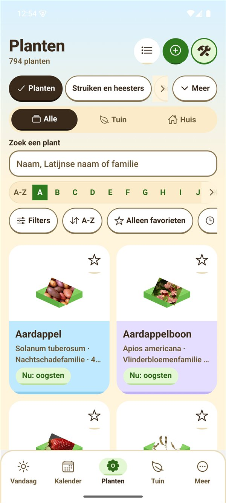
  
  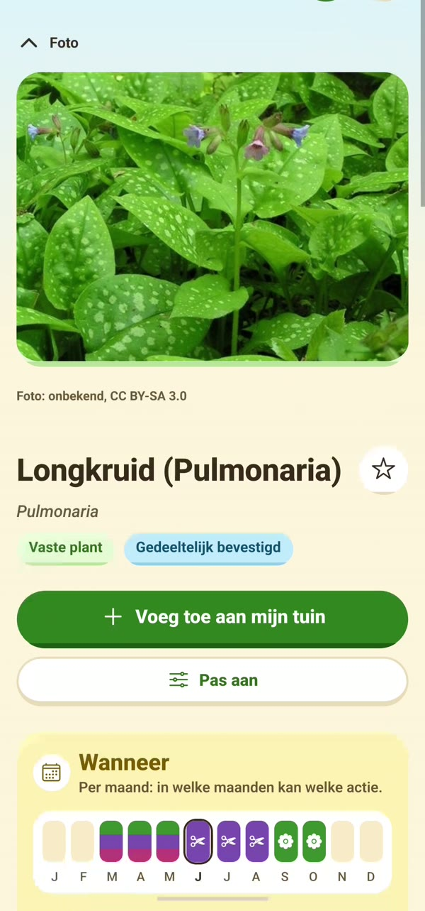
  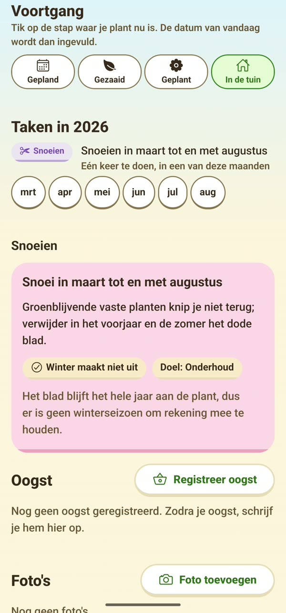

- **Bien plus que des légumes.** Arbres, conifères, arbustes, plantes grimpantes, couvre-sols, vivaces, graminées
  d'ornement, rosiers, plantes de haie, engrais verts, fruits et baies, aromatiques, légumes sauvages, champignons
  et noix. Le menu des catégories en compte 17 ; tu en fixes deux comme choix rapides dans la barre.
- **Conseils de culture par mois**, avec la source. Ils existent pour 590 plantes dans la bibliothèque, tirés de
  pages de culture de la RHS entre autres ; une partie se base sur un groupe d'espèces plutôt que sur l'espèce
  elle-même. Ce qui ne peut pas être étayé n'apparaît pas.
- **Conseil de taille** pour chaque plante, y compris s'il faut attendre la fin de l'hiver et quel est le but
  (entretien, rajeunissement).
- **Les valeurs indicatives sont signalées.** Pour la distance de plantation, la floraison et les mois de taille qui
  viennent d'une seule source, qui sont arrondis ou déduits, on lit « (richtwaarde) », c'est-à-dire « valeur
  indicative ». Les mois de plantation et de taille des arbres et arbustes plus récents viennent en partie de guides
  généraux de la RHS et sont indicatifs.
- **Maladies et ravageurs** avec comment les reconnaître et les prévenir, et une source.
- **Filtres et tri** par groupe, rôle, famille, exposition, distance de plantation, fiabilité, action et mois. Les
  titres se replient et mémorisent leur état. Trie par A-Z, à semer maintenant, favorites d'abord ou dernières consultées.
- **Choix rapides** comme « Kan nu » (Possible maintenant), « Nu zaaien » (Semer maintenant) et « Nu planten »
  (Planter maintenant), plus une barre A-Z qui reste en haut pendant que tu fais défiler.
- **Grille, liste ou compact** : trois façons d'afficher la bibliothèque.
- **Toutes, Jardin ou Maison** (*Alle*, *Tuin*, *Huis*) : la liste montre la bibliothèque du jardin, les plantes d'intérieur ou les deux.
- **Favorites** : mets une étoile à une plante (dans la liste ou la fiche) et filtre sur « Alleen favorieten » (Seulement les favorites).
- **Champignons et noix** : 21 champignons comestibles à cultiver et 27 noix, graines et cultures apparentées, avec
  notes de culture et source. Les sosies vénéneux sont indiqués, et pour le chanvre seulement un avertissement légal.
- **Toxique ou attention** : 259 plantes ont une carte rouge *Giftig* (toxique, 84) ou jaune *Let op* (attention, 175),
  avec la source. Sans carte, une plante n'est pas forcément sans danger.
- **Ajouter ta propre plante** si la tienne n'est pas dans la liste.
- Photos de Wikimedia Commons, toujours avec l'auteur et la licence. Dans la fiche, tu peux replier la photo ou la réduire.

## Mon jardin

Les plantes que tu cultives ou veux cultiver, par année et par parcelle.

  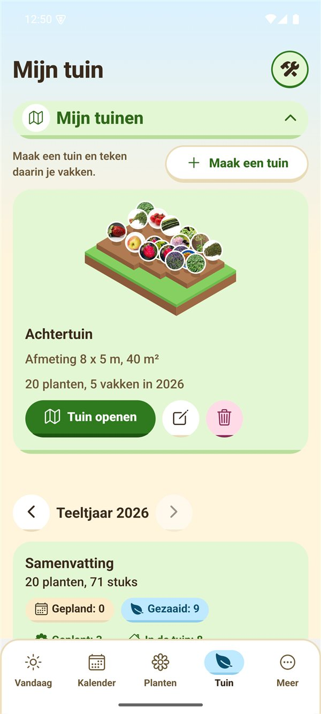
  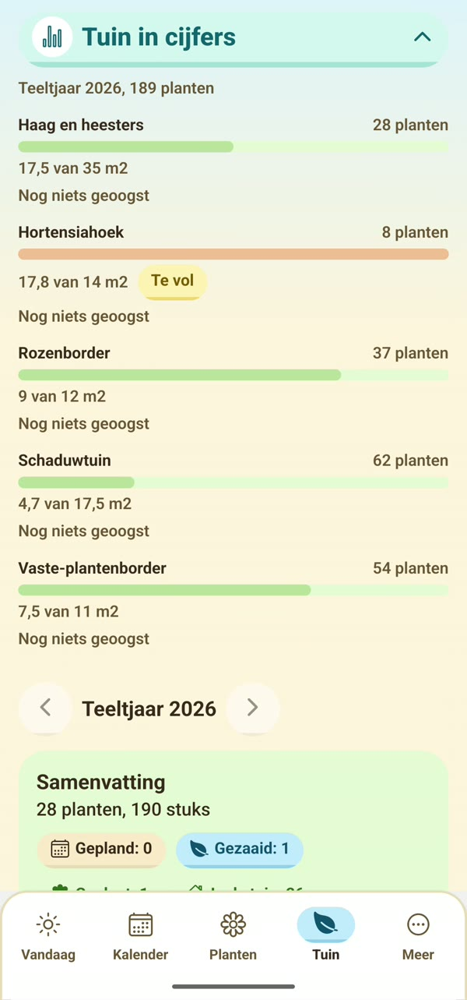
  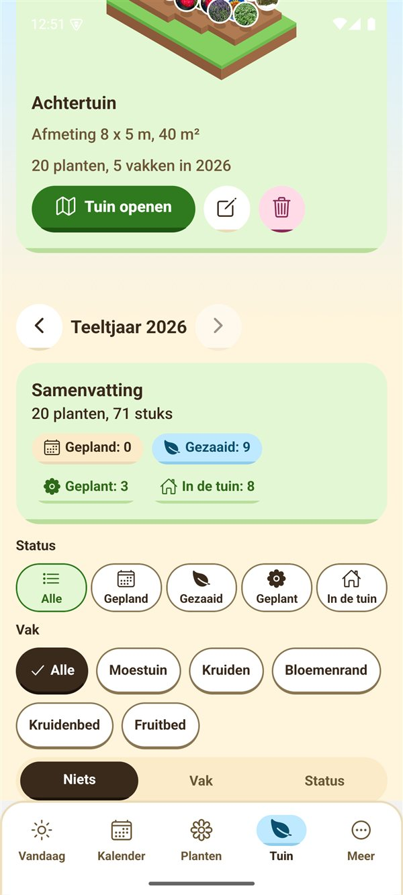
  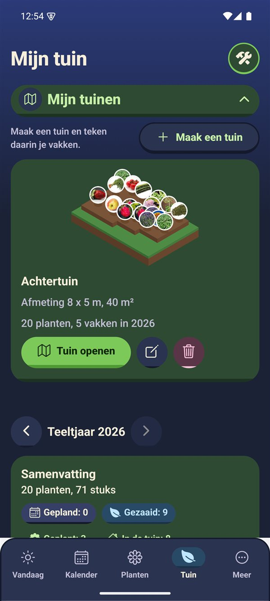

- Par plante : nombre, parcelle, variété, date de semis et de plantation, statut (prévue, semée, plantée, au jardin), récoltes, photos et notes.
- **Plusieurs jardins**, chacun avec ses propres dimensions (l'application calcule la surface) et son propre diorama.
- **Les vivaces** reviennent chaque année d'elles-mêmes.
- **Récolte et planification par année** : vois combien de chaque espèce tu as prévu, avec la place qu'elles
  prennent, combien il en tient encore dans une parcelle, et une barre annuelle par espèce. Ajuste les nombres et
  reprends la planification de cette année pour la suivante.
- **Jardin en chiffres** (*Tuin in cijfers*) : par parcelle, l'occupation en mètres carrés, le nombre de plantes et la
  récolte de cette année, avec un repère *Leeg* (vide), *Bijna leeg* (presque vide) ou *Te vol* (trop plein).
- **Partager en image** : fais de ton jardin une image à partager avec ta famille ou tes voisins.
- Une plante se supprime par un appui long ou la corbeille, toujours avec confirmation.
- Tu modifies une plante depuis une parcelle ? En fermant, tu reviens dans cette parcelle, pas dans le jardin.

## Concevoir le jardin

Dessine ton jardin avec des parcelles et vois ce qui va où. Dans l'éditeur, tu passes entre **Kaart** (carte, vue de
dessus), **Lijst** (liste) et **Diorama** (une vue isométrique avec des tuiles, des plantes et des repères).

  
  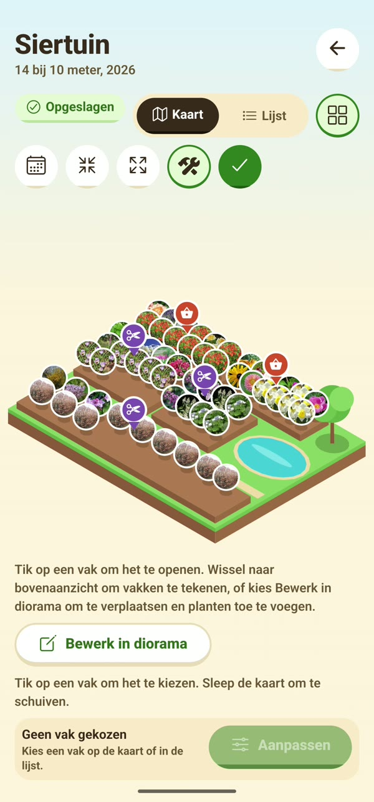
  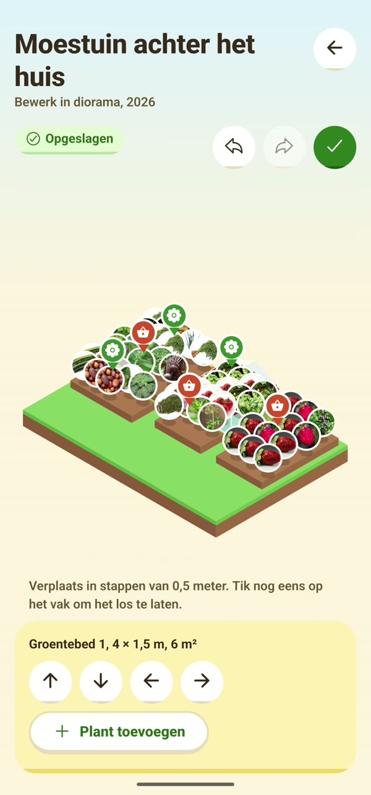
  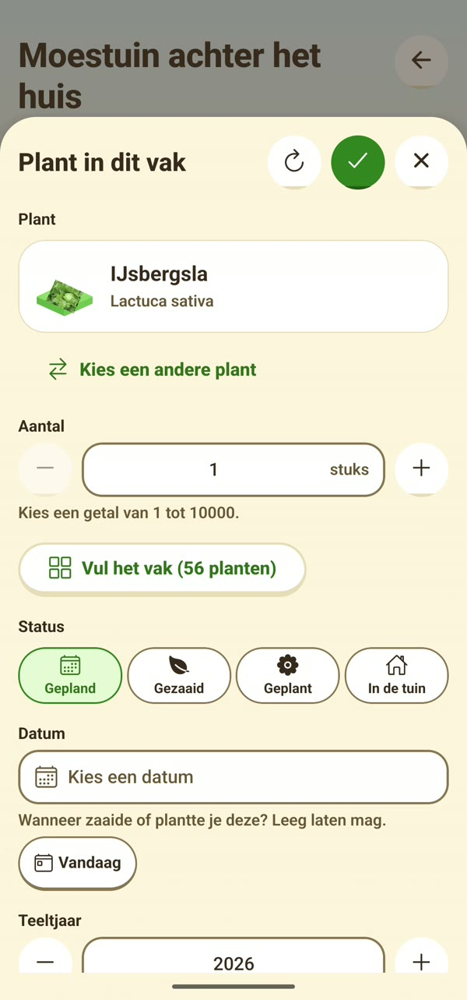

- **Parcelles** avec dimensions, plantes et une photo de fond de ton propre jardin. Aussi des allées, de l'eau, des arbres et des serres.
- **Modifier dans le diorama** : choisis une parcelle en la touchant, déplace-la avec des flèches par pas d'un demi-mètre
  (l'application surveille le bord et les collisions), ajoute une plante, annule ou rétablis. Il n'y a pas de glisser
  du doigt.
- **Rotation des cultures** (*wisselteelt*) : si la même famille de plantes reste trop peu de temps au même endroit,
  la parcelle reçoit un bord rouge en pointillés et une carte d'avertissement avec une explication. Ce bord apparaît
  aussi dans Mon jardin et dans Aujourd'hui.
- **Soleil et ombre** : l'application calcule la position du soleil pour le 21 juin et tient compte des arbres et des serres.
- **Voisins** : un avertissement quand des plantes voisines ne s'entendent pas bien.
- **Remplir la parcelle** : l'application calcule combien de plantes tiennent avec la bonne distance.
- **Comparer et copier les années** : vois ce qu'il y avait dans une parcelle l'an dernier et reprends une année pour la suivante.
- **En-tête fixe dans chaque panneau** : dans les formulaires d'un panneau, la coche, l'icône de réinitialisation et
  la croix restent toujours visibles en haut. La coche n'est cliquable que si quelque chose a changé et que tout est
  correct ; la réinitialisation remet tout comme avant.

  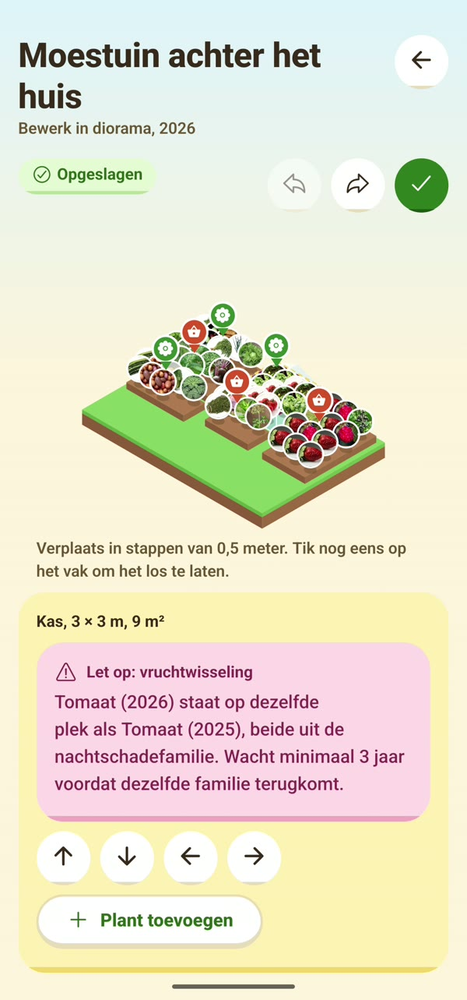

## Calendrier

  
  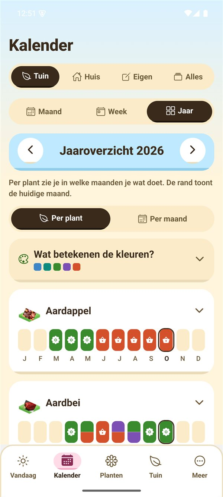
  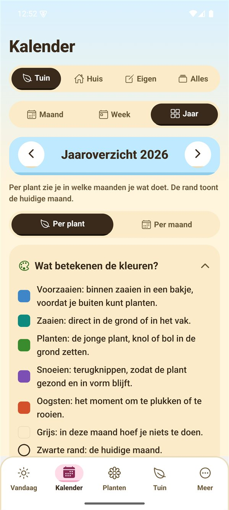
  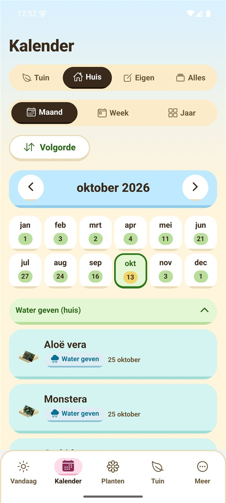

- **Maand** (mois), **Week** (semaine) ou **Jaar** (année), pour **Tuin** (jardin), **Huis** (maison), **Eigen** (propres) ou **Alles** (tout). Dans *Instellingen*, tu choisis ce que tu vois en premier.
- **Tuiles de mois** : chaque mois est une tuile calme avec son nom et le nombre de tâches dans un badge rond.
- **Arroser dans le calendrier** : l'arrosage et l'engrais des plantes d'intérieur figurent dans la liste du mois et
  dans l'aperçu de la semaine pour toutes les sources sauf Eigen.
- **Un ordre que tu fixes toi-même** : avec le bouton *Volgorde* (ordre), tu montes ou descends récoltes, taille,
  plantation, semis, semis sous abri, arrosage, engrais et tâches personnelles. Le choix est conservé et détermine
  aussi la présentation à l'intérieur d'une journée.
- L'**aperçu annuel** montre des barres colorées par plante, avec une icône quand un mois n'a qu'une seule action. Tu
  choisis entre *Per plant* (par plante), *Per maand* (par mois) et une *Raster* (grille).
- **Semaine** : tes tâches personnelles et l'arrosage et l'engrais des plantes d'intérieur, jour par jour, et en haut
  « Nog te doen » (reste à faire). Les groupes sont ouverts s'il reste quelque chose à faire, et se referment quand
  tout est fait. Maintiens un bloc de mois coloré pour une explication des couleurs.
- Tâches personnelles par semaine ; les semaines vides sont masquées par défaut. Les écrans vides ont un bouton pour ajouter quelque chose.
- Exporte les tâches vers l'agenda de ton téléphone (fichier ICS).

## Plantes d'intérieur

156 espèces de plantes d'intérieur avec photo, source et valeurs indicatives. Par espèce, tu obtiens le rythme
d'arrosage et d'engrais, l'emplacement, des conseils par mois et si la plante est toxique pour les animaux
(selon l'ASPCA).

  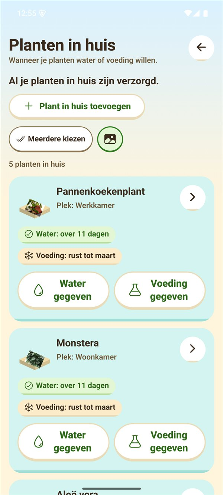
  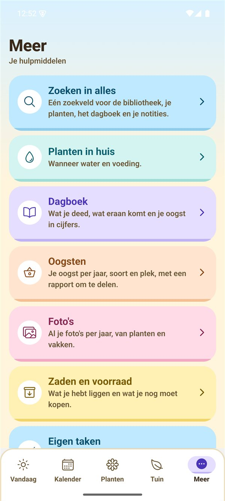

- **Arroser d'un geste dans Aujourd'hui** : l'application retient quand la plante veut de l'eau à nouveau.
- **Plusieurs plantes à la fois** : choisis-en quelques-unes et arrose-les ou nourris-les d'un coup (*Meerdere kiezen*).
- **Chaque plante à sa place** : Salon (*Woonkamer*), Cuisine (*Keuken*), Bureau (*Werkkamer*) et ce que tu inventes toi-même.
- Cherche par nom ou par un autre nom : « vingeraralia » trouve le schefflera (*Vingerboom*).
- Tiens un journal des problèmes et ajoute des photos.
- Ajoute ta propre espèce si ta plante n'est pas dans la liste, avec ta propre photo.
- **Rempotage** : annulation rapide et un rappel par plante (chaque année, tous les 2 ou 3 ans), avec une tâche dans Aujourd'hui quand c'est le moment.
- Une carte annuelle par plante dans le calendrier (Huis, Jaar) avec photo et barre annuelle.

## Journal, photos et récoltes

  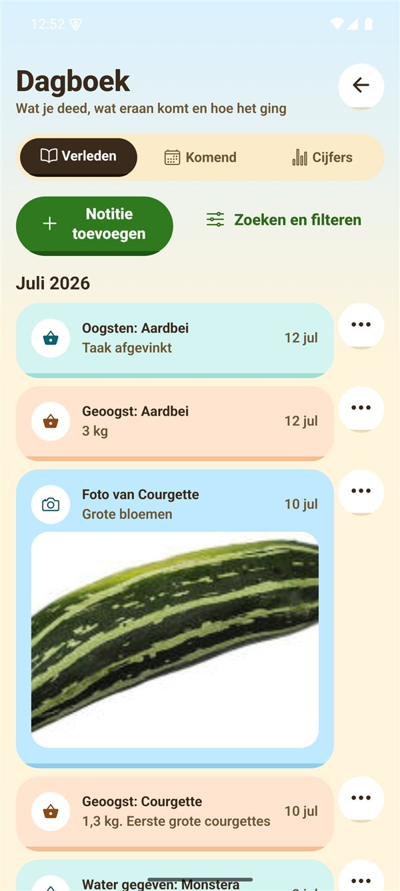
  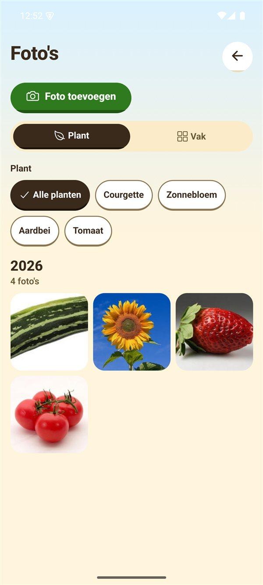
  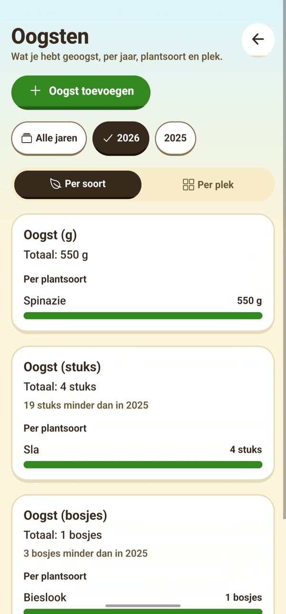
  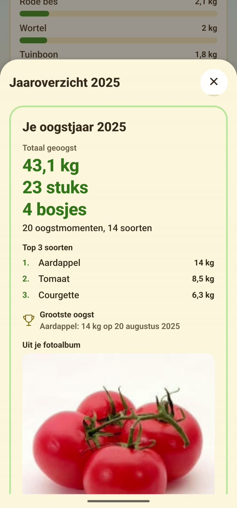

- **Komend** (à venir) : tâches en retard et tâches de cette semaine et des suivantes, à cocher directement. Jusqu'où
  tu peux cocher à l'avance (1 semaine, 1 mois ou 3 mois) se règle toi-même.
- **Geschiedenis** (historique) de ce que tu as fait, avec des notes et des photos.
- **Cijfers** (chiffres) : ce que tu as récolté, semé et planté, sur une page de statistiques courte et une longue, aussi par année.
- **Oogsten** (récoltes) a son propre écran (*Meer*, *Oogsten*, soit Plus, Récoltes) : par année, espèce et lieu, sur
  plusieurs années, avec un rapport à partager et un bouton pour ajouter une récolte.
- **Carte annuelle** : par année, tes totaux, tes records, ton top 3 et des photos de ton album. Avec le réglage
  Beleving, tu reçois aussi des confettis. Partage la carte comme image (PNG).
- **Album photo** par plante, jardin ou parcelle, avec une chronologie. Ajoute ta propre photo avec un assistant en trois étapes.

## Stock et tâches personnelles

  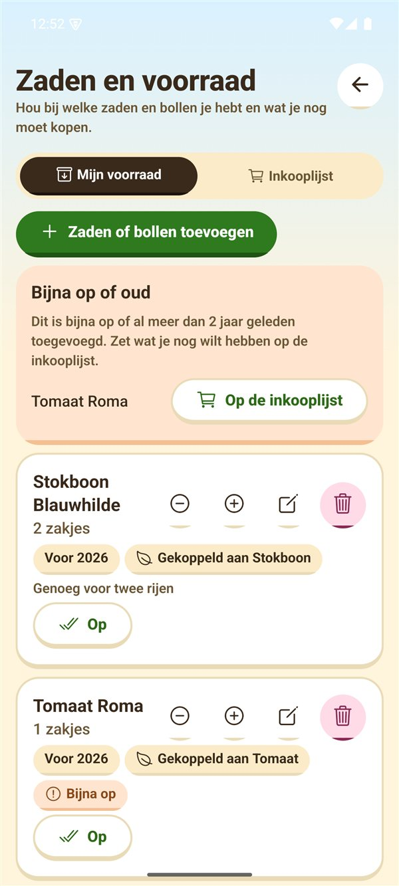
  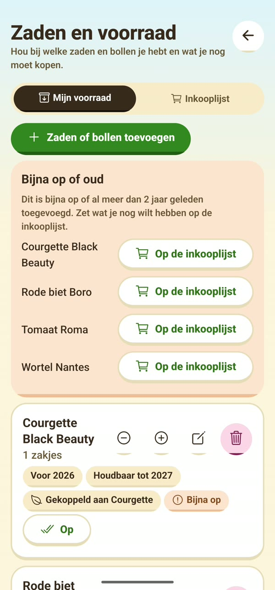
  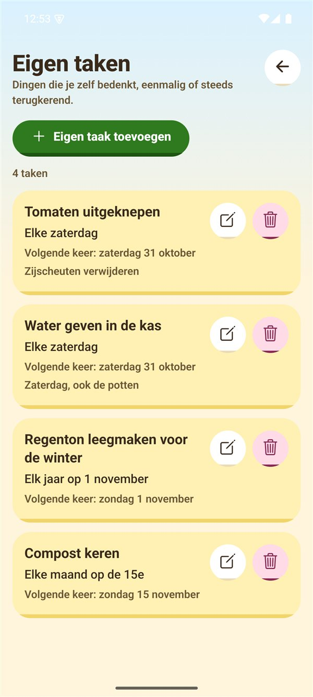

- **Graines et bulbes** : relie nom et plante, durée de conservation (aussi sur plusieurs années) et photo du sachet.
- **Presque épuisé et trop vieux** : l'application marque les graines dont il reste un sachet ou moins, et les graines
  de plus de deux ans, avec un bouton vers la liste d'achat.
- **Liste d'achat** à partir de ce dont tu as besoin pour l'année qui vient, aussi pour l'année suivante.
- **Tâches personnelles** (*eigen taken*) : récurrentes et reliables à plusieurs plantes et parcelles. Répétitions :
  chaque semaine, toutes les 2 semaines, chaque mois, tous les 2 mois, tous les 3 mois, tous les 6 mois, tous les
  9 mois, chaque année, tous les 2 ans et tous les 3 ans.

## Rappels et météo

- **Notifications** sur ton appareil : quotidiennes ou hebdomadaires, et un aperçu de la semaine le dimanche soir.
- **Reporter** : décaler une tâche d'un jour, d'une semaine ou d'un nombre de jours de ton choix.
- **Heure de rappel intelligente** (facultatif) : l'application choisit le moment où tu l'ouvres d'habitude.
- **Rappel de sauvegarde** : l'application te rappelle de faire une sauvegarde (désactivé, 1 semaine, 2 semaines, 1 mois ou 3 mois).
- **Météo** : prévisions d'Open-Meteo pour ton lieu, avec des conseils en cas de gel, chaleur, sécheresse ou forte pluie.
- **Dates de gel personnelles** : règle toi-même ton dernier et ton premier gel.

## Widgets

Quatre widgets pour ton écran d'accueil, qui suivent la palette pour daltoniens si tu l'as activée :

- **Tuin, teller** (compteur) : combien d'actions te restent et combien sont en retard.
- **Tuin, kort overzicht** (aperçu court) : les trois prochaines actions.
- **Tuin, lang overzicht** (aperçu long) : une liste des actions de ce mois et ta progression.
- **Tuin, vandaag** (aujourd'hui) : la progression du jour, la prochaine action et la météo.

## Recherche et sauvegarde

- **Tout rechercher** : bibliothèque, tes plantes, journal, tâches personnelles et stock, avec des photos dans les résultats.
- **Comestible seulement** (*Alleen eetbaar*) : un interrupteur dans la recherche n'affiche que ce qui se mange. Les
  noms de graines comme graine de tournesol ou de courge mènent à la plante.
- **Sauvegarde** : exporte et importe toutes tes données, photos comprises, ou laisse l'application déposer chaque
  semaine automatiquement une sauvegarde dans un dossier choisi.
- **Plan annuel en PDF** : d'abord un aperçu à l'écran, puis ouvrir, enregistrer ou partager.

## Apparence et accessibilité

Le design s'appelle *Tuinwereld* (monde du jardin) : un crème chaud, de grosses cartes douces, des boutons ronds et
des couleurs par élément (herbe, orange, turquoise, violet, jaune, rose et ciel).

- **Plantbeeld** (image des plantes) : choisis **Iconen** (un pictogramme par groupe de plantes), **Tekeningen** (une
  petite plante dessinée sur une tuile, plus de 50 formes) ou **Foto's** (la vraie photo sur une tuile ; sans photo,
  tu vois le dessin). Cela s'applique aux listes, tâches, calendrier, parcelles, plantes d'intérieur et au diorama.
- **Beweging** (mouvement) : **Rustig** (calme : ni animation ni vibration), **Subtiel** (les repères rebondissent,
  une petite plante saute à Klaar, une légère vibration) ou **Beleving** (expérience : en plus, des confettis à Klaar
  et des nuages et de la pluie au-dessus du petit jardin). Si la réduction des animations de ton appareil est
  activée, tu obtiens toujours Rustig.
- **Luchtverloop** (dégradé de ciel, facultatif, désactivé par défaut) : un dégradé de couleurs en haut qui suit l'heure et la saison.
- **Clair ou sombre**, selon ton appareil ou à ton choix.
- **Taille du texte** : normale, grande ou très grande.
- **Palette adaptée aux daltoniens** (Okabe-Ito) pour les couleurs de statut, aussi dans les widgets.
- Compatible **TalkBack** et adapté aux **tablettes** (deux colonnes dans Aujourd'hui, mises en page plus larges).
- Les réglages forment un menu à part, avec un écran par groupe et un champ de recherche.

## Simple ou avancé

Un bouton en haut à droite active ou désactive le mode avancé. Simple montre seulement ce dont tu as besoin
maintenant. Avancé montre tous les détails et te donne **26 fonctions supplémentaires** dans *Instellingen*
(Réglages), à activer ou désactiver une à une :

conseil avec source, conseil du mois dans Aujourd'hui, conseils pour plantes d'intérieur, maladies et ravageurs,
avertissement de rotation des cultures, durée de conservation des graines, conseil météo, date de gel par région,
aperçu de la semaine, export vers l'agenda, report de tâches, heure de rappel intelligente, analyse de l'ombre,
contrôle des voisins, remplissage automatique des parcelles, comparaison des années, photo de fond de ton jardin,
chronologie des photos, graphique de récolte, liste de courses, tâches personnelles dans Aujourd'hui, plantes
d'intérieur dans Aujourd'hui, planifier à l'avance, recherche globale, mise en page pour tablette et sauvegarde
automatique.

Rien n'est perdu quand tu changes.

## Installer

1. Ouvre la page **[Releases](../../releases)** et télécharge sur ton téléphone le dernier `tuinplanner-<version>.apk`.
2. Ouvre le fichier. Si Android le demande, autorise l'installation depuis cette source.
3. Lance Tuinplanner. C'est tout.

L'application est destinée à être installée soi-même et n'est pas sur le Play Store.

**Exigences.** Android 7.0 ou plus récent et un téléphone ou une tablette 64 bits (arm64). Le fichier d'installation
est gros (environ 155 Mo), car toute la bibliothèque de plantes avec ses photos s'y trouve ; ensuite, tout
fonctionne sans internet.

### Mises à jour

Dans l'application, ouvre **Meer → Instellingen** (Plus → Réglages) et cherche des mises à jour. L'application
trouve la dernière version ici, la télécharge et demande à Android de l'installer. Rien n'est installé sans ta
confirmation.

## Confidentialité

- Tout fonctionne hors ligne ; tes plantes, photos et notes restent sur ton appareil.
- L'application n'utilise internet que pour les conseils météo facultatifs (Open-Meteo) et pour chercher une nouvelle version.
- Pas de compte, pas de publicité, pas de suivi.

## Questions fréquentes

**Dois-je créer un compte ?** Non. Il n'y a pas de compte et rien n'est envoyé à un serveur de notre part.

**Est-ce que ça marche sans internet ?** Oui. Seuls le conseil météo et la recherche de mises à jour utilisent internet, et ils sont facultatifs.

**Comment emporter mes données sur un nouveau téléphone ?** Fais un export (photos comprises) sous *Instellingen*,
*Back-up* (Réglages, Sauvegarde) et importe-le sur le nouveau téléphone. Tu peux aussi laisser l'application déposer
chaque semaine une sauvegarde dans un dossier.

**Pourquoi lit-on « richtwaarde » à côté de certains chiffres ?** Parce que la source ne donne pas de valeur exacte,
ou parce que nous n'en avons trouvé qu'une seule. L'application ne fait pas semblant que ce soit plus sûr.

**Une plante n'y est pas ?** Ajoute-la toi-même comme plante personnelle ou, pour les plantes d'intérieur, comme espèce personnelle.

**Une plante sans carte rouge ou jaune est-elle sans danger ?** Pas forcément. Les cartes *Giftig* et *Let op* ne
figurent que pour les plantes pour lesquelles nous avons trouvé une source.

**Tu ne vois pas les films se lire ?** Télécharge le fichier dans le dossier [`video/`](video/) et lis-le en local.

**Pourquoi l'application n'est-elle pas sur le Play Store ?** Elle est destinée à être installée soi-même.

## Historique des versions

Un aperçu de ce qui s'est ajouté à chaque version. Toutes les versions figurent sur la page [Releases](../../releases).

| Version | Nouveautés |
|---|---|
| **3.4.0** | Première utilisation avec un petit jardin d'exemple (choix de l'image des plantes et du mouvement) ; l'application démarre environ deux fois plus vite et la liste des plantes défile plus fluidement |
| **3.3.0** | Modification dans le diorama, avertissement de rotation des cultures, jardin en chiffres, partage du jardin en image, carte annuelle de récolte, bouton rapide, dégradé de ciel, arrosage quand il pleut, grille du calendrier |
| **3.2.x** | Favorites, tri, palette pour daltoniens et texte très grand, rappel de sauvegarde, calendrier avec tuiles de mois, arrosage et ordre fixe, en-tête fixe avec coche et réinitialisation dans les panneaux |
| **3.1** | Mouvement (calme, subtil, expérience), Réglages comme menu à part |
| **3.0** | Nouveau design *Tuinwereld*, image des plantes avec icônes, dessins ou photos, petit jardin dans Aujourd'hui |
| **2.x** | 143 nouveaux arbres, arbustes, plantes grimpantes et vivaces (638 plantes), menu des catégories, conseils de culture pour 140 plantes de plus, valeurs indicatives signalées |
| **1.x** | Glisser sur les tâches, choix multiple, plantes d'intérieur parmi les tâches, semaine dans le calendrier, récoltes, rempotage, champignons et noix, toxique ou attention |

## Sources et remerciements

Les données sur les plantes proviennent de sources ouvertes, avec une source par plante (voir **Meer → Bronnen en foto's**, soit Plus → Sources et photos, dans l'application).
Les photos viennent de Wikimedia Commons sous licences libres ; l'auteur et la licence sont indiqués pour chaque photo.
Données météo : Open-Meteo. Toxicité pour les animaux : ASPCA.

## Code source

Le code source de ce projet est privé. Ce dépôt ne contient que les versions publiées, les films et cette page.

## Questions ou idées

Ouvre une [issue](../../issues). Fait avec amour de la nature.
