# Tuinplanner

**Nederlands** · [English](README.en.md) · [Deutsch](README.de.md) · [Français](README.fr.md) · [Español](README.es.md)

**Weten wat je vandaag in de tuin en in huis moet doen, ook zonder internet.**
Tuinplanner is een vriendelijke planner voor Android: hij laat zien wanneer je moet zaaien, planten, snoeien en
oogsten, herinnert je eraan en houdt bij wat er in je tuin en in huis groeit. Geen account, geen advertenties,
geen tracking: je gegevens blijven op je telefoon.

  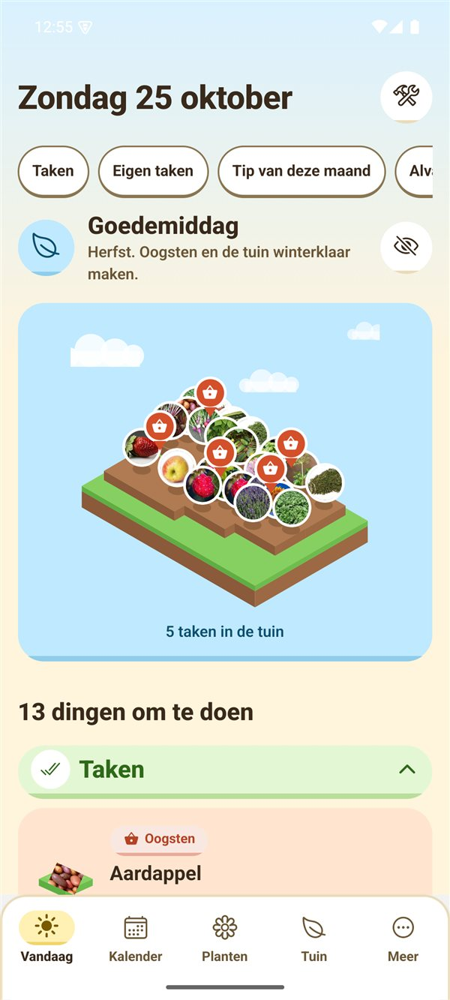
  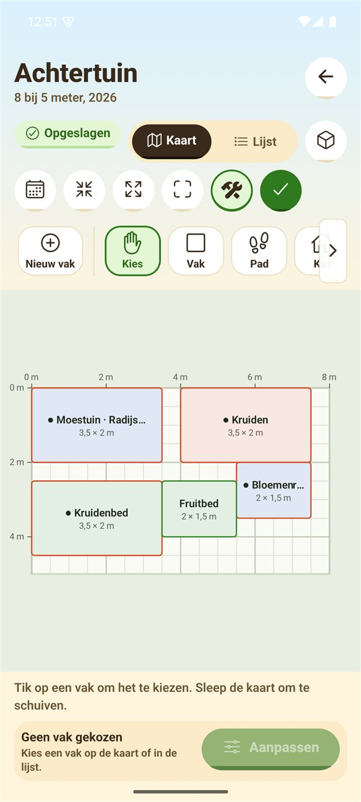
  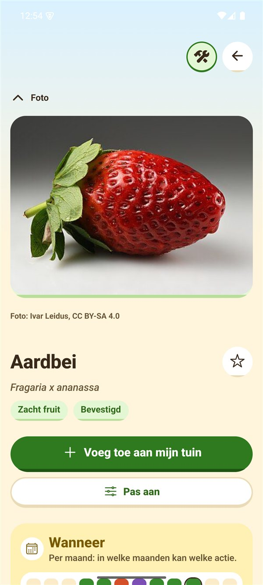
  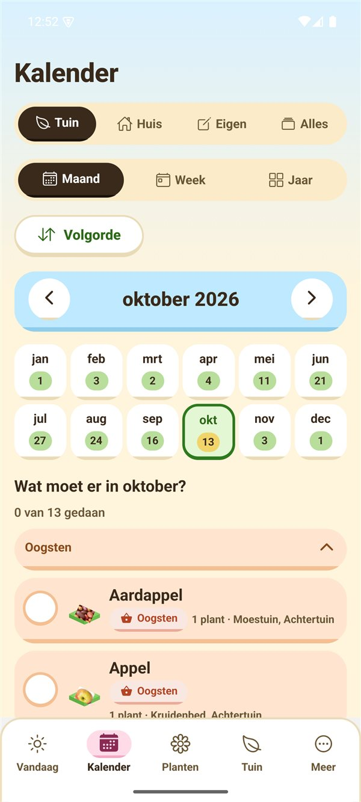

## Inhoud

[Kijk eerst de films](#kijk-eerst-de-films) · [Waarom](#waarom) · [Kort samengevat](#kort-samengevat) ·
[Eerste keer](#de-eerste-keer) · [Vandaag](#vandaag) · [Bibliotheek](#plantenbibliotheek) · [Mijn tuin](#mijn-tuin) ·
[Tuin ontwerpen](#tuin-ontwerpen) · [Kalender](#kalender) · [Planten in huis](#planten-in-huis) ·
[Dagboek, foto's en oogst](#dagboek-fotos-en-oogst) · [Voorraad en taken](#voorraad-en-eigen-taken) ·
[Herinneringen en weer](#herinneringen-en-weer) · [Widgets](#widgets) · [Zoeken en back-up](#zoeken-en-back-up) ·
[Uiterlijk en toegankelijkheid](#uiterlijk-en-toegankelijkheid) · [Simpel of geavanceerd](#simpel-of-geavanceerd) ·
[Installeren](#installeren) · [Privacy](#privacy) · [Veelgestelde vragen](#veelgestelde-vragen) ·
[Versiegeschiedenis](#versiegeschiedenis)

## Kijk eerst de films

Vier korte films laten de app in gebruik zien, elk met een andere tuinier. De gegevens in de films zijn verzonnen; de
beelden zijn opnames van de echte app (versie 3.4.0). Klik op een beeld om de film te openen en af te spelen.

<table>
  <tr>
    <td align="center" width="50%">
      <a href="video/tuinplanner-lotte.mp4">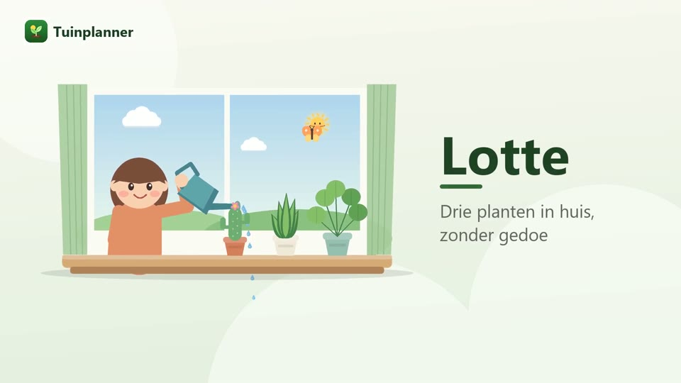</a> 
      <b>Lotte: drie plantjes in huis</b> (1:33) 
      Water geven afvinken met één veeg, een plant openen en toevoegen, en alles terugzien in de kalender. In de
      simpele weergave.
    </td>
    <td align="center" width="50%">
      <a href="video/tuinplanner-daan.mp4">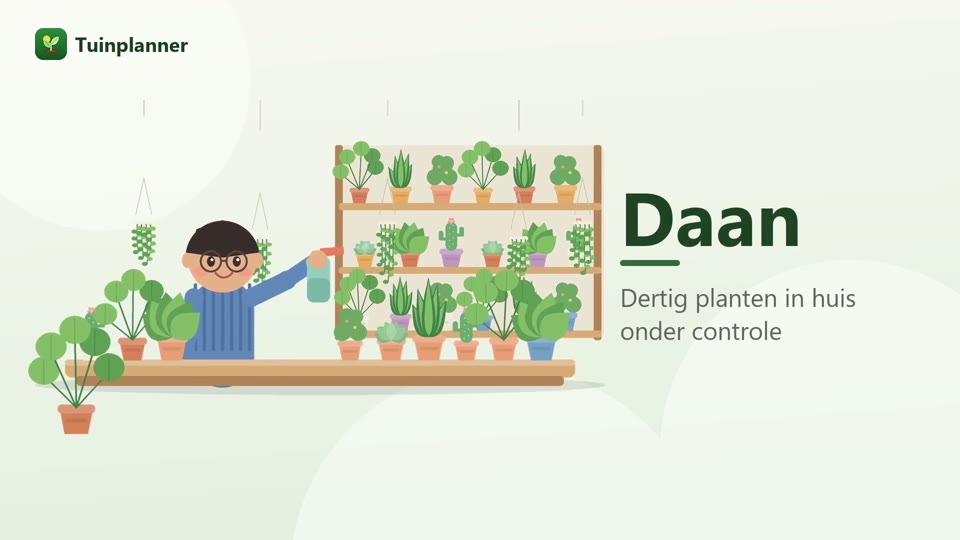</a> 
      <b>Daan: dertig planten in huis</b> (3:05) 
      Filteren op water of voeding, meerdere planten tegelijk verzorgen, zoeken, en de kalender per week en maand.
    </td>
  </tr>
  <tr>
    <td align="center" width="50%">
      <a href="video/tuinplanner-joost.mp4">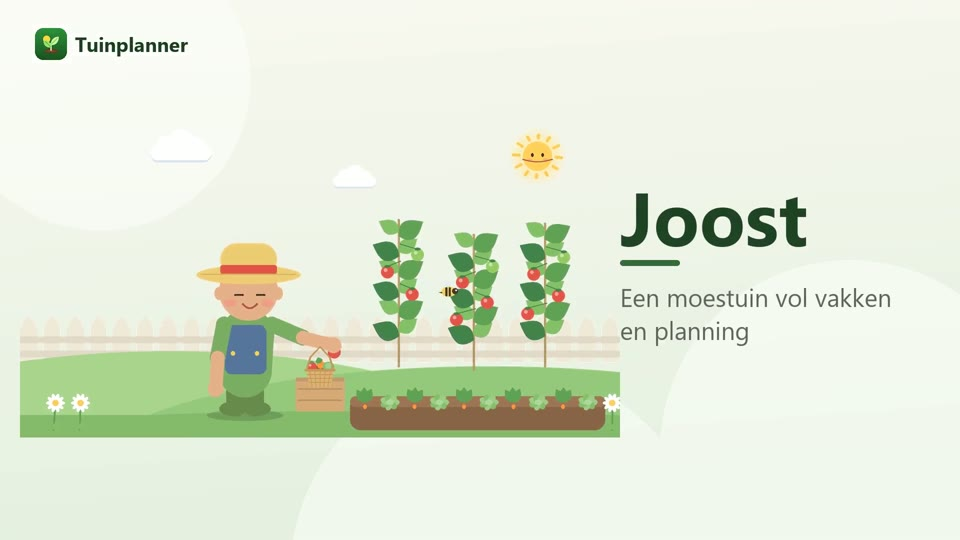</a> 
      <b>Joost: de moestuin</b> (3:48) 
      Wat nu in de grond moet, de tuin als diorama bewerken, een waarschuwing voor wisselteelt, oogst per jaar met de
      jaarkaart, en de kooplijst voor zaden.
    </td>
    <td align="center" width="50%">
      <a href="video/tuinplanner-ria.mp4">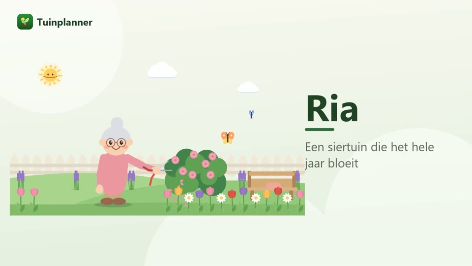</a> 
      <b>Ria: de siertuin</b> (3:30) 
      Borders en heesters in één beeld, snoeiadvies en bloeitijd per plant, snoeien in de kalender, dagboek met foto's
      en bollen op de kooplijst.
    </td>
  </tr>
</table>

De films staan als gewoon bestand in de map [`video/`](video/) (samen ongeveer 40 MB). Zie je geen speler, download
dan het bestand en open het op je computer of telefoon.

## Waarom

Een tuin vraagt aandacht op het juiste moment: te laat zaaien, water vergeten of een snoeibeurt missen. Tuinplanner
legt die momenten voor je op een rij. Je kiest wat je teelt, en de app laat per dag zien wat er aan de beurt is,
met uitleg en bronnen erbij. Het werkt volledig zonder internet; de plantenbibliotheek zit in de app.

Voor wie is het? Voor iemand met drie kamerplanten die niet wil vergeten ze water te geven, voor de moestuinier die
wil weten wat er deze maand in de grond moet en wat er vorig jaar stond, en voor de liefhebber van een siertuin met
rozen, hortensia's en heesters die op tijd gesnoeid moeten worden. Met de knop Simpel of Geavanceerd bepaal je zelf
hoeveel je ziet.

## Kort samengevat

| Onderdeel | Wat je krijgt |
|---|---|
| **Vandaag** | De taken van nu, een tuintje met pins op de vakken waar iets te doen is, weeradvies en je favorieten |
| **Plantenbibliotheek** | 638 planten, 21 bolgewassen en 156 kamerplanten (samen 794 planten in de lijst), met foto, bron en kweektips |
| **Mijn tuin** | Je planten per jaar en per vak, oogst en planning, tuin in cijfers, delen als plaatje |
| **Tuin ontwerpen** | Vakken tekenen, bewerken in het diorama, zon en schaduw, buren en wisselteelt |
| **Kalender** | Maand, week en jaar voor tuin, huis en eigen taken, met een volgorde die je zelf vastzet |
| **Planten in huis** | Water- en voedingsritme per plant, verpotten, giftigheid voor huisdieren, logboek |
| **Dagboek, foto's en oogst** | Wat je deed, wat eraan komt, je oogst per jaar en een jaarkaart om te delen |
| **Voorraad en taken** | Zaden en bollen, inkooplijst, eigen terugkerende taken |
| **Herinneringen en weer** | Meldingen, uitstellen, weer van Open-Meteo, widgets voor je beginscherm |
| **Uiterlijk** | Plantbeeld (iconen, tekeningen of foto's), beweging, donker thema, kleurenblind-palet, grote tekst |
| **Gegevens** | Offline, geen account, back-up inclusief foto's, jaarplan als PDF |

## De eerste keer

Bij het eerste gebruik loop je door vier korte stappen, die je ook kunt overslaan:

1. **Welkom.** Wat de app doet in één oogopslag: werkt zonder internet, je gegevens blijven op je toestel, alles is aan te passen.
2. **Hoeveel wil je zien?** Kies Simpel of Geavanceerd. Je kunt dit altijd wijzigen.
3. **Zo ziet je tuin eruit.** Een voorbeeldtuintje past zich meteen aan als je kiest tussen **Iconen**, **Tekeningen** of
   **Foto's** (Plantbeeld) en tussen **Rustig**, **Subtiel** of **Beleving** (Beweging).
4. **Wil je een herinnering?** Kies of je meldingen wilt en hoe laat.

  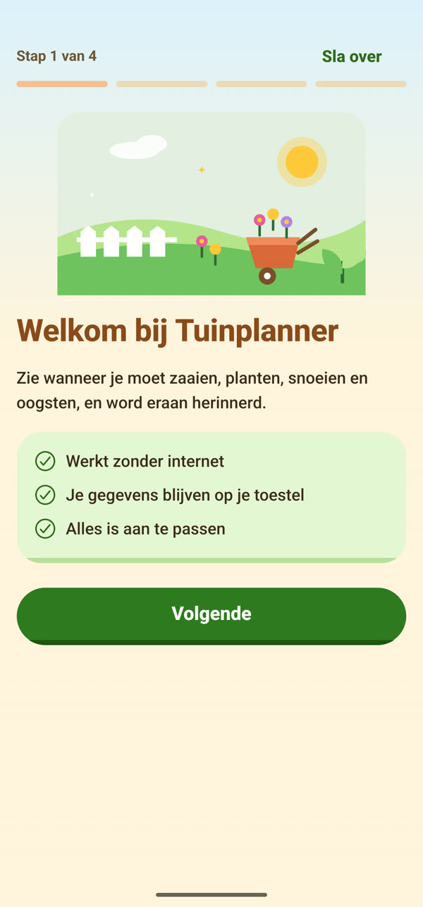
  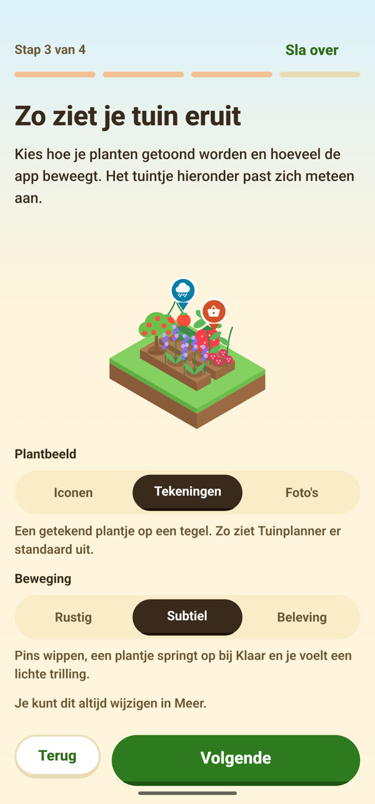
  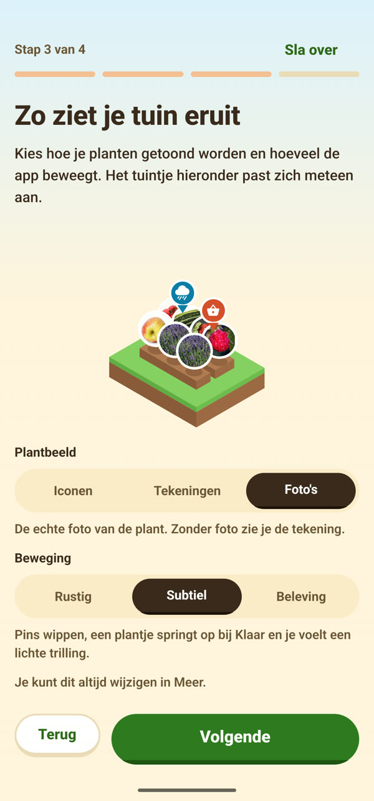

## Vandaag

Het beginscherm toont de taken van nu: zaaien, voorzaaien, planten, snoeien, oogsten, water geven en voeden.
Bovenaan staat een groet met een zin over het seizoen en een tuintje (diorama) met pins op de vakken waar iets te doen
is. Tik op het tuintje om de tuin te openen.

  
  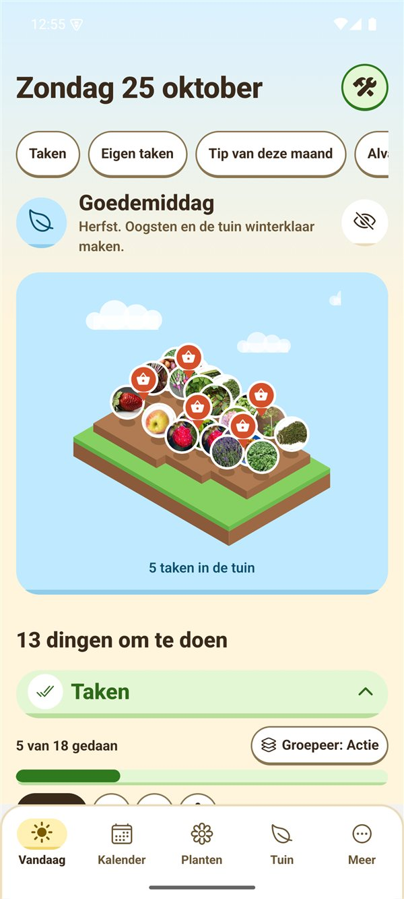
  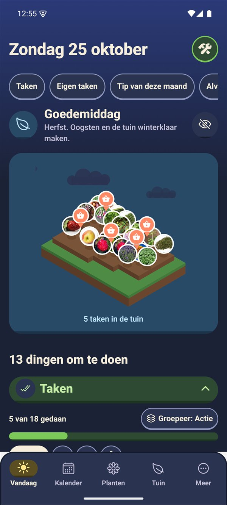

- **Afvinken met één tik.** Een oogst vraagt meteen hoeveel je hebt geoogst, zodat je dagboek vanzelf klopt.
- **Vegen.** Veeg een taak naar links om hem af te vinken en naar rechts om hem uit te stellen. Je draait dat om of zet
  het uit onder Instellingen. Een korte melding met *Ongedaan* laat je een misser herstellen, en gedane taken
  verdwijnen uit de lijst.
- **Meerdere tegelijk kiezen.** Houd een rij of tegel ingedrukt om er meer te kiezen; onderaan verschijnen dan de
  acties (op je lijst zetten, status wijzigen, verwijderen). Zonder keuze zijn ze er niet. Het werkt ook in het
  dagboek en in de zoekresultaten.
- **Later**: stel een taak uit tot morgen, volgende week of een aantal dagen dat je zelf kiest.
- **Groeperen en filteren** op actie, plant of tuinvak, met chips voor water, voeding en verpotten van planten in huis.
- **Planten in huis tussen de taken**: water, voeding en verpotten staan als gewone rijen in de lijst en tellen mee in
  je voortgang. Je kiest zelf of ze ingeklapt bovenaan of onderaan staan.
- **Jouw favorieten**: een rij met planten waar je een ster bij hebt gezet.
- **Snelle knop**: een zwevende knop met Notitie, Foto en Oogst, zodat je onderweg in de tuin snel iets vastlegt. Uit te zetten in Instellingen.
- **Alvast plannen**: kijk vooruit naar wat er de komende maanden komt.
- **Tip van deze maand** voor de planten die je hebt, met bron.
- **Weeradvies**: waarschuwing bij vorst, hitte, droogte of veel regen, met de namen van je vorstgevoelige planten.
- **Water bij regen**: is regen voorspeld, dan stelt de app voor om je eigen water-taken van vandaag over te slaan.
  Jij bevestigt met een tik. Dit werkt alleen voor eigen taken met een water-woord in de titel, want voor buitenplanten
  bestaat in de gegevens geen gietschema.
- **Jaaroverzicht in december en januari**: een uitnodiging om je oogstjaar te bekijken en te delen.
- **Wat is nieuw**: na een update verschijnt eenmalig een kaartje met wat er veranderd is. Uit te zetten.
- Op een tablet staat Vandaag in twee kolommen.

## Plantenbibliotheek

638 planten en 21 bolgewassen voor je tuin, plus 156 kamerplanten, elk met zaai-, plant-, snoei- en oogstmaanden,
afstand, standplaats, goede en slechte buren, foto's en bronnen. Dat zijn 794 planten in de lijst.

  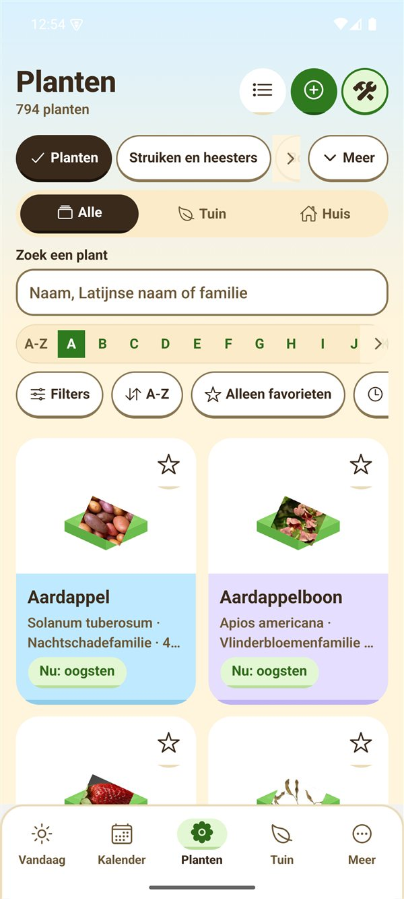
  
  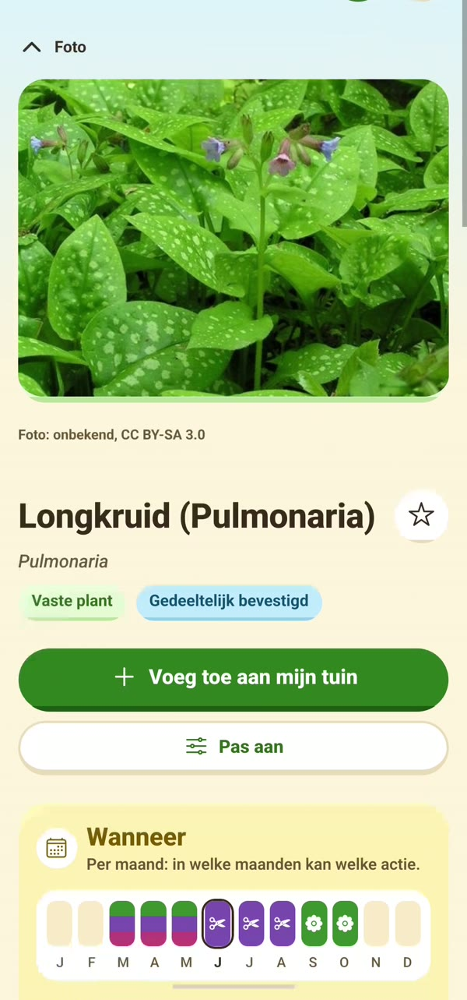
  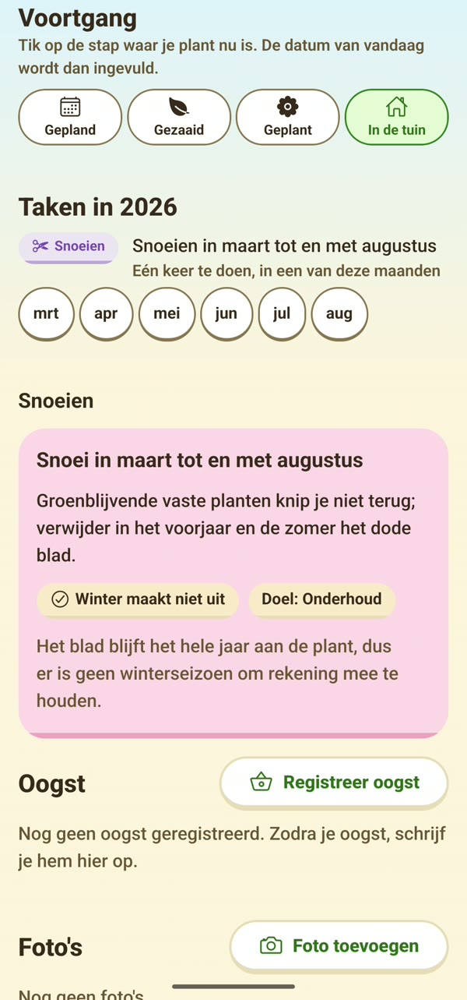

- **Meer dan alleen groenten.** Bomen, coniferen, heesters, klimplanten, bodembedekkers, vaste planten, siergrassen,
  rozen, haagplanten, groenbemesters, fruit en bessen, kruiden, wilde groenten, paddenstoelen en noten. Het
  categorieënmenu heeft 17 categorieën; twee kies je vast als snelkeuze in de balk.
- **Kweektips per maand**, met de bron erbij. Voor 590 planten staan ze in de bibliotheek, uit teeltpagina's van onder
  andere de RHS; een deel is op soortgroep in plaats van op de soort zelf gebaseerd. Wat niet te onderbouwen is, staat er niet.
- **Snoeiadvies** bij elke plant, inclusief of het "pas na de winter" kan en wat het doel is (onderhoud, verjonging).
- **Richtwaarden zijn gemarkeerd.** Bij plantafstand, bloei en snoeimaanden die uit één bron komen, afgerond of
  afgeleid zijn, staat "(richtwaarde)". Plant- en snoeimaanden van de nieuwere bomen en heesters komen deels uit algemene
  RHS-gidsen en zijn indicatief.
- **Ziekten en plagen** met herkennen en voorkomen, en een bron.
- **Filters en sortering** op groep, rol, familie, standplaats, plantafstand, betrouwbaarheid, actie en maand. Koppen
  zijn inklapbaar en onthouden hun stand. Sorteer op A-Z, nu zaaien, favorieten eerst of laatst bekeken.
- **Snelle keuzes** zoals "Kan nu", "Nu zaaien" en "Nu planten", plus een A-Z-balk die bovenaan blijft staan terwijl je scrolt.
- **Raster, lijst of compact**: drie manieren om de bibliotheek te tonen.
- **Alle, Tuin of Huis**: de lijst toont de tuinbibliotheek, de kamerplanten of allebei.
- **Favorieten**: zet een ster bij een plant (in de lijst of het detail) en filter op "Alleen favorieten".
- **Paddenstoelen en noten**: 21 eetbare paddenstoelen om te kweken en 27 noten, zaden en verwante gewassen, met kweekinfo en
  bron. Giftige verwisselingen staan erbij, en bij hennep alleen een wettelijke waarschuwing.
- **Giftig of let op**: bij 259 planten staat een rode kaart *Giftig* (84) of een gele kaart *Let op* (175), met bron.
  Zonder kaart is een plant niet per se veilig.
- **Eigen plant toevoegen** als jouw plant er niet bij staat.
- Foto's van Wikimedia Commons, met altijd maker en licentie erbij. Je kunt de foto in het detail inklappen of kleiner zetten.

## Mijn tuin

De planten die je teelt of wilt gaan telen, per jaar en per vak.

  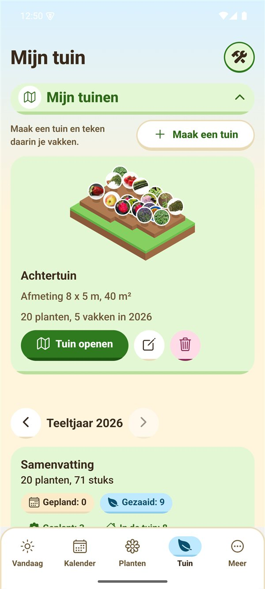
  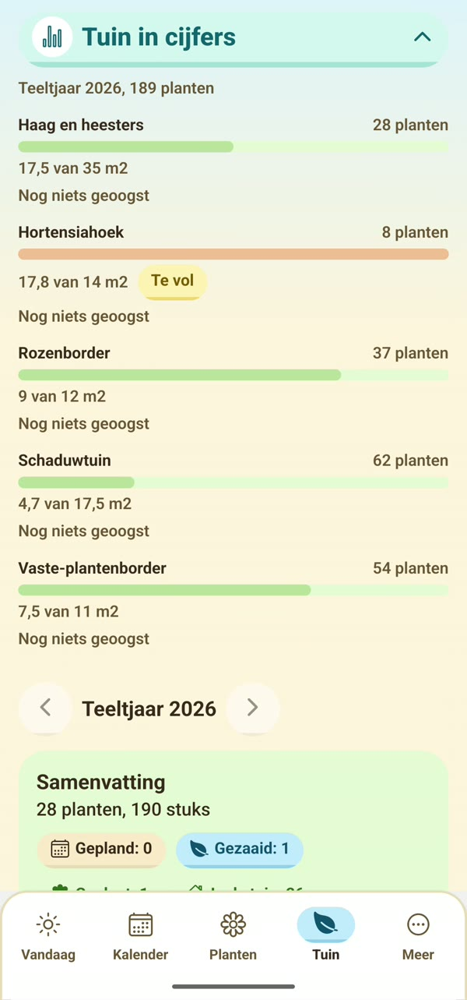
  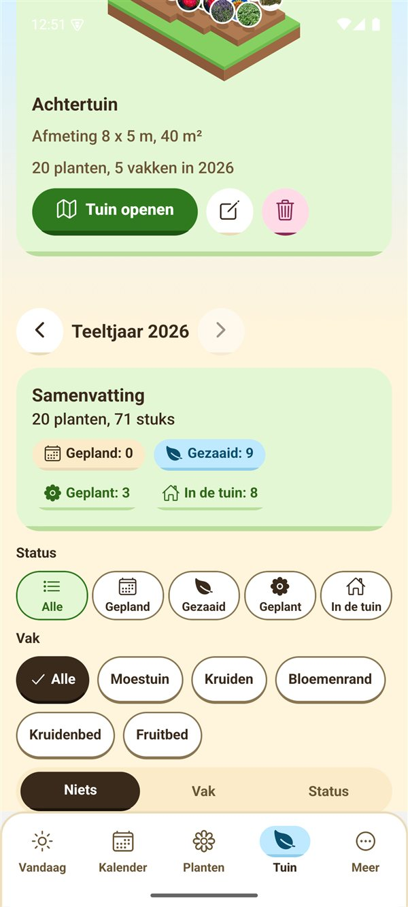
  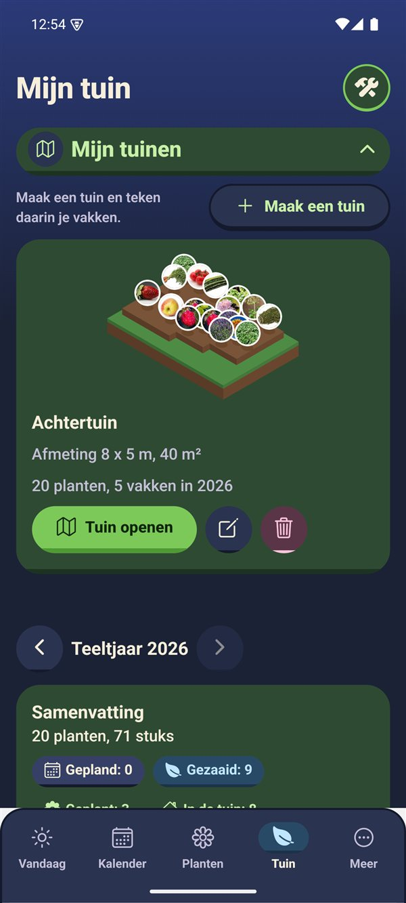

- Per plant: aantal, vak, ras, zaai- en plantdatum, status (gepland, gezaaid, geplant, in de tuin), oogsten, foto's en notities.
- **Meerdere tuinen** met elk een eigen afmeting (de app rekent de oppervlakte uit) en een eigen diorama.
- **Vaste planten** komen elk jaar vanzelf terug.
- **Oogst en planning per jaar**: zie hoeveel je van elke soort hebt gepland, met de ruimte die ze innemen, hoeveel er
  nog in een vak past, en een jaarbalk per soort. Pas aantallen aan en neem de planning van dit jaar over naar het volgende.
- **Tuin in cijfers**: per vak de bezetting in vierkante meter, het aantal planten en de oogst van dit jaar, met een
  markering *Leeg*, *Bijna leeg* of *Te vol*.
- **Deel als plaatje**: maak van je tuin een plaatje om te delen met familie of buren.
- Een plant verwijderen kan met lang indrukken of de prullenbak, altijd met een bevestiging.
- Plant bewerken vanuit een vak? Sluiten brengt je terug in dat vak, niet in de tuin.

## Tuin ontwerpen

Teken je tuin met vakken en zie wat er waar kan. In de editor wissel je tussen **Kaart** (bovenaanzicht), **Lijst** en
**Diorama** (een isometrisch beeld met tegels, planten en pins).

  
  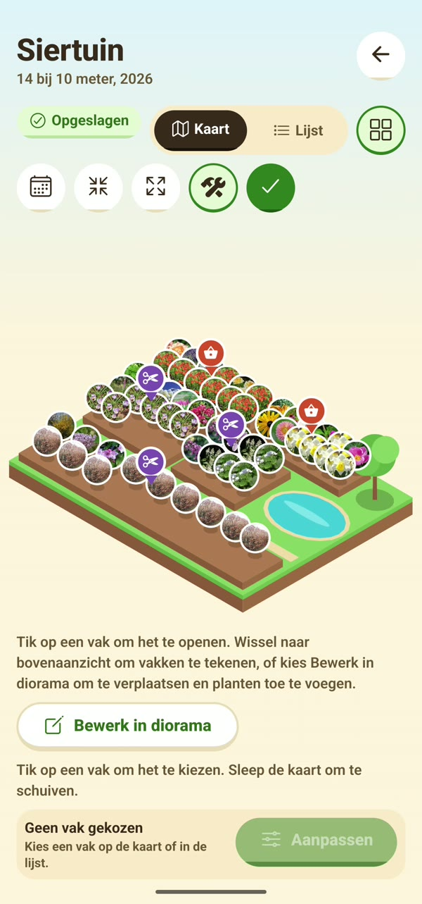
  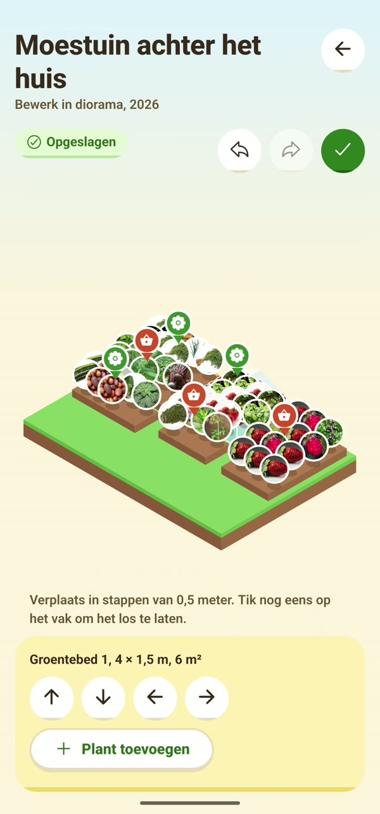
  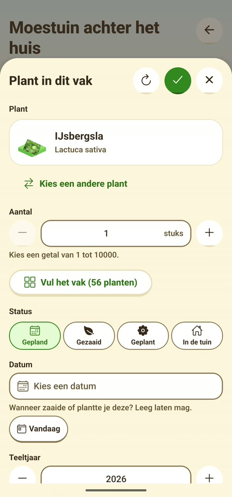

- **Vakken** met afmetingen, planten erin en een achtergrondfoto van je eigen tuin. Ook paden, water, bomen en kassen.
- **Bewerk in diorama**: kies een vak door erop te tikken, verplaats het met pijlen in stappen van een halve meter
  (de app let op de rand en op botsingen), voeg een plant toe en maak ongedaan of opnieuw. Slepen met de vinger is er niet.
- **Wisselteelt (vruchtwisseling)**: staat dezelfde plantenfamilie te kort op dezelfde plek, dan krijgt het vak een
  rode stippelrand en een waarschuwingskaart met uitleg. Die rand zie je ook in Mijn tuin en op Vandaag.
- **Zon en schaduw**: de app rekent de zonnestand door voor 21 juni en houdt rekening met bomen en kassen.
- **Buren**: waarschuwing als planten naast elkaar niet goed samengaan.
- **Vak vullen**: de app rekent uit hoeveel planten er met de juiste afstand in passen.
- **Jaren vergelijken en kopiëren**: zie wat er vorig jaar in een vak stond en neem een jaar over naar het volgende.
- **Vaste kop in elk paneel**: bij formulieren in een paneel staan het vinkje, een reset-icoon en het kruisje altijd
  zichtbaar boven. Het vinkje is pas aan te klikken als er iets veranderd is en alles klopt; reset zet alles terug.

  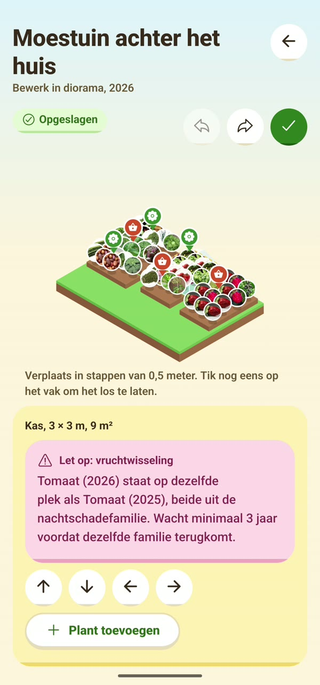

## Kalender

  
  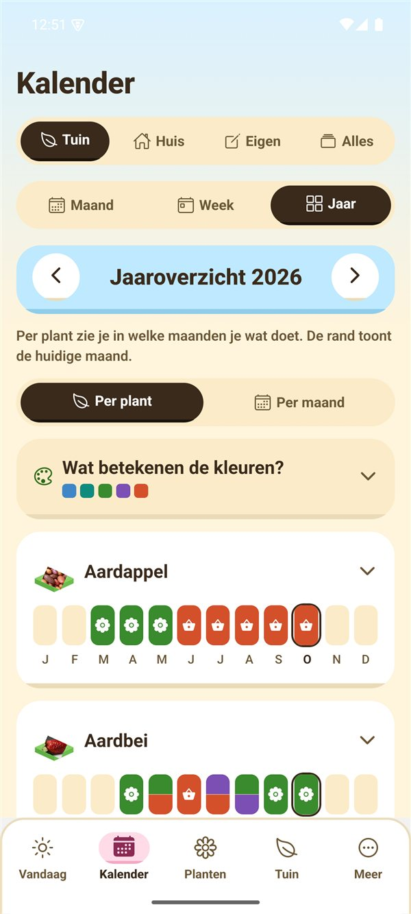
  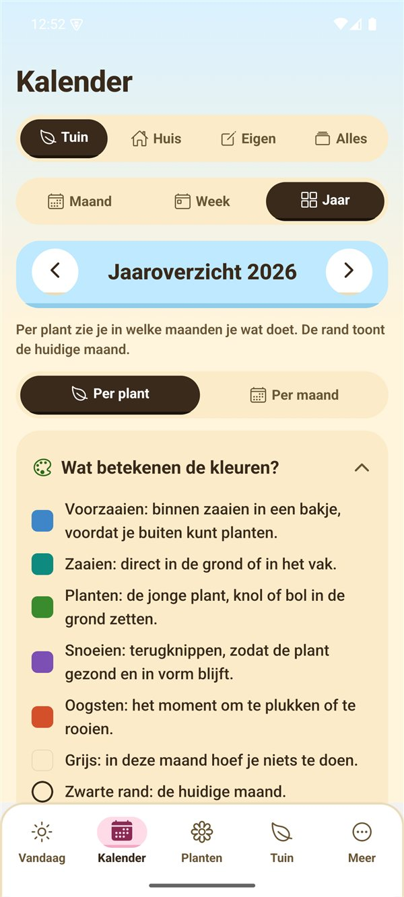
  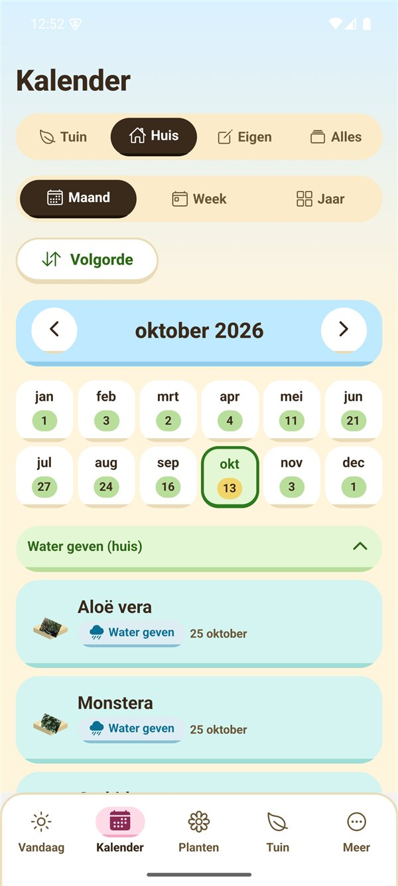

- **Maand**, **Week** of **Jaar**, voor **Tuin**, **Huis**, **Eigen** of **Alles**. In Instellingen kies je wat je als eerste ziet.
- **Maandtegels**: elke maand is een rustige tegel met naam en het aantal taken in een ronde badge.
- **Water geven in de kalender**: water en voeding van planten in huis staan in de maandlijst en het weekoverzicht bij
  elke bron behalve Eigen.
- **Volgorde die je zelf vastzet**: met de knop *Volgorde* schuif je oogsten, snoeien, planten, zaaien, voorzaaien,
  water, voeden en eigen taken omhoog of omlaag. De keuze blijft bewaard en bepaalt ook de indeling binnen een dag.
- Het **jaaroverzicht** toont per plant gekleurde balkjes, met een icoon als een maand maar één actie heeft. Je kiest
  tussen *Per plant*, *Per maand* en een *Raster*.
- **Week**: je eigen taken, het water en de voeding voor je planten in huis per dag, en bovenaan "Nog te doen". Groepen
  staan open als er nog iets te doen is, en klappen dicht als alles gedaan is. Houd een gekleurd maandblok ingedrukt
  voor uitleg bij de kleuren.
- Eigen taken per week; lege weken zijn standaard verborgen. Lege schermen hebben een knop om iets toe te voegen.
- Exporteer taken naar de agenda van je telefoon (ICS-bestand).

## Planten in huis

156 soorten kamerplanten met foto, bron en richtwaarden. Je krijgt per soort het water- en voedingsritme, de plek,
tips per maand en of de plant giftig is voor huisdieren (volgens de ASPCA).

  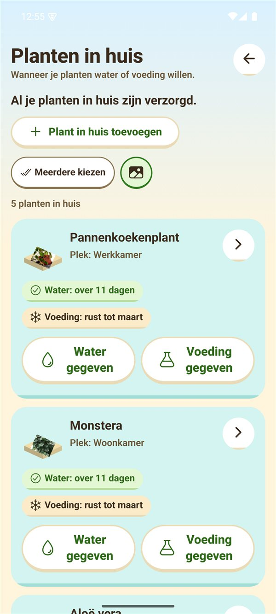
  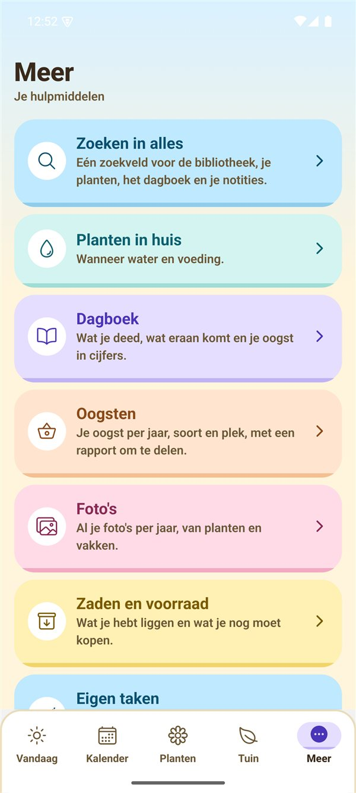

- **Water geven met een veeg op Vandaag**: de app onthoudt wanneer de plant weer water wil.
- **Meerdere planten tegelijk**: kies er een paar en geef ze in één keer water of voeding (Meerdere kiezen).
- **Elke plant op zijn eigen plek**: Woonkamer, Keuken, Werkkamer en wat je zelf bedenkt.
- Zoek op naam of op een andere naam: "vingeraralia" vindt de Vingerboom.
- Houd een probleemlogboek bij en voeg foto's toe.
- Voeg een eigen soort toe als jouw plant er niet bij staat, met een eigen foto.
- **Verpotten**: kort ongedaan maken en een herinnering per plant (elk jaar, om de 2 of 3 jaar), met een taak op Vandaag als het tijd is.
- Een jaarkaart per plant in de kalender (Huis, Jaar) met foto en jaarbalk.

## Dagboek, foto's en oogst

  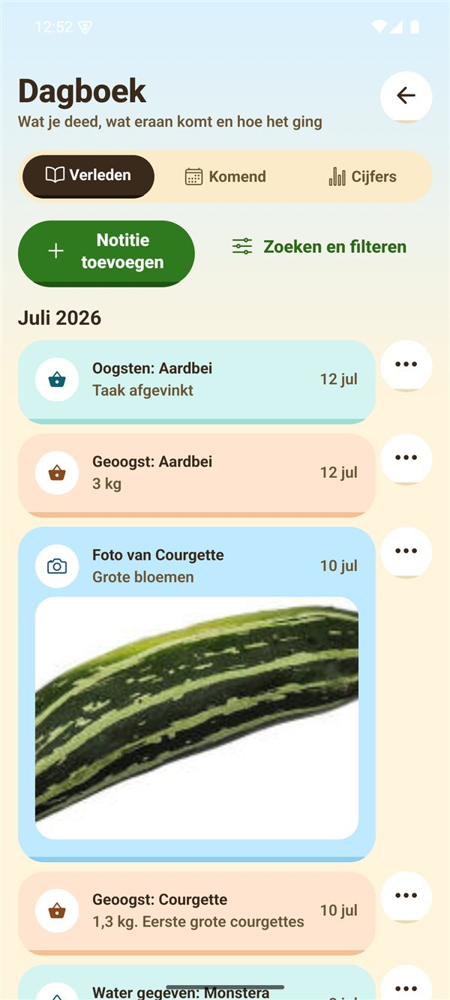
  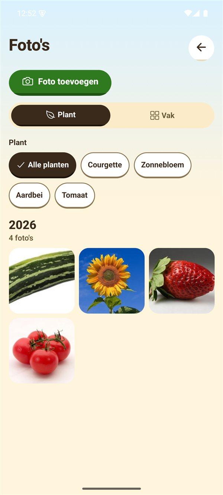
  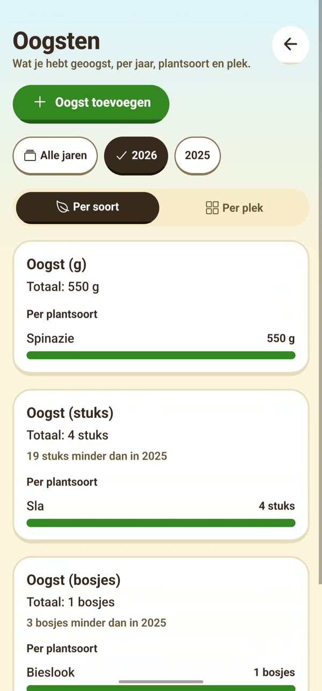
  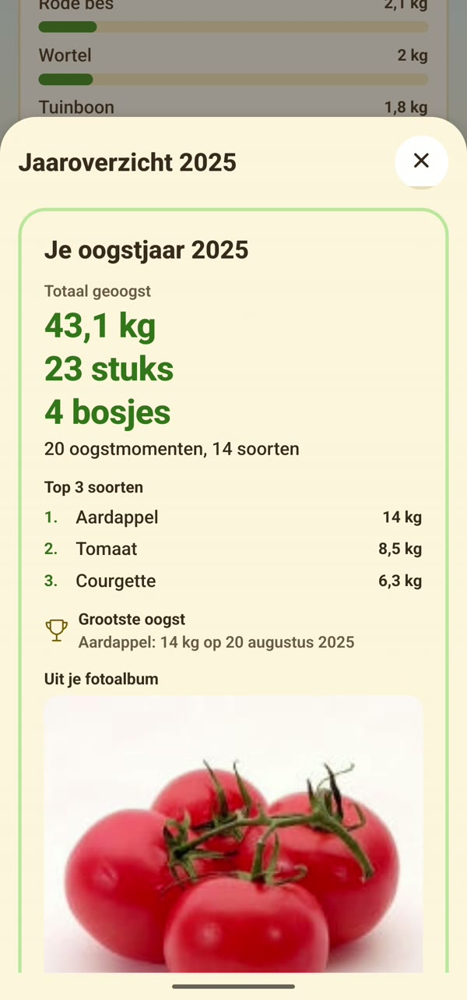

- **Komend**: achterstallige taken en taken van deze en volgende weken, direct af te vinken. Hoe ver vooruit je mag
  afvinken (1 week, 1 maand of 3 maanden) stel je zelf in.
- **Geschiedenis** van wat je deed, met notities en foto's.
- **Cijfers**: wat je hebt geoogst, gezaaid en geplant, in een korte en een lange statistiekenpagina, ook per jaar.
- **Oogsten** heeft een eigen scherm (Meer, Oogsten): per jaar, soort en plek, over meerdere jaren, met een rapport om
  te delen en een knop om een oogst toe te voegen.
- **Jaarkaart**: per jaar je totalen, records, top 3 en foto's uit je album. Bij de instelling Beleving krijg je er
  confetti bij. Deel de kaart als plaatje (PNG).
- **Fotoalbum** per plant, tuin of vak, met een tijdlijn. Voeg een eigen foto toe via een wizard in drie stappen.

## Voorraad en eigen taken

  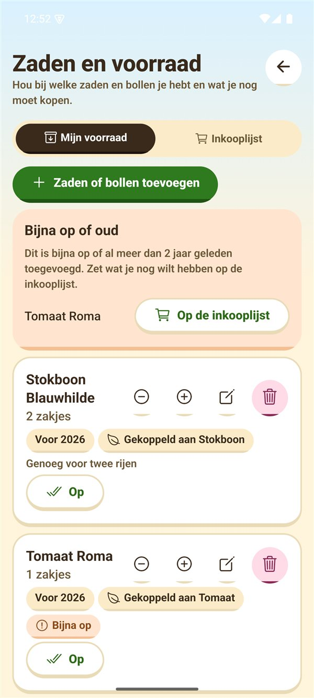
  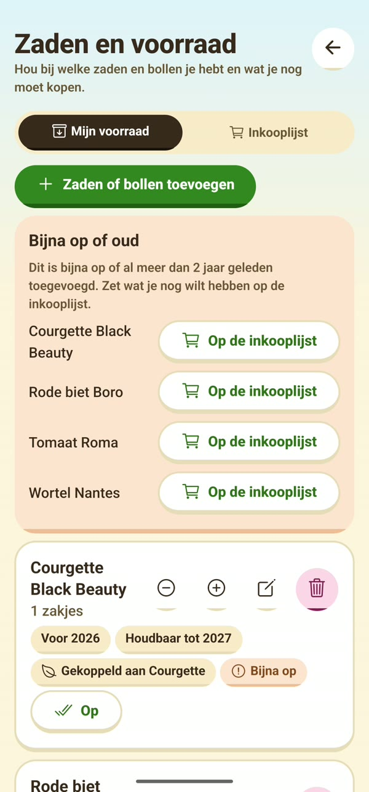
  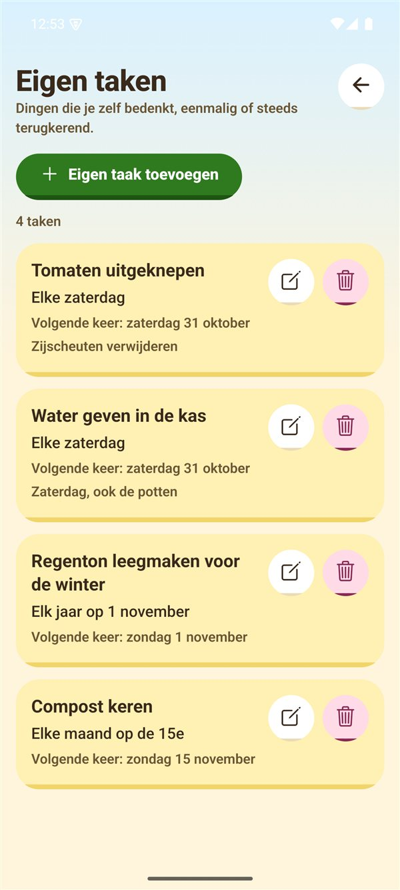

- **Zaden en bollen**: naam en plant koppelen, houdbaarheid (ook voor meerdere jaren) en een foto van het zakje.
- **Bijna op en te oud**: de app markeert zaden waarvan er nog één of minder is, en zaden ouder dan twee jaar, met een
  knop naar de inkooplijst.
- **Inkooplijst** uit wat je nodig hebt voor het komende jaar, ook voor het jaar erna.
- **Eigen taken**: terugkerend, te koppelen aan meerdere planten en vakken. Herhalingen: elke week, om de 2 weken, elke
  maand, om de 2 maanden, elke 3 maanden, elk half jaar, elke 9 maanden, elk jaar, om het jaar en om de 3 jaar.

## Herinneringen en weer

- **Meldingen** op je toestel: dagelijks of wekelijks, en een weekoverzicht op zondagavond.
- **Uitstellen**: een taak een dag, een week of een zelfgekozen aantal dagen opschuiven.
- **Slimme meldingstijd** (optioneel): de app kiest het moment waarop je de app meestal opent.
- **Back-up herinnering**: laat de app je eraan herinneren om een back-up te maken (uit, 1 week, 2 weken, 1 maand of 3 maanden).
- **Weer**: voorspelling van Open-Meteo voor je plaats, met advies bij vorst, hitte, droogte of veel regen.
- **Eigen vorstdata**: stel zelf je laatste en eerste vorst in.

## Widgets

Vier widgets voor je beginscherm, die volgen het kleurenblind-palet als je dat aan hebt staan:

- **Tuin, teller**: hoeveel acties je nog moet doen en hoeveel er te laat zijn.
- **Tuin, kort overzicht**: de eerstvolgende drie acties.
- **Tuin, lang overzicht**: een lijst met de acties van deze maand en je voortgang.
- **Tuin, vandaag**: voortgang van vandaag, de volgende actie en het weer.

## Zoeken en back-up

- **Zoeken in alles**: bibliotheek, jouw planten, dagboek, eigen taken en voorraad, met foto's in de resultaten.
- **Alleen eetbaar**: een schakelaar in Zoeken toont alleen wat je kunt eten. Zaadnamen als zonnebloempit of pompoenpit vind je bij de plant.
- **Back-up**: exporteer en importeer al je gegevens, inclusief foto's, of laat de app elke week automatisch een
  back-up in een gekozen map zetten.
- **Jaarplan als PDF**: eerst een voorbeeld op het scherm, daarna openen, opslaan of delen.

## Uiterlijk en toegankelijkheid

Het ontwerp heet *Tuinwereld*: warm crème, dikke zachte kaarten, ronde knoppen en kleuren per onderdeel (gras, oranje,
turkoois, paars, geel, roze en hemel).

- **Plantbeeld**: kies voor **Iconen** (een pictogram per plantgroep), **Tekeningen** (een getekend plantje op een
  tegel, meer dan 50 vormen) of **Foto's** (de echte foto op een tegel; zonder foto zie je de tekening). Het geldt in
  lijsten, taken, kalender, tuinvakken, kamerplanten en het diorama.
- **Beweging**: **Rustig** (geen animatie of trilling), **Subtiel** (pins wippen, een plantje springt op bij Klaar,
  een lichte trilling) of **Beleving** (daarbovenop confetti bij Klaar en wolken en regen boven het tuintje). Staat
  de beweging-vermindering van je toestel aan, dan krijg je altijd Rustig.
- **Luchtverloop** (optioneel, standaard uit): een kleurverloop bovenaan dat het tijdstip en het seizoen volgt.
- **Licht of donker**, volgens je toestel of zelf gekozen.
- **Tekstgrootte**: normaal, groot of extra groot.
- **Kleurenblind-vriendelijk palet** (Okabe-Ito) voor de statuskleuren, ook in de widgets.
- Werkt met **TalkBack** en past zich aan op **tablets** (twee kolommen op Vandaag, bredere indelingen).
- Instellingen zijn een eigen menu met een scherm per groep en een zoekveld.

## Simpel of geavanceerd

Met één knop rechtsboven zet je geavanceerd aan of uit. Simpel toont alleen wat je nu nodig hebt. Geavanceerd
toont alle details en geeft je in Instellingen **26 extra functies** die je één voor één aan of uit zet:

tip met bron, tip van de maand op Vandaag, kamerplant-tips, ziekten en plagen, wisselteelt-waarschuwing,
houdbaarheid van zaad, weeradvies, vorstdatum per regio, weekoverzicht, agenda-export, taken uitstellen, slimme
meldingstijd, schaduwanalyse, burencontrole, vak automatisch vullen, jaren vergelijken, achtergrondfoto van je tuin,
fototijdlijn, oogstgrafiek, boodschappenlijst, eigen taken op Vandaag, planten in huis op Vandaag, alvast plannen,
globaal zoeken, tabletindeling en automatische back-up.

Er gaat niets verloren als je wisselt.

## Installeren

1. Open de pagina **[Releases](../../releases)** en download op je telefoon de nieuwste `tuinplanner-<versie>.apk`.
2. Open het bestand. Vraagt Android erom, sta dan installeren uit deze bron toe.
3. Start Tuinplanner. Klaar.

De app is bedoeld om zelf te installeren en staat niet in de Play Store.

**Eisen.** Android 7.0 of nieuwer en een 64-bits telefoon of tablet (arm64). Het installatiebestand is groot
(ongeveer 155 MB), omdat de hele plantenbibliotheek met foto's erin zit; daarna werkt alles zonder internet.

### Updates

Open in de app **Meer, Instellingen** en controleer op updates. De app zoekt de nieuwste release hier, haalt hem
op en vraagt Android om te installeren. Er wordt niets geïnstalleerd zonder jouw bevestiging.

## Privacy

- Alles werkt offline; je planten, foto's en notities blijven op je toestel.
- De app gebruikt internet alleen voor het optionele weeradvies (Open-Meteo) en om een nieuwe versie te zoeken.
- Geen accounts, geen advertenties en geen tracking.

## Veelgestelde vragen

**Moet ik een account maken?** Nee. Er is geen account en er wordt niets naar een server van ons gestuurd.

**Werkt het zonder internet?** Ja. Alleen het weeradvies en het zoeken naar updates gebruiken internet, en die zijn optioneel.

**Hoe neem ik mijn gegevens mee naar een nieuwe telefoon?** Maak onder Instellingen, Back-up een export (met foto's) en
importeer die op de nieuwe telefoon. Je kunt ook elke week automatisch een back-up in een map laten zetten.

**Waarom staat er "richtwaarde" bij sommige getallen?** Omdat de bron geen exacte waarde geeft, of omdat we er één
bron voor vonden. De app doet er geen voorstelling van dat het zekerder is.

**Staat er een plant niet bij?** Voeg hem zelf toe als eigen plant of, voor kamerplanten, als eigen soort.

**Is een plant zonder rode of gele kaart veilig?** Niet per se. De kaarten Giftig en Let op staan alleen bij planten
waarvoor we een bron vonden.

**Zie je de films niet afspelen?** Download het bestand uit de map [`video/`](video/) en speel het lokaal af.

**Waarom staat de app niet in de Play Store?** Hij is bedoeld om zelf te installeren.

## Versiegeschiedenis

Een greep uit wat er per versie is bijgekomen. Alle versies staan op de pagina [Releases](../../releases).

| Versie | Wat is er nieuw |
|---|---|
| **3.4.0** | Onboarding met een voorbeeldtuintje (plantbeeld en beweging kiezen); de app start ongeveer twee keer zo snel en de plantenlijst scrolt vloeiender |
| **3.3.0** | Bewerken in het diorama, wisselteelt-waarschuwing, tuin in cijfers, tuin delen als plaatje, oogst-jaarkaart, snelle knop, luchtverloop, water bij regen, kalenderraster |
| **3.2.x** | Favorieten, sorteren, kleurenblind-palet en extra grote tekst, back-up herinnering, kalender met maandtegels, water geven en vaste volgorde, vaste kop met vinkje en reset in panelen |
| **3.1** | Beweging (rustig, subtiel, beleving), Instellingen als eigen menu |
| **3.0** | Nieuw ontwerp *Tuinwereld*, plantbeeld met iconen, tekeningen of foto's, tuintje op Vandaag |
| **2.x** | 143 nieuwe bomen, heesters, klimplanten en vaste planten (638 planten), categorieënmenu, kweektips voor 140 extra planten, richtwaarden gemarkeerd |
| **1.x** | Vegen op taken, meerdere kiezen, planten in huis tussen de taken, week in de kalender, oogsten, verpotten, paddenstoelen en noten, giftig of let op |

## Bronnen en dank

De plantgegevens zijn samengesteld uit openbare bronnen, met een bron per plant (zie **Meer, Bronnen en foto's** in de app).
Foto's komen van Wikimedia Commons onder vrije licenties; maker en licentie staan bij elke foto.
Weerdata: Open-Meteo. Giftigheid voor huisdieren: ASPCA.

## Broncode

De broncode van dit project is privé. Deze repository bevat alleen de releases, de films en deze pagina.

## Vragen of ideeën

Maak een [issue](../../issues) aan. Gemaakt met liefde voor de natuur.
