# Tuinplanner

**Nederlands** · [English](README.en.md) · [Deutsch](README.de.md) · [Français](README.fr.md) · [Español](README.es.md)

**Weten wat je vandaag in de tuin en in huis moet doen, ook zonder internet.**
Tuinplanner is een vriendelijke planner voor Android: hij laat zien wanneer je moet zaaien, planten, snoeien en
oogsten, herinnert je eraan en houdt bij wat er in je tuin en in huis groeit. Geen account, geen advertenties,
geen tracking: je gegevens blijven op je telefoon.

  
  
  
  

## Inhoud

[Waarom](#waarom) · [Vandaag](#vandaag) · [Bibliotheek](#plantenbibliotheek) · [Mijn tuin](#mijn-tuin) ·
[Tuin ontwerpen](#tuin-ontwerpen) · [Kalender](#kalender) · [Planten in huis](#planten-in-huis) ·
[Dagboek en foto's](#dagboek-en-fotos) · [Voorraad en taken](#voorraad-en-eigen-taken) ·
[Herinneringen en weer](#herinneringen-en-weer) · [Zoeken en back-up](#zoeken-en-back-up) ·
[Simpel of geavanceerd](#simpel-of-geavanceerd) · [Installeren](#installeren) · [Privacy](#privacy)

## Waarom

Een tuin vraagt aandacht op het juiste moment: te laat zaaien, water vergeten of een snoeibeurt missen. Tuinplanner
legt die momenten voor je op een rij. Je kiest wat je teelt, en de app laat per dag zien wat er aan de beurt is,
met uitleg en bronnen erbij. Het werkt volledig zonder internet; de plantenbibliotheek zit in de app.

## Vandaag

Het beginscherm toont de taken van nu: zaaien, voorzaaien, planten, snoeien, oogsten, water geven en voeden.

  
  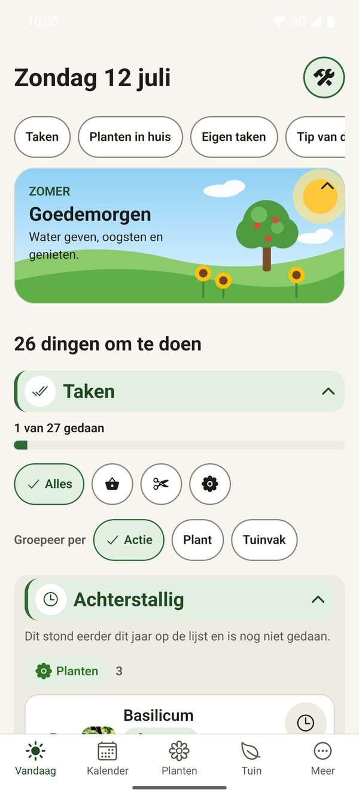
  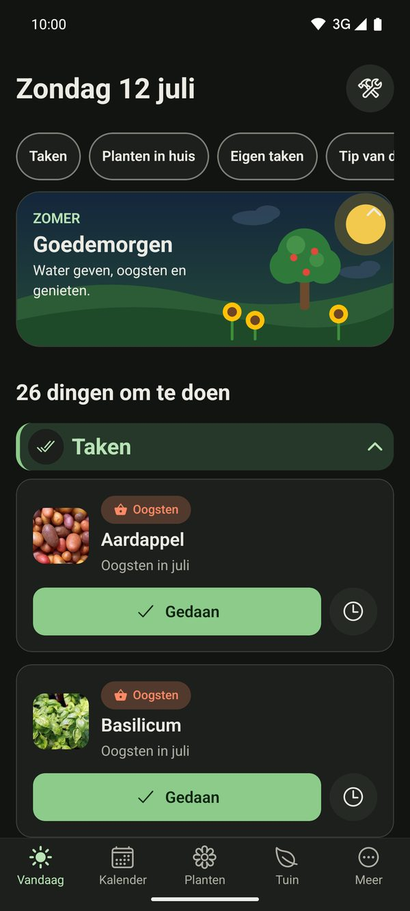

- **Afvinken met één tik.** Een oogst vraagt meteen hoeveel je hebt geoogst, zodat je dagboek vanzelf klopt.
- **Meerdere tegelijk kiezen.** Houd een rij of tegel ingedrukt om er meer te kiezen; onderaan verschijnen dan de acties (op je lijst zetten, status wijzigen, verwijderen). Zonder keuze zijn ze er niet.
- **Vegen.** Veeg een taak naar links om hem af te vinken en naar rechts om hem uit te stellen. Je draait dat om of zet het uit onder Instellingen. Een korte melding met *Ongedaan* laat je een misser herstellen, en gedane taken verdwijnen uit de lijst.
- **Later**: stel een taak uit tot morgen, volgende week of een aantal dagen dat je zelf kiest.
- **Groeperen en filteren** op actie, plant of tuinvak.
- **Tip van deze maand** voor de planten die je hebt, met bron.
- **Weeradvies**: waarschuwing bij vorst, hitte, droogte of veel regen, met de namen van je vorstgevoelige planten.
- **Eigen taken en planten in huis** staan in aparte blokken die je kunt in- en uitklappen.
- Op een tablet staat Vandaag in twee kolommen.

## Plantenbibliotheek

495 planten en 21 bolgewassen, elk met zaai-, plant-, snoei- en oogstmaanden, afstand, standplaats, goede en slechte
buren, foto's en bronnen.

  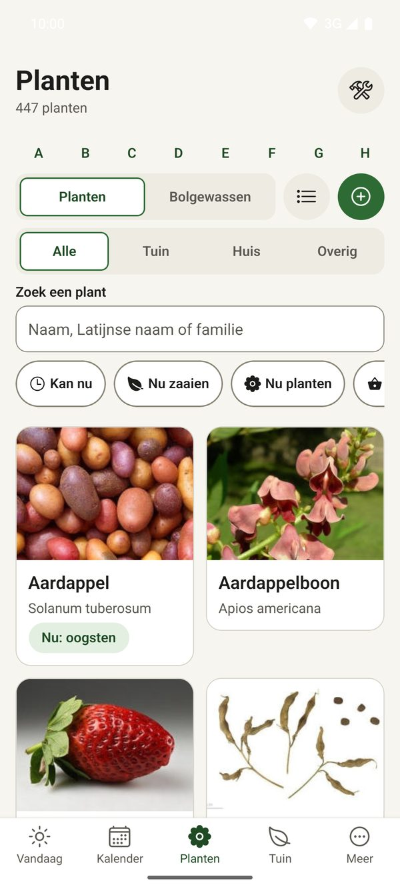
  
  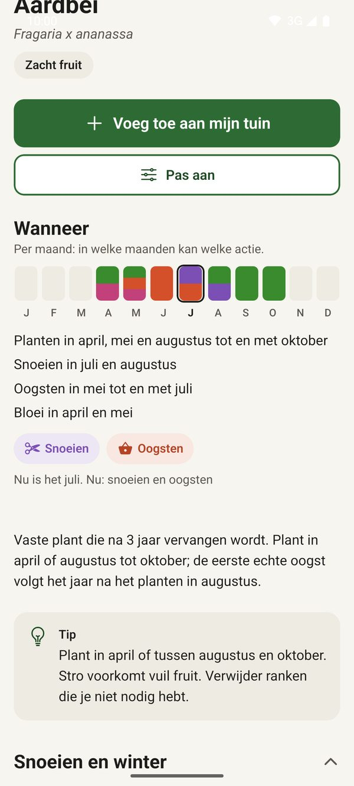

- **Kweektips per maand**, met de bron erbij. De tips voor 57 planten zijn uit teeltpagina's van de RHS; voor de
  rest zijn ze afgeleid uit de maanden in de gegevens. Wat niet te onderbouwen is, staat er niet.
- **Ziekten en plagen** met herkennen en voorkomen, en een bron.
- **Snoeiadvies** inclusief of het "pas na de winter" kan.
- **Filters en sortering** op groep, rol, familie, standplaats, plantafstand, betrouwbaarheid, actie en maand. Koppen
  zijn inklapbaar en onthouden hun stand.
- **Snelle keuzes** zoals "Kan nu", "Nu zaaien" en "Nu planten", plus een A-Z-balk.
- **Alle, Tuin of Huis**: de lijst toont de tuinbibliotheek, de kamerplanten of allebei. Bij bolgewassen alleen de bollen die ook binnen kunnen.
- **Paddenstoelen en noten**: 21 eetbare paddenstoelen om te kweken en 27 noten, zaden en verwante gewassen, met kweekinfo en bron. Giftige verwisselingen staan erbij, en bij hennep alleen een wettelijke waarschuwing.
- **Giftig of let op**: bij 216 planten staat een rode kaart *Giftig* of een gele kaart *Let op*, met bron. Zonder kaart is een plant niet per se veilig.
- Foto's van Wikimedia Commons, met altijd maker en licentie erbij.

## Mijn tuin

De planten die je teelt of wilt gaan telen, per jaar en per vak.

  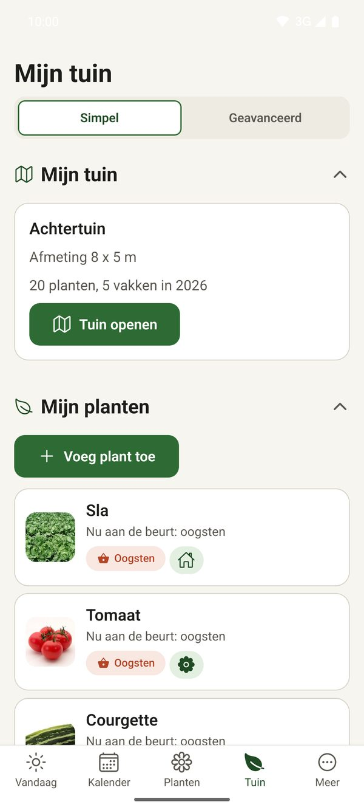
  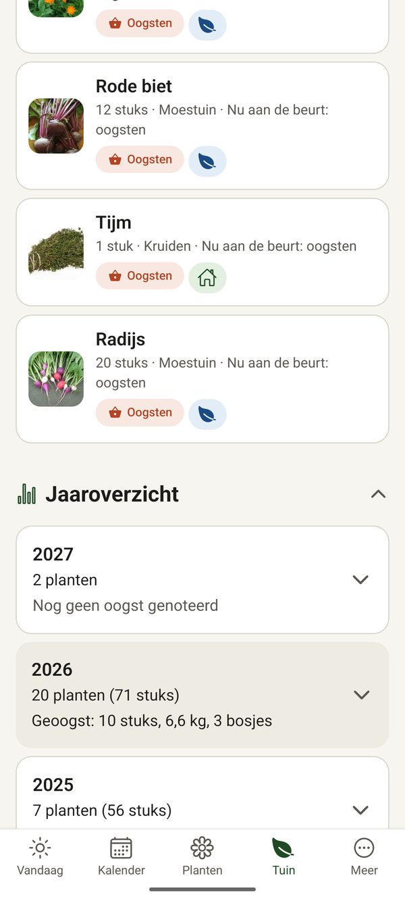
  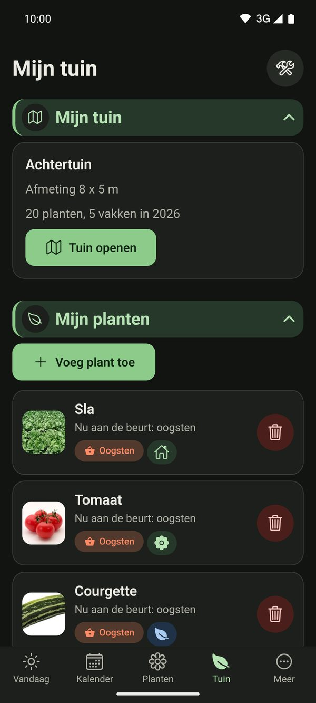

- Per plant: aantal, vak, ras, zaai- en plantdatum, oogsten, foto's en notities.
- **Vaste planten** komen elk jaar vanzelf terug.
- **Oogst en planning per jaar**: zie hoeveel je van elke soort hebt gepland (planten, vakken en oppervlakte), pas
  aantallen aan en neem de planning van dit jaar over naar het volgende.
- Een plant verwijderen kan met lang indrukken of de prullenbak, altijd met een bevestiging.

## Tuin ontwerpen

Teken je tuin met vakken en zie wat er waar kan.

  

- **Vakken** met afmetingen, planten erin en een achtergrondfoto van je eigen tuin.
- **Zon en schaduw**: de app rekent de zonnestand door voor 21 juni en houdt rekening met bomen en kassen.
- **Buren**: waarschuwing als planten naast elkaar niet goed samengaan.
- **Vak vullen**: de app rekent uit hoeveel planten er met de juiste afstand in passen.
- **Jaren vergelijken**: zie wat er vorig jaar in een vak stond, ook voor vruchtwisseling.

## Kalender

  
  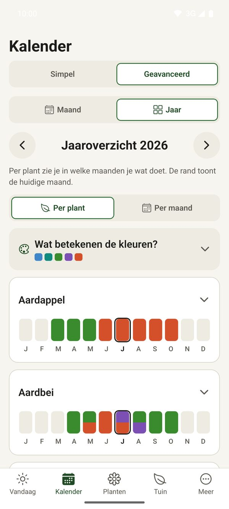
  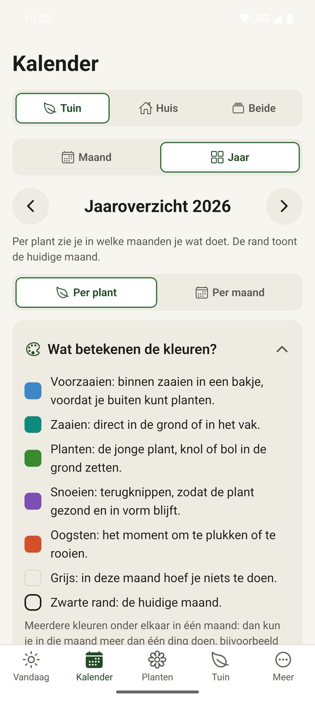
  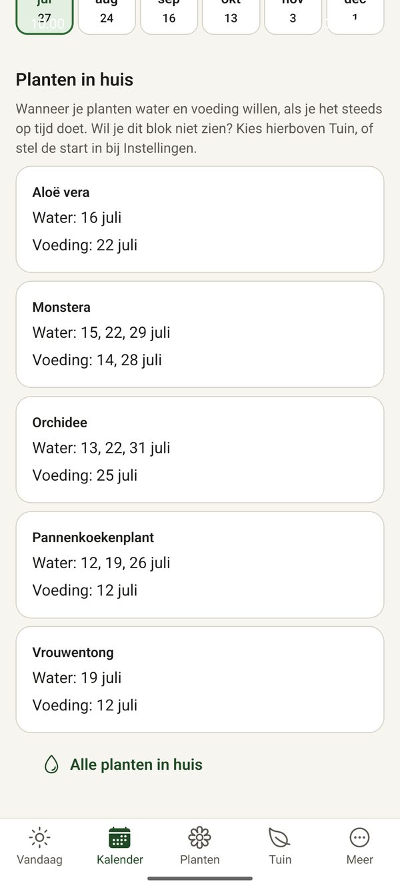

- **Maand** of **Jaar**, voor **Tuin**, **Huis**, **Eigen** of **Alles**. In Instellingen kies je wat je als eerste ziet.
- Het jaaroverzicht toont per plant gekleurde balkjes, met een icoon als een maand maar één actie heeft.
- **Week**, naast maand en jaar: je eigen taken en het water en de voeding voor je planten in huis per dag. Groepen staan open als er nog iets te doen is binnen de horizon die je instelt, en klappen dicht als alles gedaan is. Houd een gekleurd maandblok ingedrukt voor uitleg bij de kleuren.
- Eigen taken per week; lege weken zijn standaard verborgen.
- Exporteer taken naar de agenda van je telefoon (ICS-bestand).

## Planten in huis

156 soorten kamerplanten met foto, bron en richtwaarden. Je krijgt per soort het water- en voedingsritme, de plek,
tips per maand en of de plant giftig is voor huisdieren (volgens de ASPCA).

  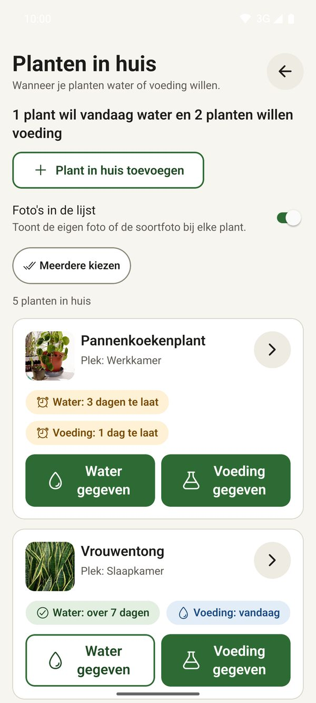
  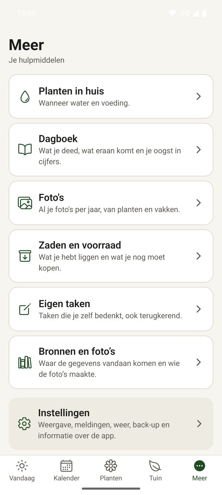

- Zoek op naam of op een andere naam: "vingeraralia" vindt de Vingerboom.
- Houd een probleemlogboek bij en voeg foto's toe.
- Voeg een eigen soort toe als jouw plant er niet bij staat.
- **Verpotten**: kort ongedaan maken en een herinnering per plant (elk jaar, om de 2 of 3 jaar), met een taak op Vandaag als het tijd is.

## Dagboek en foto's

  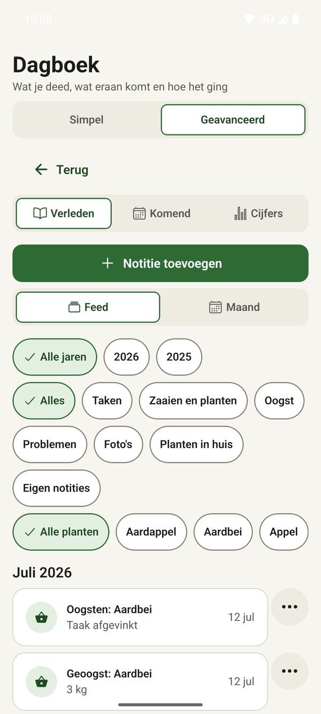
  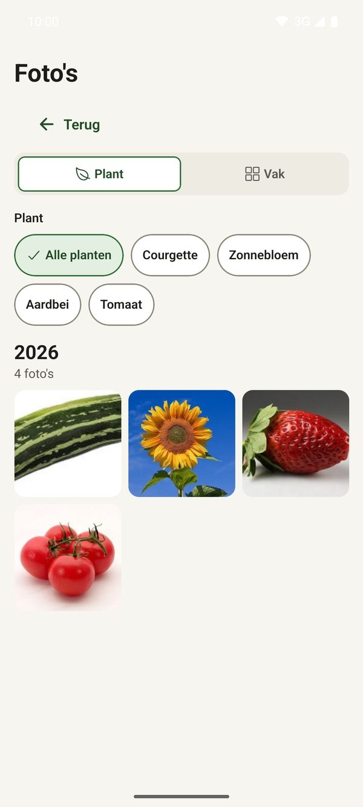

- **Komend**: achterstallige taken en taken van deze en volgende weken, direct af te vinken. Hoe ver vooruit je mag
  afvinken (1 week, 1 maand of 3 maanden) stel je zelf in.
- **Geschiedenis** van wat je deed, met notities.
- **Cijfers**: wat je hebt geoogst, gezaaid en geplant, in een korte en een lange statistiekenpagina, ook per jaar.
- **Oogsten** heeft een eigen scherm (Meer, Oogsten): per jaar, soort en plek, over meerdere jaren, met een rapport om te delen.
- **Fotoalbum** per plant, tuin of vak, met een tijdlijn. Voeg een eigen foto toe via een wizard in drie stappen.

## Voorraad en eigen taken

  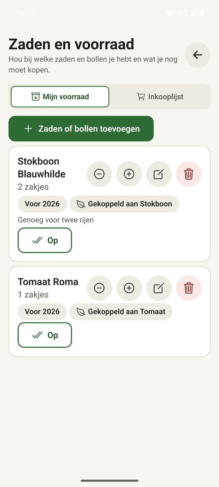
  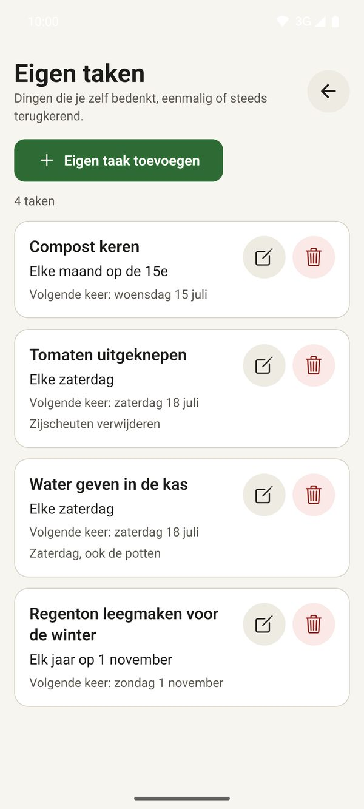

- **Zaden en bollen**: naam en plant koppelen, houdbaarheid (ook voor meerdere jaren) en een foto van het zakje.
- **Eigen taken**: terugkerend (wekelijks, maandelijks, jaarlijks) en te koppelen aan meerdere planten en vakken.
- **Boodschappenlijst** uit wat je nodig hebt.

## Herinneringen en weer

- **Meldingen** op je toestel: dagelijks of wekelijks, en een weekoverzicht op zondagavond.
- **Uitstellen**: een taak een dag, een week of een zelfgekozen aantal dagen opschuiven.
- **Slimme meldingstijd** (optioneel): de app kiest het moment waarop je de app meestal opent.
- **Weer**: voorspelling van Open-Meteo voor je plaats, met advies bij vorst, hitte, droogte of veel regen.
- **Eigen vorstdata**: stel zelf je laatste en eerste vorst in.
- **Widgets** voor je beginscherm.

## Zoeken en back-up

- **Zoeken in alles**: bibliotheek, jouw planten, dagboek, eigen taken en voorraad, met foto's in de resultaten.
- **Alleen eetbaar**: een schakelaar in Zoeken toont alleen wat je kunt eten. Zaadnamen als zonnebloempit of pompoenpit vind je bij de plant.
- **Back-up**: exporteer en importeer al je gegevens, inclusief foto's, of laat de app elke week automatisch een
  back-up in een gekozen map zetten.
- **Jaarplan als PDF**: eerst een voorbeeld op het scherm, daarna openen, opslaan of delen.

## Simpel of geavanceerd

Met één knop rechtsboven zet je geavanceerd aan of uit. Simpel toont alleen wat je nu nodig hebt. Geavanceerd
toont alle details en geeft je in Instellingen **26 extra functies** die je één voor één aan of uit zet, zoals
weeradvies, zon en schaduw, agenda-export en taken uitstellen. Er gaat niets verloren als je wisselt.

Verder: lichte en donkere weergave, twee tekstgroottes, werkt met TalkBack en past zich aan op tablets.

## Installeren

1. Open de pagina **[Releases](../../releases)** en download op je telefoon de nieuwste `tuinplanner-<versie>.apk`.
2. Open het bestand. Vraagt Android erom, sta dan installeren uit deze bron toe.
3. Start Tuinplanner. Klaar.

De app is bedoeld om zelf te installeren en staat niet in de Play Store.

### Updates

Open in de app **Meer → Instellingen** en controleer op updates. De app zoekt de nieuwste release hier, haalt hem
op en vraagt Android om te installeren. Er wordt niets geïnstalleerd zonder jouw bevestiging.

## Privacy

- Alles werkt offline; je planten, foto's en notities blijven op je toestel.
- De app gebruikt internet alleen voor het optionele weeradvies (Open-Meteo) en om een nieuwe versie te zoeken.
- Geen accounts, geen advertenties en geen tracking.

## Bronnen en dank

De plantgegevens zijn samengesteld uit openbare bronnen, met een bron per plant (zie **Meer → Bronnen en foto's** in de app).
Foto's komen van Wikimedia Commons onder vrije licenties; maker en licentie staan bij elke foto.
Weerdata: Open-Meteo. Giftigheid voor huisdieren: ASPCA.

## Broncode

De broncode van dit project is privé. Deze repository bevat alleen de releases en deze pagina.

## Vragen of ideeën

Maak een [issue](../../issues) aan. Gemaakt met liefde voor de natuur.
